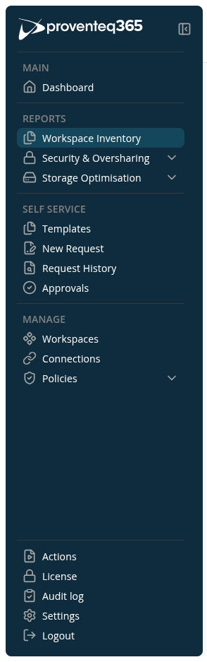

# Navigation Menu

The **Main** navigation menu in Proventeq365 provides quick access to key modules for **monitoring, reporting, self-service, and governance management** across your Microsoft 365 environment.

This menu includes the following modules:

**Main**

- **Dashboard** — Consolidated insights and key metrics on governance, security and storage for the selected workspace. See [Dashboard](../03-main/dashboard/README.md).

**Reports**

- **Workspace Inventory** — The sites and OneDrives in the workspace, with archive and restore actions. See [Workspace Inventory](../04-reports/workspace-inventory/README.md).
- **Security & Oversharing** — Permissions and sharing with potential security risk. Its sub-menu holds:
  - **External Users** — Users outside your organisation who can access your content. See [External Users](../04-reports/external-users/README.md).
  - **App Permissions** — Apps and service principals with access to SharePoint and OneDrive content. See [App Permissions](../04-reports/app-permissions/README.md).
- **Site Engagement** — Monthly usage, access and engagement per site, when your license includes it. See [Site Engagement](../04-reports/site-engagement/README.md).
- **Storage Optimisation** — Storage use, reclaimable content and growth. Its sub-menu holds **Duplicate documents**, **Obsolete documents** and **Trivial documents**. See [Storage Optimisation Overview](../04-reports/storage-optimization/README.md).

In an **Exchange Monitoring** workspace, **Reports** shows the **Emails** and **Links** reports instead. See [Exchange Monitoring](../11-exchange-monitoring/README.md).

**Self Service**

- **Templates** — Create and manage provisioning templates. See [Templates](../05-self-service/templates/README.md).
- **New Request** — Request a site, team or user from a published template. See [New Request](../05-self-service/new-request/README.md).
- **Request History** — Track your provisioning requests. See [Request History](../05-self-service/request-history/README.md).
- **Approvals** — Review requests waiting for your approval. See [Approvals](../05-self-service/approvals/README.md).

**Manage**

- **Workspaces** — Create, edit and refresh workspaces. See [Workspaces](../02-manage/workspaces/README.md).
- **Connections** — Archive connections and the default archive destination. See [Connections](../02-manage/connections/README.md).
- **Policies** — The governance policies of the selected workspace. Its sub-menu holds **Policy Rules**, for custom rules. See [Policies](../02-manage/policies/README.md) and [Policy Rules](../02-manage/policy-rules/README.md).

At the bottom of the menu:

- **Actions** — Every action run in the workspace. See [Actions](../02-manage/actions/README.md).
- **License** — License status and renewal. See [License](../08-license/README.md).
- **Audit log** — System and user activity. See [Audit Log](../07-audit-log/README.md).
- **Settings** — Chart colours and app connections for the Public API. See [Settings](../06-settings/README.md).
- **Logout** — Sign out of Proventeq365.

The **bell** icon at the top of the page opens your notifications. See [Notification](../09-notification/README.md).

Menu options shown in the navigation depend on the features your license includes and on your role. For example, **Workspaces**, **Connections**, **Templates**, **License**, **Audit log** and **Settings** are shown to Tenant Admins only.
