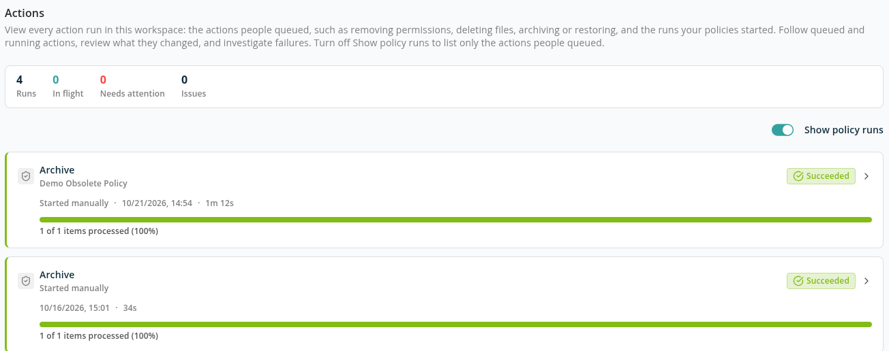
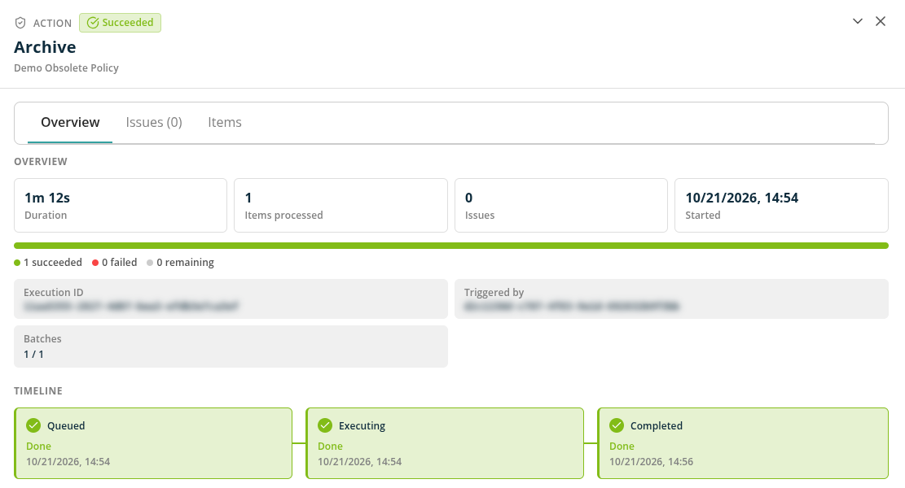
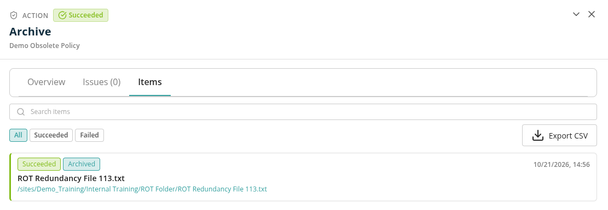

# Actions

The **Actions** page lists every action run in the workspace: the actions people queued — such as removing permissions, deleting files, archiving or restoring — and the runs your policies started. Use it to follow queued and running actions, review what they changed, and investigate failures item by item.

Open **Actions** in the lower part of the menu. It appears only for a Microsoft 365 Governance workspace, and only when your license includes both the **Execution Report** and **Execute Policy** features. Any user with a role in the workspace (**Workspace User** or above) can view it.

## Show policy runs

The **Show policy runs** switch is on by default, so the list holds every action run. Turn it off to list only the actions a person queued — from a report, from a policy report with **Execute**, or a restore. Actions started by an approval also count as queued by a person, because the approver started them.

## Counts

The bar above the list shows:

- **Runs** — The number of action runs in the workspace.
- **In flight** — Runs that are queued or running.
- **Needs attention** — Runs that failed or partially completed.
- **Issues** — The number of issues across the runs.

The list shows one page of runs at a time. When there are more runs than fit on the page, the bar says so: **In flight**, **Needs attention** and **Issues** then count only the runs on the page. Use **Rows per page** and the page buttons below the list to move through older runs.

## Run Cards

Each card shows:

- The action — for example **Remove Permissions**, **Archive**, **M365 Archive**, **Trim versions** or **Restore from archive**. **Remove File**, **Remove Empty Folders** and **Remove Duplicate Content** runs all appear as **Remove Trivial**, and **Remove Sharing Links** runs appear as **Remove Permissions**; the policy name tells them apart.
- The policy that the run belongs to, or *Started manually* for an action a person queued outside a policy. Beside a policy name, *Started manually* or *Started by a policy run* says how the run began.
- The status, the progress (*N of M items processed*), the number of issues and the duration.

Click a card to open the run's details.

## Statuses

| Status | Meaning |
| --- | --- |
| **Queued** | Waiting to start. Only one run of the same action runs in a workspace at a time; the next one waits. |
| **Running** | Finding the items to act on, or acting on them. |
| **Succeeded** | Every item was processed without a failure. |
| **Partially completed** | Some items succeeded and at least one failed. |
| **Failed** | The run failed, or no item succeeded. |
| **Stopped** | The run was called off before it started — for example because its policy was disabled. The reason is shown in the run's details. |

## Run Details

The details open in a side panel over the list. Use the arrows to step to the previous or next run.

### Overview

- **Duration**, **Items processed**, **Issues** and **Started**.
- A progress bar with the number of items succeeded, failed and remaining.
- Facts: **Execution ID** (quote it to support), **Triggered by**, **Batches** (completed / total), **Estimated completion** while the run is in progress, and **Reason** for a stopped run.
- For a **Trim versions** run: **Versions removed** and **Space reclaimed (approx.)**.
- **Timeline** — **Queued**, **Executing** and **Completed**, with times. A run stopped before it started shows **Run ended** instead.

### Issues

**Issues (N)** says how many failures the run recorded. For an action run, the failed items and their errors are listed on the **Items** tab: click **Show failed items** to go there with the **Failed** filter applied. A run that ended with a problem but reported no reason or failure count says so, and points you to the **Items** tab.

### Items

The **Items** tab lists every item the run acted on.

- **Search items** — Search the rows loaded so far.
- **All** / **Succeeded** / **Failed** — Filter by outcome.
- Each row shows the item, its outcome, what the action did (for example *Permissions Removed*, *Archived*, *Versions Trimmed*), the target and who ran it. A **Trim versions** row also shows how many versions were removed and kept.

Outcomes:

- **Succeeded** — The action changed the item.
- **Failed** — The action could not change the item. The row shows the error and the number of attempts.
- **Revoked** — The change was reversed later, for example an archived item that was restored.
- **Skipped** — The action left the item alone on purpose, for example a digitally signed PDF that **OCR Enrichment** does not change.

*Failures shown are the outstanding errors last attributed to this run — a later run that fails the same item takes the row over, and a success clears it. Attempt counts are cumulative across runs.* So an older run's failures can disappear once a later run fixes them.

The tab counts successes and failures up to 10,000 each; above that it shows *of more than* the count. Click **Load more items** to load further rows.

## Export CSV

On the **Items** tab, click **Export CSV** to download the items for the selected outcome — **All**, **Succeeded** or **Failed**. The export holds every row, not only the rows loaded on screen.

The file is prepared in the background: *Your CSV is being prepared. It downloads by itself while this view stays open, or you can come back for it later.* When it is ready, the notice offers **Download**. If the export did not finish, click **Try again**. Your exports are visible only to you and are kept for seven days.

## Runs of One Policy Action

In a policy report, **View Executions** on an action card opens **Runs**: the same list and details, limited to that action of that policy. See [Policies](../policies/README.md#available-actions).

Notifications and emails about an action run link straight to the run's details.

## Roles and License

| Task | Role | License feature |
| --- | --- | --- |
| View action runs, their items and issues; export CSV | Workspace User | Execution Report and Execute Policy |
| Start an action from a policy report | Workspace Admin | Execute Policy |

## Related

- [Policies](../policies/README.md)
- [How to Track and Investigate Action Runs](../../13-how-to-guides/21-track-and-investigate-action-runs.md)
- [Workspace Runs](../workspaces/workspace-runs.md)
- [Error Messages: Policies and Remediation Actions](../../15-error-catalog/03-policies-and-remediation.md#actions-page)
