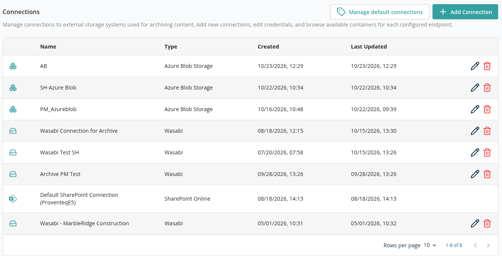
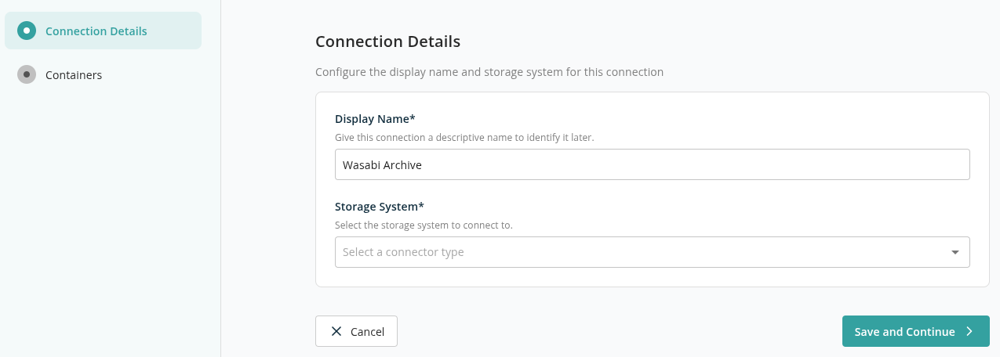
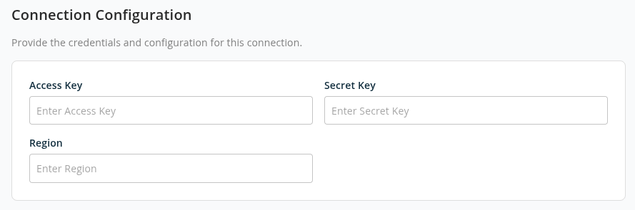
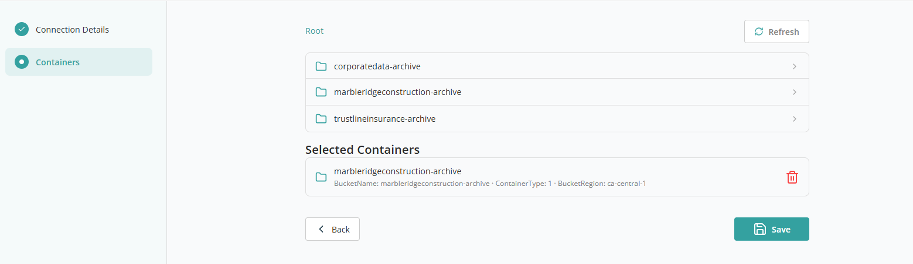
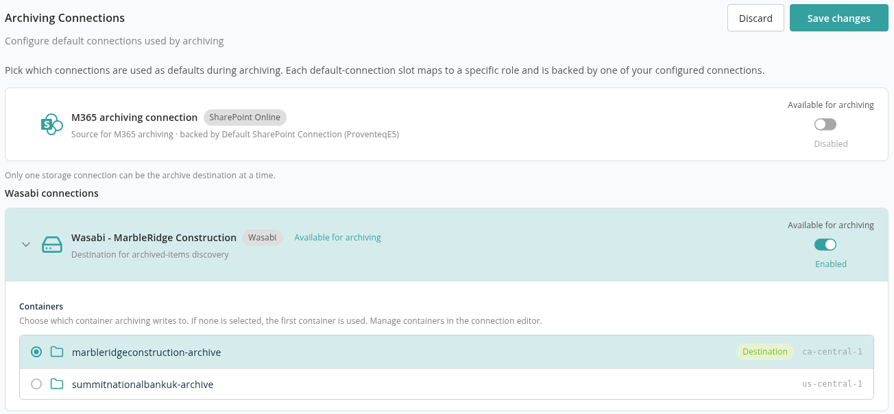

# Connections

The **Connections** page manages the storage that Proventeq365 archives content to. You can connect **Wasabi** object storage or **Azure Blob Storage**, choose the buckets or containers archived files are written to, and pick which connection is the default archive destination on the **Archiving Connections** screen. The list also shows the **SharePoint Online** connection Proventeq365 uses to read your tenant.

Open it from **Manage** → **Connections** in the menu. You need the **Tenant Admin** role, and your license must include the **Execute Policy** feature.

## Connections List

Each row is one connection:

- **Type icon** — The storage system: Wasabi, Azure Blob Storage or SharePoint Online.
- **Name** — The display name given to the connection. You choose it as the **Target Connection** of an archive action.
- **Type** — The storage system.
- **Created** — When the connection was added.
- **Last Updated** — When the connection was last changed. The list is sorted by this column, newest first.
- **Edit** and **Delete** icons — Change or remove the connection. The SharePoint Online connection is created by Proventeq365 and has no Edit or Delete icons.

Use the search box above the list to find a connection by name; type at least three characters. Click a column heading to sort by it.

Two buttons sit above the list:

- **Manage default connections** — Opens the [Archiving Connections](#archiving-connections) screen.
- **Add Connection** — Adds a new storage connection.

## Add Connection

**Add Connection** opens a two-step page: **Connection Details**, then **Containers**.

### Connection Details

- **Display Name** — Required. A descriptive name to identify the connection later. Each connection name must be unique.
- **Storage System** — Required. Choose **Wasabi** or **Azure Blob Storage**.

When you choose a storage system, the **Connection Configuration** section appears with the credentials that system needs:

- **Wasabi** — **Access Key**, **Secret Key** and **Region** (for example `eu-west-1`) of the bucket's account.
- **Azure Blob Storage** — **Connection String**: the storage account's connection string from **Access keys** → **Connection string** in the Azure portal. It must include the account key and must not be a shared access signature (SAS). When the string is valid, Proventeq365 shows the account and Blob endpoint it found.

Click **Save and Continue**. Proventeq365 checks that it can connect with the details you entered and saves the connection. If the check fails, the connection is not saved. Click **Cancel** to leave without saving.

### Containers

Containers — Wasabi buckets or Azure Blob containers, and the folders inside them — are where archived files are written. Until the connection is saved, this step shows **Save the connection first**.

1. Expand a bucket or container to see its folders. When a folder has no more sub-folders, the page says so.
2. Click **Select this container** for the bucket, container or folder archived files should go to.
3. The choice appears under **Selected Containers**. You can select more than one.
4. Click **Close** to return to the list.

Click **Refresh** to reload the list, for example after creating a bucket or container in the storage itself or changing the key's access. Use the **Delete** icon next to a selected container to remove it. A container can't be removed while archived files are stored in it or while it is the archive destination on [Archiving Connections](#archiving-connections).

## Edit a Connection

Click the **Edit** icon in a connection's row. The same two steps open:

- **Connection Details** — Change the name or credentials and click **Continue**, which saves the details. Secret fields such as the **Secret Key** and **Connection String** are shown masked. Leave a masked field as it is to keep the stored value, or clear it and type the new value. A masked value can't be saved as a new secret.
- **Containers** — Select or remove containers as described above, then click **Save**.

## Delete a Connection

Click the **Delete** icon in the row and confirm. A connection can't be deleted while archived files depend on it — their stub links point to it, and restores read from it — or while it is enabled on [Archiving Connections](#archiving-connections). To stop archiving to a connection, choose a different target in your archive policies and on **Archiving Connections** instead.

## Archiving Connections

**Manage default connections** opens **Archiving Connections**, where you pick which connection archiving uses when no policy names one — for example when you archive sites from [Workspace Inventory](../../04-reports/workspace-inventory/README.md) or documents from the Obsolete Documents report. An archive action in a policy always uses the **Target Connection** and **Target Container** set in the policy.

The screen has a card for each connection, grouped by storage system:

- **M365 archiving connection** — Shown when the SharePoint Online connection exists. Its label reads **Source for M365 archiving**, followed by the name of the SharePoint Online connection behind it.
- **Wasabi connections** and **Azure Blob Storage connections** — One card per storage connection. Turn on **Available for archiving** to make that connection the archive destination. Only one storage connection can be the archive destination at a time; turning one on turns the others off.

Expand a storage connection's card to choose its container under **Containers**. The selected container is marked **Destination**. If you select none, archiving writes to the first container of the connection. Containers are added and removed in the connection editor, not here.

When you move the destination to another connection, the card notes that existing archives stay where they were written and restore from there.

Changes are not applied until you click **Save changes**. Cards with pending changes show **Unsaved changes — save to apply them**. Click **Discard** to undo them.

If the enabled connection has no containers, the card shows **Action required** and the page shows **Can't save — 1 connection has missing required settings.** Add a container to the connection in the connection editor, or turn the connection off, then save again.

If you save with no connection enabled, archiving from Workspace Inventory and the Obsolete Documents report is turned off, and their **Archive** actions are no longer offered. Archive actions in policies are not affected.

## Related

- [How to Add an Archive Connection](../../13-how-to-guides/06-add-an-archive-connection.md)
- [How to Set the Default Archive Destination](../../13-how-to-guides/26-set-the-default-archive-destination.md)
- [Archive](../../10-archive/README.md)
- [Error Messages: Connections, Archiving and Restore](../../15-error-catalog/04-connections-and-archiving.md#connections)
