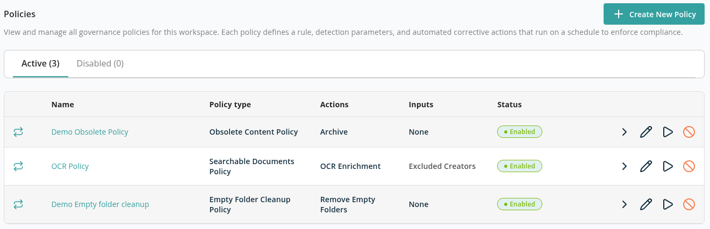
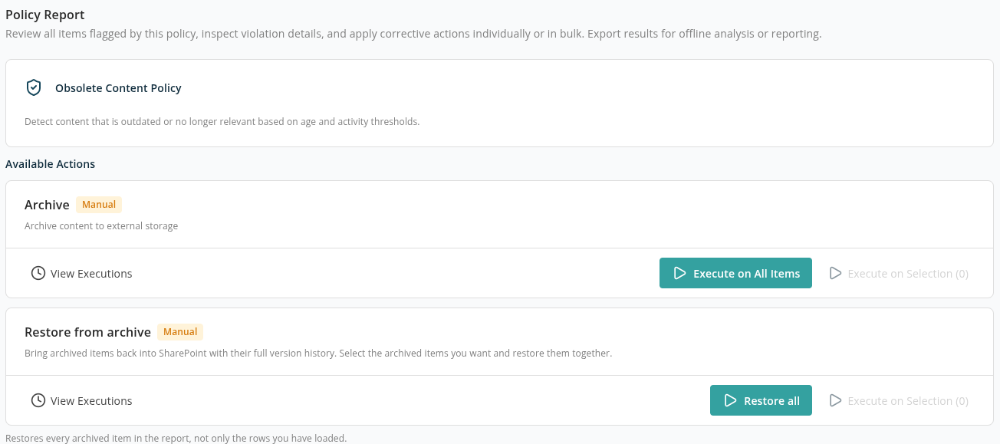
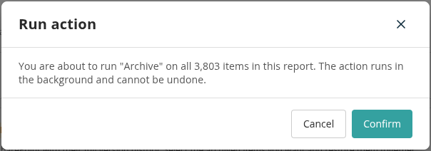
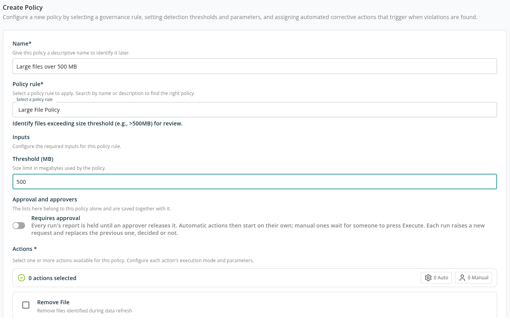

# Policies

A **policy** applies a rule to a workspace's discovered data — for example *Excessive Sharing*, *Large File* or *Obsolete Content* — and lists every item that matches in a **policy report**. A policy can also have **actions**, such as removing permissions or archiving files, that run on the matching items either manually or automatically. Open **Manage** → **Policies** to see and manage the policies of the selected workspace.

The **Policies** menu appears only for a Microsoft 365 Governance workspace, and only when your license includes the **Execution Report** feature.

## Policies List

The list has two tabs: **Active** and **Disabled**, each with the number of policies in it.

Each row shows:

- **Name** — The policy name. Click it to open the policy report.
- **Policy type** — The rule the policy uses. See [Predefined Policies](../../appendix/predefined-policies.md).
- **Actions** — The actions added to the policy, or *None*.
- **Inputs** — The rule inputs and their values, for example a threshold.
- **Status** — **Enabled** or **Disabled**.

Row icons:

- **View** — Open the policy report.
- **Edit** — Change the policy. Shown for enabled policies. Needs the **Tenant Admin** role.
- **Run Policy** — Evaluate the policy now. Shown for enabled policies, to Tenant Admins.
- **Disable** / **Enable** — Switch the policy off or on. Needs the **Workspace Admin** role.

### Disable or enable a policy

Click **Disable** and confirm. A disabled policy stays available to view, but it is skipped during discovery and can no longer be run, and its actions cannot be started. An action that was queued but had not started when the policy was disabled is stopped with the reason *Policy was disabled before the action was dispatched*. Click **Enable** to switch the policy back on.

## Run a Policy

Every enabled policy is evaluated automatically at the end of each data refresh of the workspace. Policies have no schedule of their own.

To evaluate a policy now, click **Run Policy** in its row. The **Run policy** dialog asks you to confirm:

- For a policy without automatic actions: *You are about to run "Policy name". It re-evaluates the policy against the latest discovered data and refreshes its report.*
- For a policy with automatic actions, the dialog also names those actions: *…then runs its automatic action (Archive) on every item the policy matches. Those actions run in the background and cannot be undone.*

Click **Confirm**. The message *Policy run started successfully* appears. While the run is in progress, the policy report says the policy is still being evaluated.

If one of the policy's actions is still running, the policy is not evaluated again until that action has finished.

## Policy Report

Click **View** or the policy name to open its report. The report shows the rule's name and description, and a **Disabled** label if the policy is disabled.

### Notices

A banner at the top tells you when the report is not a normal result:

- *This policy is still being evaluated.* — The run hasn't finished. The page checks again every 15 seconds.
- *The last run of this policy failed, so no results are shown.* — Read the run's notification for the reason, fix the cause and run the policy again.
- *This policy did not run — a required parameter is empty.* — Edit the policy, fill in the missing input and run it again. The report is not a clean result.

For a policy that requires approval, a second banner shows the approval status and, for approvers, **Approve report** and **Reject** buttons. See [Policy Approvals](./policy-approvals.md).

### Configuration Settings

**Configuration Settings** shows the values of the policy's inputs.

### Available Actions

Each action of the policy has a card with its name, an **Automatic** or **Manual** badge, and a description. Every card has **View Executions**, which lists that action's runs for this policy. Approvers of the policy also see **Approvals**.

A **Manual** action card also has buttons to run the action, shown to Workspace Admins when the policy is enabled and, for a policy that requires approval, after the report is approved:

- **Execute on All Items** — Run the action on every item in the report that is still waiting for it or failed last time.
- **Execute on Approved Items (N)** — Shown instead when the approval covers only some items. Runs the action on those items.
- **Execute on Selection (N)** — Run the action on the items you ticked in the list below.

A **Run action** dialog asks you to confirm, for example: *You are about to run "Archive" on all 120 items in this report. The action runs in the background and cannot be undone.* After you confirm, *Action execution started successfully* appears. Follow the run with **View Executions** or on the [Actions](../actions/README.md) page.

An **Automatic** action card has no run buttons: the action runs by itself every time the policy runs.

### Restore from archive

On a policy that has an **Archive** action, Workspace Admins also see a **Restore from archive** card when the report holds archived items:

- **Restore all** — Restore every archived item in the report back into SharePoint, not only the rows loaded on screen. You are asked to confirm.
- **Execute on Selection (N)** — Restore the archived items you ticked. Up to 1,000 archived records are restored at a time; the card tells you how many of your ticked rows have no archive record and will be skipped.

Each restoring row shows its progress. Follow the restore on the **Actions** page. See [Restore Archived Content](../../10-archive/03-restore-archived-content.md).

### Identified items

The list shows *Identified items — N found*, with every item that matches the policy and the reason it matched. Items load as you scroll.

- Tick items to run a manual action or a restore on them, or use **Select visible**. Only items an action can still change can be ticked; items already done or skipped stay in the list but cannot be ticked.
- Click the open icon next to an item to open it in SharePoint.
- Items covered by a partial approval show an **Approved** label.
- **Export** — Download the whole report as a CSV file. The file is prepared in the background and downloads when it is ready.

For an **Items With Sharing Links Policy**, the list shows each item with its sharing links. Expand an item to see each link's type and role, and expand a link to see its users. Tick individual links, or all the links of an item, to remove only those.

## Create or Edit a Policy

Click **Create New Policy**, or **Edit** in a policy's row. You need the **Tenant Admin** role. You can also add policies on the **Governance Policies** step when you create a workspace.

- **Name** — A descriptive name for the policy.
- **Policy rule** — Search by name or description and choose a rule. The list holds the [predefined rules](../../appendix/predefined-policies.md) and any custom rules approved for this workspace on [Policy Rules](../policy-rules/README.md).
- **Inputs** — The rule's inputs, for example a **Threshold** with a compare mode. Not every rule has inputs.
- **Approval and approvers** — Turn on **Requires approval** to hold every run's report until an approver releases it, and add the **Approvers**. See [Policy Approvals](./policy-approvals.md).
- **Actions** — Select one or more of the rule's actions. Each selected action has a switch to choose **Automatic** or **Manual** (new actions start as **Manual**), and some have an **Action Configuration**:
  - **Archive** — Target connection and container, stub, folder structure and which versions to archive. See [How to Archive Obsolete Content](../../13-how-to-guides/07-archive-obsolete-content.md).
  - **Trim versions** — **Versions to keep**: **Keep the last N versions** or **Keep versions from the last X months**. *Older versions are deleted permanently and cannot be restored.*
  - **OCR Enrichment** — **OCR Text Column**, the internal name of the column the extracted text is written to.

Click **Add Policy**, or save your changes on the edit page. If an **Archive** action leaves some versions out, Proventeq365 asks you to confirm (*Leave some versions out of the archive?*). If you add or change a **Trim versions** action, it asks *Permanently delete older versions?*

The policy runs with its new settings the next time it is evaluated — after the next data refresh, or when you click **Run Policy**.

## Roles and License

| Task | Role | License feature |
| --- | --- | --- |
| See policies and policy reports | Workspace User | Execution Report |
| Create or edit a policy | Tenant Admin | Execution Report |
| Run a policy (**Run Policy**) | Tenant Admin | Execution Report |
| Enable or disable a policy | Workspace Admin | Execution Report |
| Run a manual action or restore from the report | Workspace Admin | Execute Policy |
| Approve or reject a report | A designated approver of the policy | Execute Policy |

## Related

- [Predefined Policies](../../appendix/predefined-policies.md)
- [Policy Approvals](./policy-approvals.md)
- [Actions](../actions/README.md)
- [Policy Rules](../policy-rules/README.md)
- [How to Add a Governance Policy](../../13-how-to-guides/05-add-a-governance-policy.md)
- [Error Messages: Policies and Remediation Actions](../../15-error-catalog/03-policies-and-remediation.md)
