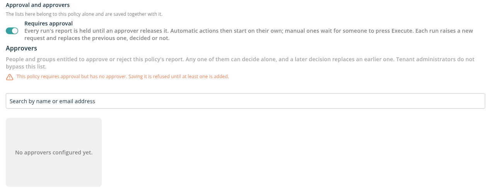

# Policy Approvals

**Requires approval** holds every report a policy produces until a designated approver releases it. Nothing runs against a held report: automatic actions wait, and manual actions cannot be started. When an approver approves the report — whole, or only selected items — the automatic actions start and the manual ones can be run. Use it for policies whose actions delete, archive or remove access, so that a second person checks the results first.

## Turn On Approval for a Policy

Approval is set on the policy form, in the **Approval and approvers** section. Only a **Tenant Admin** can change it; other users see *Only a tenant administrator can change the approval setting, trusted accounts and approvers of this policy.*

1. Open **Manage** → **Policies**, then click **Create New Policy**, or **Edit** in the policy's row.
2. Turn on **Requires approval**. *Every run's report is held until an approver releases it. Automatic actions then start on their own; manual ones wait for someone to press Execute. Each run raises a new request and replaces the previous one, decided or not.*
3. Under **Approvers**, search for people or groups and add them. *Any one of them can decide alone, and a later decision replaces an earlier one. Tenant administrators do not bypass this list.*
4. Save the policy.

A policy that requires approval needs at least one approver: saving it without one is refused. On a new policy the approvers are saved with the policy. On an existing policy each approver is saved as soon as you add or remove them — *they are not part of this form's save*. While approval is on, the last approver cannot be removed; add another approver first, or turn approval off.

## What Happens When the Policy Runs

1. The policy runs — after a data refresh, or when someone clicks **Run Policy** — and produces its report.
2. If the report has items, it is held as **Pending** and every approver is notified: *Policy name: N items are waiting for your decision*. The **Approval requested** notification is sent in the app and by email, depending on each approver's notification preferences. A report with no items raises no request.
3. An approver approves or rejects the report.
4. **Approved** — any automatic actions start at once, recorded as started by the approver. Manual actions can now be run by a Workspace Admin with **Execute on All Items**, or **Execute on Approved Items (N)** when only some items were approved. Approving does not give the approver the right to run actions, and running actions does not make someone an approver.
5. **Rejected** — nothing runs against the report.

The next run of the policy replaces the report and **supersedes** its approval, whether it was decided or not. The new report needs its own decision.

Approval requests and decisions are recorded in the [Audit log](../../07-audit-log/README.md).

## Approve or Reject from the Policy Report

Open the policy report. A banner shows where the approval stands:

- *This policy requires approval. Its actions stay locked until the next run produces a report and an approver releases it.*
- *This report is waiting for approval. Nothing runs against it until an approver releases it.*
- *Approved by Name. The actions are released: any automatic ones have started, and the manual ones can be run below.*
- *This report was rejected, so nothing runs against it. An approver can still change that decision — the last one made is the one that counts.*
- *A later run replaced the report this decision covered, so it no longer releases anything. The new report needs its own decision.*

Approvers see buttons in the banner:

- **Approve report** — Approve every item in the report.
- **Approve N selected items** — Shown when you tick items in the list. Approves only those items; only they can then be run.
- **Reject** — Reject the report.
- **Approve instead** / **Reject instead** — Change a decision already made.
- **Approve all items** — After a partial approval, widen it to the whole report.

A dialog (*Approve this action?* or *Reject this action?*) says how many items the decision covers and lets you add a comment. Click **Approve** or **Reject** to record it.

## The Approvals Page

Approvers of a policy see **Approvals** on the policy's action cards in the policy report. The **Approval requested** notification also opens it. The page lists the policy's *Policy reports waiting on a decision*:

- **Policy** — The policy name. Click a row to open the approval.
- **Status** — **Pending**, **Approved**, **Rejected** or **Superseded**. A partial approval shows, for example, *3 of 23 items approved*.
- **Pending items** — The number of items in the report.
- **Requested** — When the report was held (*Held since …*).
- **Decided** — Who decided, and when.

Anyone else who opens the page sees *Approvals are for this policy's approvers*.

### Approval detail

The approval shows the policy name, *N pending items · requested date*, the status, who decided and their comment. Below is every item the policy proposed:

- **Item** — The item.
- **Outcome** — What the action would do: **Will change**, **Skipped**, **Already applied**, **Failed** or **Unknown**. Items inside a partial approval show **Approved**.
- **What changes** and **Details** — The change and the reason the item matched.

Tick items to narrow the approval, or leave them all unticked:

- **Approve** — Approve the ticked items, or the whole report if nothing is ticked.
- **Reject** — Reject the whole report.
- **Add N items to the approval** — After a partial approval, add more items to it.
- **Approve all items** — After a partial approval, approve the whole report.

When a later run has replaced the report, its item list is no longer shown: *A later run has replaced the report this approval covered, so its item list is no longer shown. The counts, decision and comment above are the retained record, and the items themselves are archived.*

## Limits

- A single approval can cover up to **100,000** items. For a larger report, approve a selection of items, or narrow the policy's inputs and run it again.
- The items of replaced reports are kept as a record for **400 days**.

Both are defaults of your deployment — ask Proventeq if they need to change.

## Roles and License

| Task | Who | License feature |
| --- | --- | --- |
| Turn approval on or off, add or remove approvers | Tenant Admin | Execution Report |
| Approve or reject a report | A user or group member listed under **Approvers** | Execute Policy |
| Run released manual actions | Workspace Admin | Execute Policy |
| See the approval banner on the report | Workspace User | Execution Report |

## Related

- [Policies](./README.md)
- [How to Require Approval Before Policy Actions Run](../../13-how-to-guides/20-require-approval-before-policy-actions-run.md)
- [Notifications](../../09-notification/README.md)
- [Error Messages: Policies and Remediation Actions](../../15-error-catalog/03-policies-and-remediation.md#policy-approvals)
