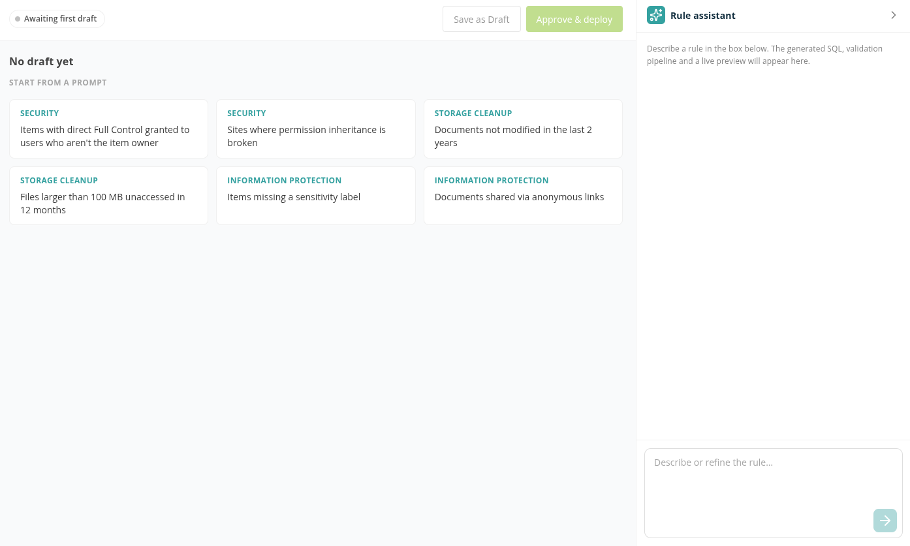

# Policy Rules

**Policy Rules** is where you create custom policy rules for a workspace when none of the [predefined rules](../../appendix/predefined-policies.md) fits. You describe the rule in plain language to the **Rule assistant**; it drafts the rule from the workspace's discovered data, runs safety checks and shows a preview of the items the rule would find. Once a Tenant Admin approves and deploys the rule, it can be chosen as the **Policy rule** of any policy in that workspace.

Open **Manage** → **Policies** → **Policy Rules**.

> **Note:** Policy Rules is available only when the optional AI component is included in your Proventeq365 deployment — ask Proventeq. It works only for Microsoft 365 Governance workspaces, and a rule belongs to the workspace it was created in.

## Policy Rules List

The list shows every custom rule of the workspace and all its versions.

- **Lineage** — Groups the versions of the same rule.
- **Rule** — The rule's display name.
- **Version** — Editing an approved rule creates a new version.
- **Status** — **Draft** (saved, not deployed), **Approved** (deployed and usable in policies) or **Superseded** (replaced by a newer approved version). **Stale** is added when the workspace's data structure has changed since the rule was generated.
- **Parameters** — The rule's inputs.
- **Schema baseline** — The version of the workspace data structure the rule was generated for.

Row icons:

- **Edit** — Open the rule in the editor.
- **Upgrade** — Shown on a **Stale** rule. Opens the rule in the editor so you can refine it for the current data structure, then save and approve a new version.
- **Delete** — Delete the rule after you confirm. A rule that a policy uses cannot be deleted; remove it from those policies first.

## Create a Rule

Click **New rule**. The editor has the rule on the left and the **Rule assistant** on the right; you can resize or collapse the assistant.

1. Describe the rule in the box (*Describe or refine the rule…*) and click **Send**. Or pick one of the examples under **Start from a prompt**, grouped as **Security**, **Storage cleanup** and **Information protection** — for example *Documents not modified in the last 2 years*.
2. The **Validating rule** panel shows four checks: **Generate**, **Static checks**, **Sandbox compile & contract** and **Preview**. The preview runs against this workspace's live data.
3. The assistant replies with the outcome:
   - *Passed all checks · N preview rows. Review on the right, then save as Draft.*
   - *The draft didn't pass validation yet. Refine the description to resolve:* followed by the reasons.
4. Send more messages to refine the rule. Each message produces a new draft and runs the checks again. Click **View validation** in the conversation to see the checks again, including **Why it didn't pass** and any **Review advisories**.

The status at the top of the editor shows where the rule stands: **Awaiting first draft**, **Generating…**, **Validated · unsaved**, **Validation failed**, **Draft · not deployed**, **Approved · deployed** or **Generation failed**. If generation fails, the assistant shows *Couldn't generate the rule* with **Retry** and **Edit & resend**.

## Review the Rule

- **Results** — A preview of the items the rule finds in this workspace. Long previews are capped, and the preview says how many rows it shows. *No preview rows. Empty or sparse results are informational, not a failure.*
- **Details** → **Parameters & SQL** — The **Parameters** tab lists the rule's inputs with their **Type**, **Default**, **Description** and whether **Compare mode** is enabled. These become the rule's inputs on the policy form. The **SQL** tab shows the query the rule runs.

To adjust the rule by hand, click **Edit**, change a parameter's default or the query, and click **Validate** to run the checks and refresh the preview (*Validate to refresh results.*). Click **Cancel** or **Discard changes** to drop your edits.

## Save as Draft

When the rule has passed validation, click **Save as Draft** and fill in:

- **Display name** — The name shown in the **Policy rule** list.
- **Category** — **Permissions and access control**, **ROT and lifecycle** or **Information protection**.
- **Available actions** — *Pick the actions an admin will be able to bind to this rule when configuring a policy.* Leave all unticked for a report-only rule.

Click **Save**. The rule is saved as a **Draft**. A draft is not deployed and cannot be used in a policy yet.

## Approve and Deploy

Click **Approve & deploy** to deploy the draft to the workspace. The message *Rule deployed* appears and the rule's status becomes **Approved**. If approval hits a conflict — for example someone else approved another version of the rule meanwhile — the assistant says *Could not approve the rule due to a conflict. Refine and try again.*

To change an approved rule, click **Edit**, refine it, and click **Save as Draft**: this creates a new version. When you approve the new version, the previous one becomes **Superseded**.

## Use a Custom Rule in a Policy

1. Open **Manage** → **Policies** and click **Create New Policy**.
2. In **Policy rule**, choose the approved rule by its display name.
3. Fill in its inputs, choose from the actions you made available, and click **Add Policy**.

Custom rules can be chosen only on the **Policies** page of their workspace — not on the **Governance Policies** step of the workspace wizard, because the workspace does not exist yet there.

## Roles and License

| Task | Role | License feature |
| --- | --- | --- |
| Open **Policy Rules** and see the rules | Workspace Admin | Execution Report |
| Create, edit, validate, save, approve, upgrade or delete a rule | Tenant Admin | Execution Report |
| Use an approved rule in a policy | Tenant Admin | Execution Report |

## Related

- [Policies](../policies/README.md)
- [Predefined Policies](../../appendix/predefined-policies.md)
- [How to Create a Custom Policy Rule with the Rule Assistant](../../13-how-to-guides/22-create-a-custom-policy-rule.md)
- [Error Messages: Policies and Remediation Actions](../../15-error-catalog/03-policies-and-remediation.md#policy-rules)
