# Workspaces

A **workspace** defines which Microsoft 365 content Proventeq365 analyses, how often its data is refreshed, how content is classified and who can see the results. The **Workspaces** screen lists every workspace in your organisation and lets you create new ones with the **Create New Workspace** wizard. Each workspace has its own dashboard, reports, policies and run history.

The **Workspaces** screen and the **Create New Workspace** wizard are available to the **Tenant Admin** role. Open them from **Manage** → **Workspaces**.

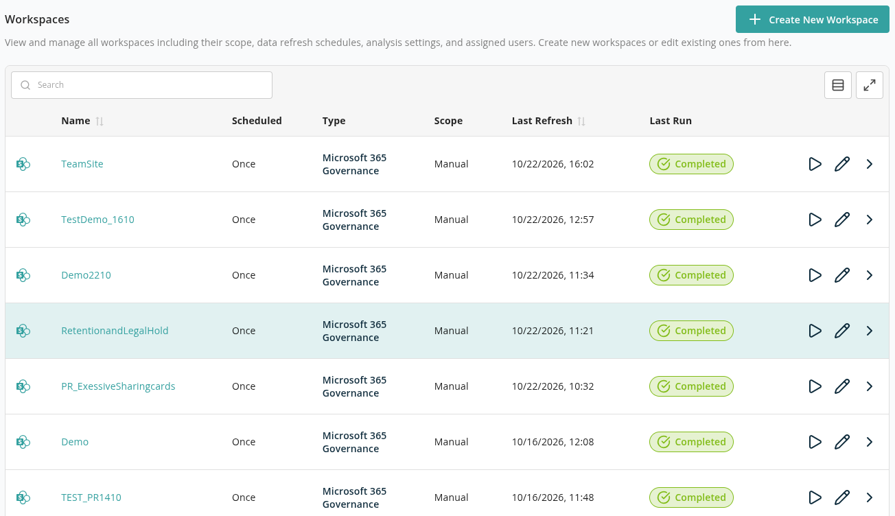

## Workspaces List

Each row is one workspace and shows:

- **Name** — The workspace name. Click it to open the workspace.
- **Scheduled** — How often the data is refreshed: **Once**, **Daily**, **Weekly** or **Monthly**.
- **Type** — **Microsoft 365 Governance**, **Exchange Monitoring**, **Azure AD Data Refresh** or **Content Migration**.
- **Scope** — Which sites are included: **All** (every site in the tenant), **Manual** (sites entered by hand or matched by a pattern) or **CSV** (sites imported from a CSV file).
- **Last Refresh** — The date and time of the last data refresh that completed.
- **Last Run** — The status of the most recent run, for example **Completed**, **Running**, **Transforming**, **Failed** or **Stopped**. **No runs** means the workspace has never been refreshed.

Each row has three actions:

- **Refresh data** — Starts a data refresh now. While a refresh is already in progress, the button is unavailable and its tooltip reads *A data refresh is already running*.
- **Edit** — Opens the workspace's settings in the same steps as the wizard, except **Policies** (manage policies under **Policies** instead). The scope cannot be changed (see [After the workspace is created](#after-the-workspace-is-created)).
- **View runs** — Opens the workspace's run history. See [Workspace Runs](./workspace-runs.md).

You can sort the list by **Name** and **Last Refresh**, search it by name, and move between pages with the controls at the bottom of the list. Workspaces cannot be deleted from this screen.

## Create a Workspace

Click **Create New Workspace** to open the wizard. The steps listed on the left depend on the workspace type you choose:

| Workspace type | Steps |
| --- | --- |
| Microsoft 365 Governance | Sources, Schedule, Configuration, Policies, Users |
| Exchange Monitoring | Sources, Schedule, Configuration, Users |
| Azure AD Data Refresh | Sources, Schedule, Users |

Use **Next** and **Previous** to move between steps, and **Create Workspace** on the last step. **Cancel** on the first step returns you to the previous screen. If a required field is missing, the wizard says *Some required fields are missing. Please review the highlighted steps.*

### Define Your Workspace

The first step names the workspace, sets its type and, for a Microsoft 365 Governance workspace, its scope.

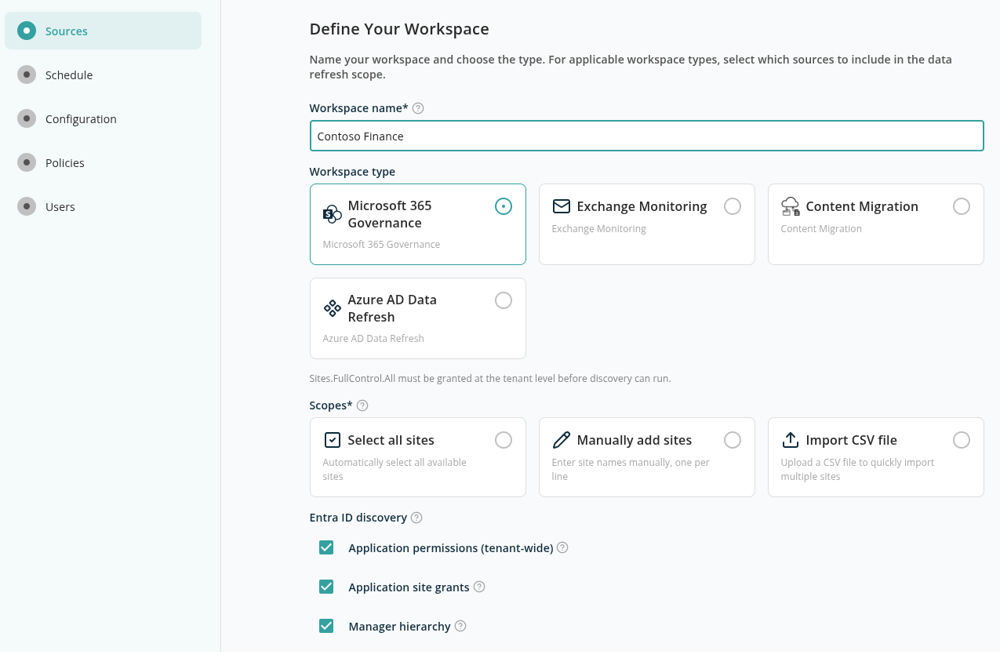

- **Workspace name** — Required. The name must be unique; otherwise you see *A workspace with this name already exists*.
- **Workspace type** — Choose one of the cards:
  - **Microsoft 365 Governance** — SharePoint sites, Teams sites and, optionally, OneDrives. This type feeds the dashboard and the SharePoint reports, and is the only type that supports governance policies.
  - **Exchange Monitoring** — Email in your organisation's mailboxes. See [Exchange Monitoring](../../11-exchange-monitoring/README.md).
  - **Azure AD Data Refresh** — Microsoft Entra ID data only (see below). There is no site scope to choose.
  - **Content Migration** — Belongs to the separate Proventeq content migration product and is not covered in this help.

#### Azure AD Data Refresh

Every data refresh reads users, groups and applications from Microsoft Entra ID, together with their permissions. A Microsoft 365 Governance workspace does this first on every run, before it reads SharePoint. An **Azure AD Data Refresh** workspace does only this step, with every Entra ID option below switched on. This directory data feeds the [App Permissions](../../04-reports/app-permissions/README.md) report.

#### Scopes

For a Microsoft 365 Governance workspace, the step shows the notice *Sites.FullControl.All must be granted at the tenant level before discovery can run.* Make sure the Proventeq365 app registration has this permission with admin consent before the first refresh.

Choose one of three scopes:

- **Select all sites** — Every site in the tenant.
- **Manually add sites** — Sites you list yourself, or sites that match a pattern.
- **Import CSV file** — Sites listed in a CSV file.

##### Select All Sites

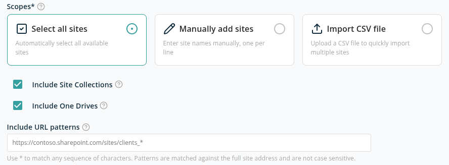

- **Include Site Collections** — Include SharePoint site collections in the refresh.
- **Include One Drives** — Include users' OneDrive storage in the refresh.
- **Include URL patterns** — Read only the sites whose address matches one of these patterns. Leave it empty to read every site. Enter full addresses that start with `https://` and use `*` to match any sequence of characters, for example `https://contoso.sharepoint.com/sites/clients_*`. Patterns are matched against the full site address and are not case sensitive.

##### Manually Add Sites

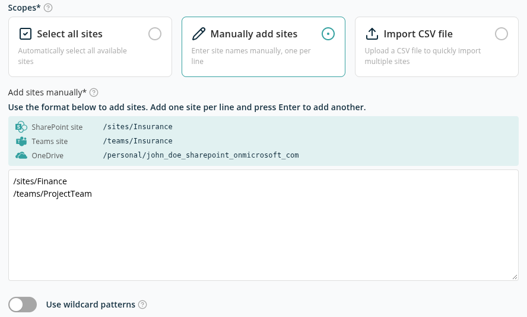

Enter one site path per line. The help text shows the format for a SharePoint site (`/sites/…`), a Teams site (`/teams/…`) and a OneDrive (`/personal/…`).

Turn on **Use wildcard patterns** to match sites by URL pattern with `*` instead of listing them. Click **Check pattern** to see how many sites currently match. Patterns are evaluated again on every data refresh, so new sites that match are picked up automatically, and sub-sites of a matching site are included. A pattern of only `*` is not allowed — use **Select all sites** instead.

##### Import CSV File

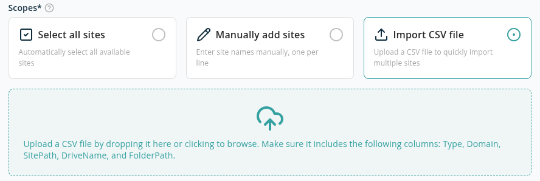

Drop a CSV file into the area, or click it to browse. The file must have the columns **Type**, **Domain**, **SitePath**, **DriveName** and **FolderPath**:

```csv
Type,Domain,SitePath,DriveName,FolderPath
Site,contoso.sharepoint.com,/sites/Marketing,,
Site,contoso.sharepoint.com,/teams/HR,,
Site,contoso.sharepoint.com,/personal/adele_contoso_com,,
```

#### Entra ID Discovery

A Microsoft 365 Governance workspace also shows **Entra ID discovery**. Every run reads users, groups and applications from Entra ID; the four options below are extra stages that are all on by default. Switch off the ones this workspace does not report on to make each run shorter.

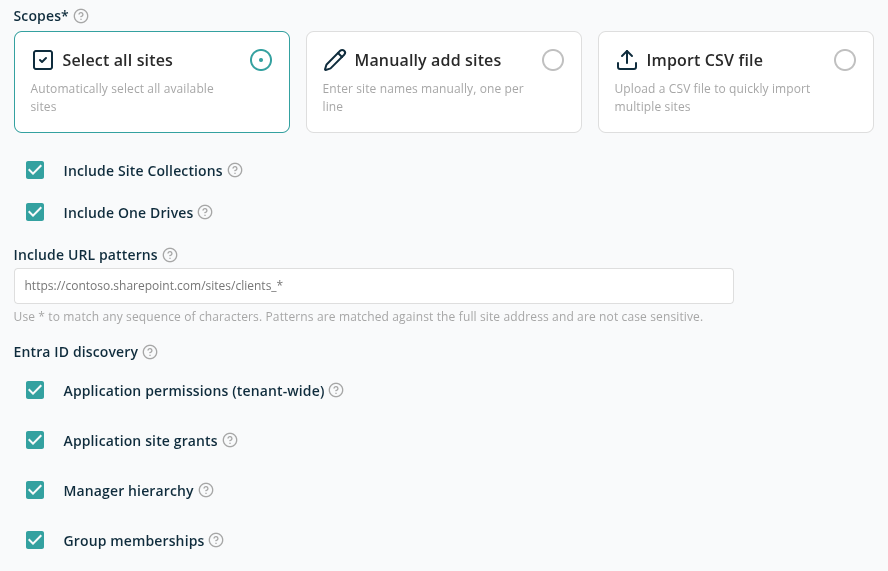

- **Application permissions (tenant-wide)** — Reads every application's tenant-wide and delegated Microsoft Graph permissions. Feeds the App Permissions report.
- **Application site grants** — Checks every site collection in the tenant for applications that were granted access to individual sites. Feeds the App Permissions report and the application entries in the Security & Oversharing report. This is the slowest stage on large tenants.
- **Manager hierarchy** — Reads each user's manager. Feeds the organisation hierarchy data.
- **Group memberships** — Reads the members of every Entra ID group. Feeds group member counts and the people counts in the Site Engagement report.

> **Important:** The Entra ID discovery options cannot be changed after the workspace is created. To use different settings, create a new workspace.

### Data Refresh Schedule

Choose how often the workspace data is refreshed.

- **One time** — The data is refreshed once.

  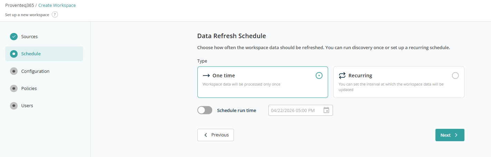

  - Leave **Schedule run time** off to start the data refresh as soon as the workspace is created.
  - Turn on **Schedule run time** to pick a date and time. Dates and times in the past cannot be selected.

- **Recurring** — The data is refreshed repeatedly. Choose the **Interval**:

  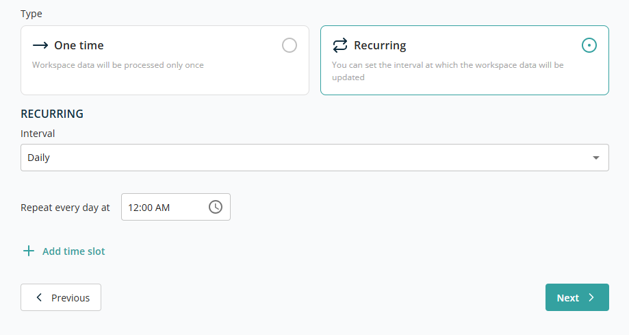

  - **Daily** — **Repeat every day at** a time you choose.

    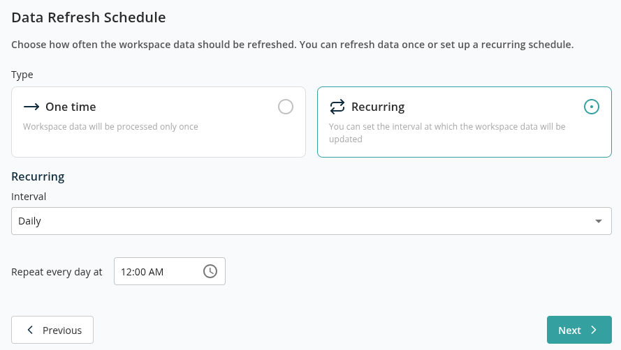

  - **Weekly** — **Repeat every week on** a day, **at** a time. Click **Add time slot** to add more days.

    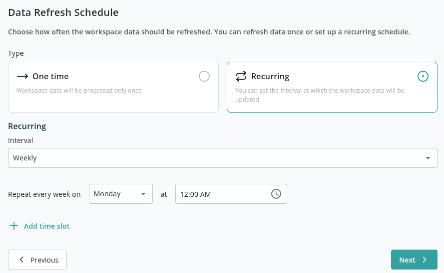

  - **Monthly** — **Repeat every month on the** day you choose, **at** a time. Click **Add time slot** to add more days. A refresh scheduled on the 29th, 30th or 31st runs only in months that have that day.

    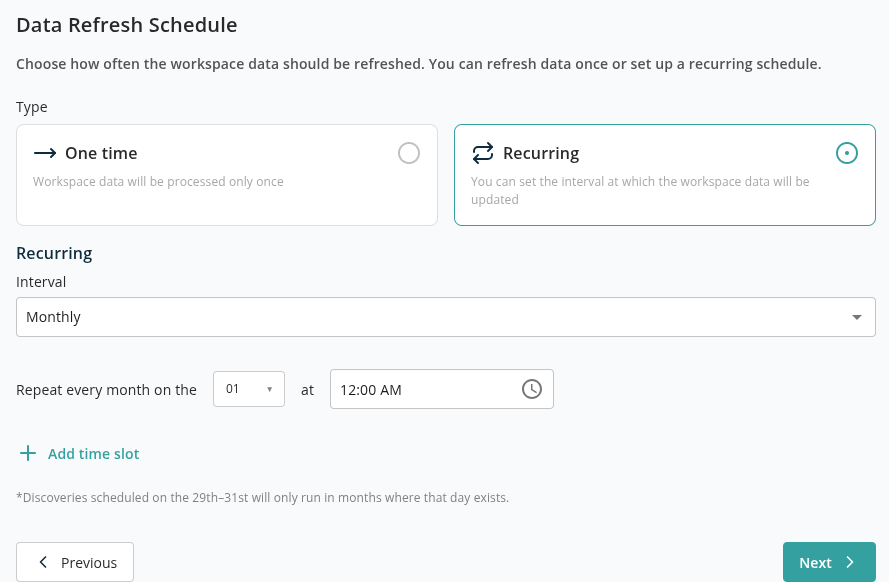

You can pick only one time per day. Times are entered in your local time.

### Analysis Configuration

For a Microsoft 365 Governance workspace, this step sets how redundant, obsolete and trivial (ROT) content is identified. Changes take effect on the next data refresh.

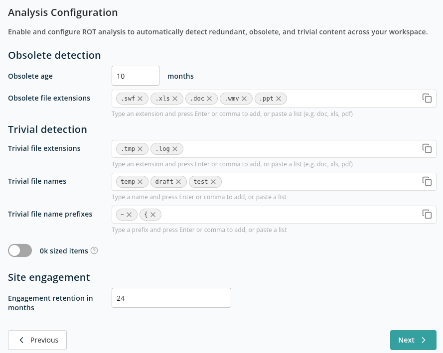

- **Obsolete detection**
  - **Obsolete age** — Age in months after which content counts as obsolete. Default: 10. Must be a whole number of at least 1.
  - **Obsolete file extensions** — File types that count as obsolete. Default: `swf, xls, doc, wmv, ppt`. Type an extension and press Enter or a comma, or paste a list.
- **Trivial detection**
  - **Trivial file extensions** — Default: `tmp, log`.
  - **Trivial file names** — Default: `temp, draft, test`.
  - **Trivial file name prefixes** — Default: `~, {`.
  - **0k sized items** — Flag files with zero bytes as trivial. Off by default.
- **Site engagement**
  - **Engagement retention in months** — How many months of site usage history to keep. Default: 24.

For an Exchange Monitoring workspace, this step holds the email settings instead. See [Exchange Monitoring](../../11-exchange-monitoring/README.md).

### Governance Policies

This step appears only for a Microsoft 365 Governance workspace, and only when your license includes the **Execution Report** feature.

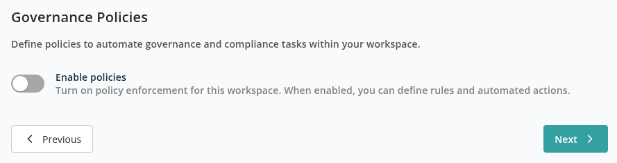

Turn on **Enable policies** to add governance policies to the new workspace now. Give each policy a **Name**, choose a **Policy rule**, set its parameters and actions, and click **Add Policy**. The policy appears in the list below. You can also add policies later. See [Policies](../policies/README.md) and [Predefined Policies](../../appendix/predefined-policies.md).

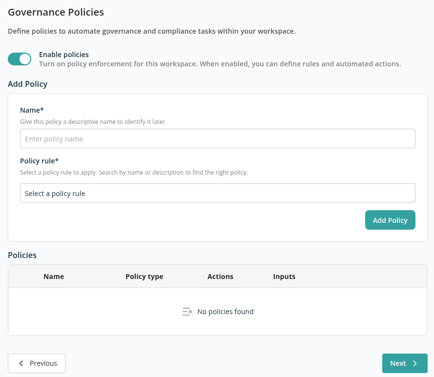

### Workspace Users

Add the people who can use the workspace and choose their role. At least one user is required.

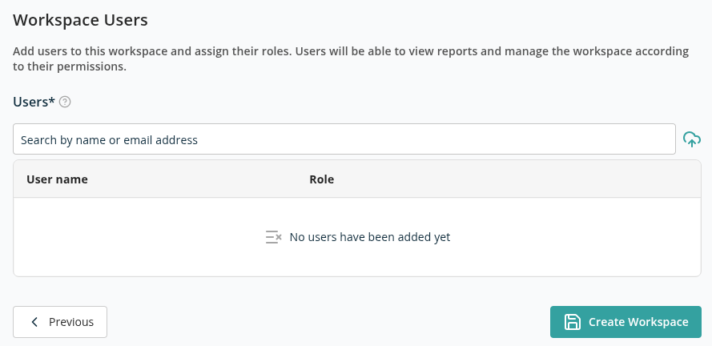

- **Search** — Type a name or email address and select the person. A person who is already in the list shows **Already added**.
- **Upload CSV** — Add many people at once from a CSV file with one email address per line. A header row is allowed and the file can be up to 5 MB. Each person found is added as a **Workspace User**. A summary shows how many were added, how many were already in the list and which addresses were not found.
- **Role** — Choose **Workspace User** or **Workspace Admin** for each person. Use the delete icon to remove someone.

Click **Create Workspace**. Proventeq365 opens the new workspace — the dashboard for a Microsoft 365 Governance workspace, or the email report for an Exchange Monitoring workspace.

## After the Workspace Is Created

- The **scope** cannot be changed: *Scope editing is disabled after workspace creation for security reasons.* This covers the scope type, the site list or CSV file, **Use wildcard patterns**, **Include Site Collections**, **Include One Drives** and the **Entra ID discovery** options. Create a new workspace to use different settings.
- **Include URL patterns** can still be edited. Changing them makes the next run re-read every site in the tenant.
- The schedule, analysis configuration and users can be changed with **Edit**. Proventeq365 asks you to confirm before saving. Changes apply from the next data refresh.

## Roles

| Role | Create a workspace | See the Workspaces list | Edit a workspace | See runs, start, stop or retry a refresh |
| --- | --- | --- | --- | --- |
| Tenant Admin | Yes | Yes | Yes | Yes |
| Workspace Admin | No | No | Yes, for their workspace (not the scope) | Yes, for their workspace |
| Workspace User | No | No | No | No |

Workspace Users can view the workspace's dashboard and reports.

## Related

- [Workspace Runs](./workspace-runs.md)
- [How to Create a Microsoft 365 Governance Workspace](../../13-how-to-guides/02-create-a-governance-workspace.md)
- [How to Give Users Access to a Workspace](../../13-how-to-guides/04-give-users-access-to-a-workspace.md)
- [Error Messages: Workspaces and Data Refresh](../../15-error-catalog/02-workspaces-and-data-refresh.md)
