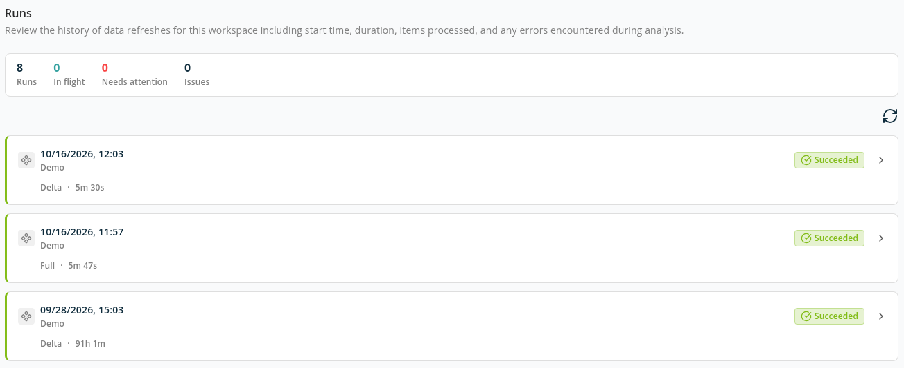
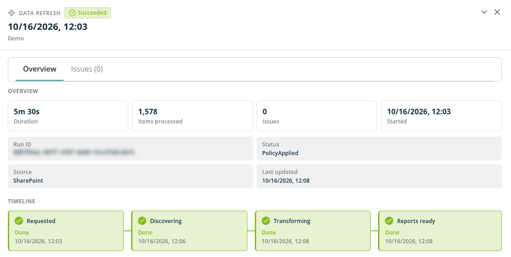

# Workspace Runs

The **Runs** screen lists every data refresh of a workspace — when it started, how far it got, how long it took and whether it recorded any issues. Use it to follow a refresh in progress, find out why one failed, stop one that is still collecting data, or retry one that failed.

You need the **Workspace Admin** role on the workspace, or the **Tenant Admin** role. Open the screen in either of these ways:

- **Manage** → **Workspaces**, then **View runs** in the workspace's row.
- **View run details** on the data refresh progress shown on the dashboard and reports while a refresh is running or after one has failed.

## Counters

The bar at the top summarises the runs in the list:

- **Runs** — The number of runs.
- **In flight** — Runs that are queued or running.
- **Needs attention** — Runs that failed.
- **Issues** — The total number of issues recorded across the runs.

Use **Reload run history** to refresh the list. The list also updates on its own while a run is in progress.

## Run List

Each run is a card titled with the date and time it started, with the workspace name below. A card shows the run's status, the number of issues (when there are any), whether it was a **Full** or **Delta** run, and its duration.

A run has one of these statuses:

- **Queued** — The refresh has been requested and is waiting to start.
- **Running** — The refresh is collecting or processing data.
- **Succeeded** — The refresh completed and the reports show its data.
- **Failed** — The refresh did not complete.
- **Stopped** — Someone stopped the refresh.

### Full and Delta Runs

The first data refresh of a workspace is always a **Full** run: it reads everything in scope. Later refreshes are **Delta** runs: they read only what changed since the last completed refresh, which makes them much faster. Items that SharePoint reports as deleted are removed from the reports by a Delta run.

### What a Run Covers

Every data refresh first reads Microsoft Entra ID (users, groups, applications and their permissions), then the workspace's own source — SharePoint for a Microsoft 365 Governance workspace, or email for an Exchange Monitoring workspace. Each part is listed as its own run, and the run details show which **Source** it covers. If a part fails, the parts after it do not run.

**Items processed** counts different things depending on the source: items for SharePoint, mailboxes for Exchange, and users, groups and applications for Entra ID. Content that cannot be read for an expected reason — for example a OneDrive that was never set up — is skipped and not counted as an issue.

## Run Details

Click a run to open its details. Use **Previous run** and **Next run** to move through the list without closing the panel.

### Overview

- **Duration**, **Items processed**, **Issues** and **Started**.
- **Timeline** — The stages of the run and when each finished:
  - **Requested** — The refresh was queued.
  - **Discovering** — Data is being collected from Microsoft 365.
  - **Transforming** — The collected data is being processed for the reports.
  - **Reports ready** — The reports show the new data.

  A run that failed or was stopped shows **Requested** followed by **Run ended**.
- **Run ID**, **Status**, **Source** and **Last updated**. Quote the **Run ID** when you contact Proventeq support.

### Issues

The **Issues** tab lists each failure the run recorded, grouped into categories. Use **Search issues** and the category filters to narrow the list, and **Load more issues** to see more. When there are none, the tab says *No issues recorded for this run*.

## Stop a Data Refresh

While a run is **Queued** or still collecting data, its card shows **Stop data refresh**. Confirm to stop it. Data already collected is kept, and the reports keep showing the results of the last completed refresh until you run a new one. Once a run has moved on to processing the data, it can no longer be stopped. If the run had already finished, you see *The data refresh had already finished, so there was nothing to stop*.

## Retry a Failed Run

A **Failed** run shows **Retry**. Confirm *This data refresh failed. Retry the step that failed?* to repeat the failed step without starting the whole refresh again. You see *Retry started* when it begins.

To start a completely new refresh instead, use **Refresh data** in the workspace's row on the **Workspaces** screen, or on the dashboard when it offers it. Only one data refresh can run at a time for a workspace.

## Reports During a Refresh

- Until a workspace's first refresh completes, its dashboard and reports show the refresh progress instead of data.
- After that, the reports stay available while a new refresh collects data, and show the previous results. They are briefly unavailable while the new data is processed (**Transforming**).
- If the newest refresh failed, reports show the data of the last refresh that completed, with a notice that the figures come from an earlier refresh.

## Related

- [Workspaces](./README.md)
- [How to Run a Workspace Scan](../../13-how-to-guides/03-run-a-workspace-scan.md)
- [Notifications](../../09-notification/README.md) — get an email when a data refresh fails.
- [Error Messages: Workspaces and Data Refresh](../../15-error-catalog/02-workspaces-and-data-refresh.md)
