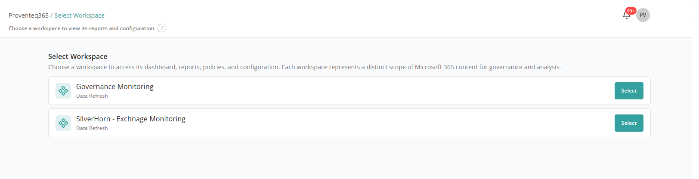
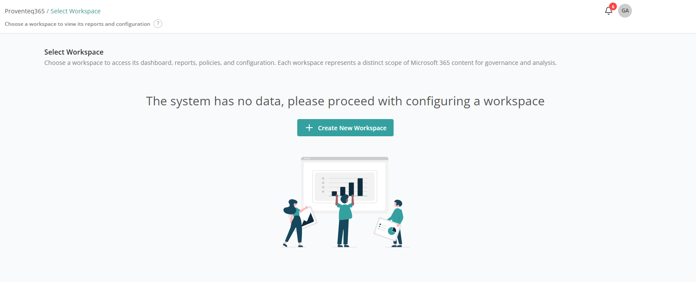
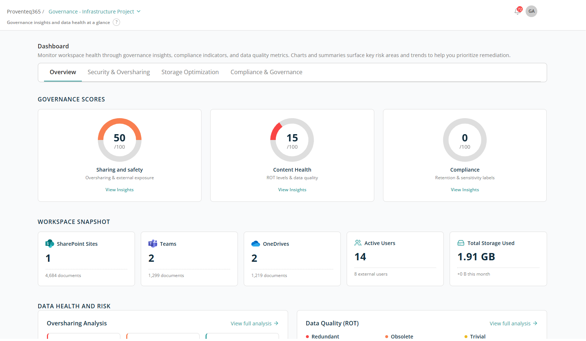
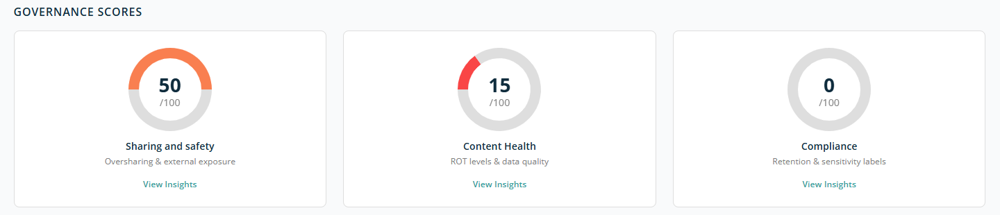
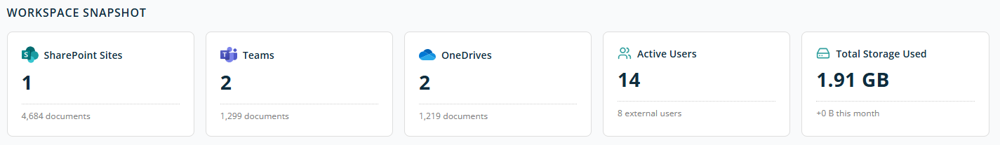
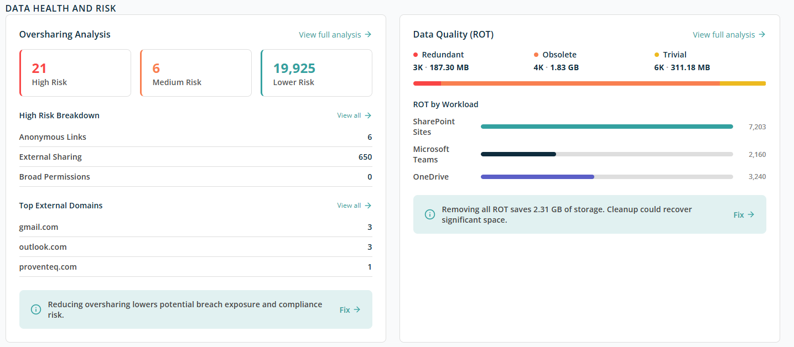

# Dashboard — Overview

The **Dashboard** is the home page of a Microsoft 365 Governance workspace. It brings together governance scores, a snapshot of the workspace, and summaries of oversharing and redundant, obsolete and trivial (ROT) content, so that you can spot risk areas and trends and decide what to fix first.

## Who Can Use It

- Any user with a role on the workspace (**Workspace User** or higher) can view the dashboard.
- The dashboard is available for **Microsoft 365 Governance** workspaces. An **Exchange Monitoring** workspace has no dashboard — selecting it opens its email report instead. See [Exchange Monitoring](../../11-exchange-monitoring/README.md).

## Choose a Workspace

After you sign in, the **Select Workspace** screen lists the workspaces you have access to, each with its type. Click **Select** on a workspace to open it — a Microsoft 365 Governance workspace opens on its dashboard. If there are no workspaces yet, the screen shows *The system has no data, please proceed with configuring a workspace*, and a Tenant Admin can click **Create New Workspace**. See [Workspaces](../../02-manage/workspaces/README.md).

To switch to another workspace, use the workspace selector at the top of the screen. It also shows when the current workspace's data was last refreshed (**Last run**). To return to the dashboard from another page, open **Main** → **Dashboard**.

## Navigation Tabs

At the top of the Dashboard you can switch between different governance focus areas:

- **Overview** — Governance scores, workspace snapshot, and data health and risk. *(This page.)*
- [Security & Oversharing](./security-oversharing.md) — Risk summary and detailed breakdown of sharing, access and permission risks.
- [Storage Optimization](./storage-optimization.md) — Redundant, obsolete and trivial content to help you optimise storage.
- [Compliance & Governance](./compliance-governance.md) — Active policies, files matched and remediation status.

## Governance Scores

Three ring charts show scores out of 100. The higher the score, the better. A score of 70 or more is shown in green, 40 to 69 in orange, and below 40 in red.

- **Sharing and safety** — *Oversharing & external exposure.* Based on the number of items at high, medium and lower oversharing risk, compared with all items assessed. High-risk items lower the score most.
- **Content Health** — *ROT levels & data quality.* The share of content that is not redundant, obsolete or trivial: a workspace with no ROT scores 100.
- **Compliance** — *Retention & sensitivity labels.* The percentage of enabled policies that have run and found no matching items. A workspace with no enabled policies, or whose policies have not run yet, scores 100.

Click **View Insights** on a card to open the matching tab — **Security & Oversharing**, **Storage Optimization** or **Compliance & Governance**.

## Workspace Snapshot

A quick summary of the workspace's content.

- **SharePoint Sites** — The number of sites, and the documents stored in them.
- **Teams** — The number of sites connected to a team, and the documents stored in them.
- **OneDrives** — The number of OneDrives, and the documents stored in them.
- **Active Users** — The number of active users, with the number of external users.
- **Total Storage Used** — The storage the content uses, with the growth this month (for example *+1.2 GB this month*).

## Data Health and Risk

This section highlights where data may pose security risks or waste storage, in two panels side by side.

### Oversharing Analysis

- **High Risk**, **Medium Risk** and **Lower Risk** — The number of items at each oversharing risk level, as classified in the [Security & Oversharing report](../../04-reports/security-oversharing/README.md).
- **High Risk Breakdown** — Why content is classed as high risk:
  - **Anonymous Links** — Files or folders shared with links that do not require sign-in.
  - **External Sharing** — Content shared with users outside your organisation.
  - **Broad Permissions** — Documents or folders that more than 20 users or groups can access.
- **Top External Domains** — The three external domains that content is most often shared with, for example `gmail.com` or `outlook.com`. Use it to spot unintended external collaboration.

The banner at the bottom reads *Reducing oversharing lowers potential breach exposure and compliance risk.* Click **Fix**, **View all** or **View full analysis** to open the **Security & Oversharing** tab.

### Data Quality (ROT)

ROT is content that is:

- **Redundant** — Duplicate copies of the same content.
- **Obsolete** — Outdated content that is no longer used.
- **Trivial** — Low-value content with little business relevance.

For each category the panel shows the number of files and the storage they use. The colour-coded bar below shows how the ROT storage splits between the three categories.

**ROT by Workload** shows the number of ROT items in **SharePoint Sites**, **Microsoft Teams** and **OneDrive**. Each bar has its workload's colour, the same colours the other reports use for SharePoint, Teams and OneDrive.

The banner at the bottom shows how much storage the ROT content uses, for example *Removing all ROT saves 2.31 GB of storage. Cleanup could recover significant space.* Click **Fix** or **View full analysis** to open the **Storage Optimization** tab. For storage capacity, forecasts and savings, see [Storage Optimisation Overview](../../04-reports/storage-optimization/README.md).

## While Data Is Refreshing

The dashboard shows the results of the workspace's last completed data refresh.

- **First refresh** — Until the workspace's first data refresh has completed, a progress card is shown in place of the dashboard, for example *Data scan is scheduled to run* or *The data scan run is in progress*. Once the refresh has started, the card shows its stages, how long it has been running, the items processed so far and any issues. The dashboard appears on its own when the refresh is done.
- **Later refreshes** — While a new refresh is collecting data, the dashboard stays readable with the data from the last completed refresh. A **Data scan in progress** indicator at the bottom right shows the current step, for example *Step 2 of 4*; click it to see the refresh's progress. In the final stage, while the new data is being prepared, the progress card replaces the dashboard until the new figures are ready.
- **Failed or stopped refresh** — If the latest refresh failed or was stopped, the dashboard shows *Data scan failed* or *Data scan was stopped* instead of figures. A Workspace Admin or Tenant Admin can click **Refresh data** on the card to start a new refresh. The reports still show the data from the last completed refresh.

Click **View run details** on the progress card or indicator to open the refresh on the [Workspace Runs](../../02-manage/workspaces/workspace-runs.md) screen (Workspace Admin or Tenant Admin).

If a section of the dashboard can't be loaded, it shows *We couldn't load this section. Please try again.* with a **Try again** button; the rest of the dashboard still works. If the workspace itself can't be loaded, the page shows *We couldn't load this workspace. Please try again in a moment.*

## Related

- [Dashboard — Security & Oversharing](./security-oversharing.md)
- [Dashboard — Storage Optimization](./storage-optimization.md)
- [Dashboard — Compliance & Governance](./compliance-governance.md)
- [Storage Optimisation Overview](../../04-reports/storage-optimization/README.md)
- [How to Run a Workspace Scan](../../13-how-to-guides/03-run-a-workspace-scan.md)
- [Troubleshooting — Workspaces and Data Refresh](../../14-troubleshooting/README.md#workspaces-and-data-refresh)
