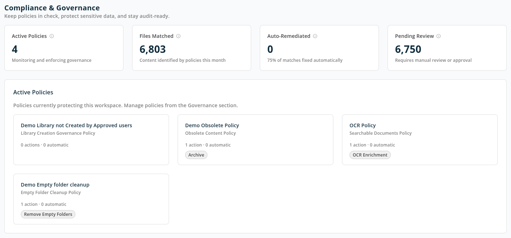

# Dashboard — Compliance & Governance

The **Compliance & Governance** tab of the [Dashboard](./README.md) helps you keep policies in check, protect sensitive data and stay audit-ready. It shows the governance policies active in the workspace, how much content they found, and how much of it is handled automatically or waits for someone to act.

Open the **Dashboard** and select the **Compliance & Governance** tab, or click **View Insights** on the **Compliance** score of the **Overview** tab.

## Compliance Summary

The cards at the top summarise policy activity in the workspace. They count enabled policies only, and use each policy's latest run:

- **Active Policies** — The number of enabled policies in the workspace.
- **Files Matched** — The number of items found by the latest run of each active policy.
- **Auto-Remediated** — The items found by policies that have at least one **Automatic** action, which runs without anyone starting it.
- **Pending Review** — The items found by policies that have at least one **Manual** action, which waits for someone to review the report and start it.

A policy with both automatic and manual actions counts towards both cards. For how actions run, see [Policies](../../02-manage/policies/README.md).

## Active Policies

*Policies currently protecting this workspace. Manage policies from the Governance section.*

Each enabled policy has a card showing:

- The policy's **Name** and the policy rule it uses, for example **Obsolete Content Policy**.
- A summary of its actions, for example *2 actions · 1 automatic*.
- Up to two of its actions by name, with *+1 more* when it has more.

Click a card to open the policy's report. Opening the report needs the **Execution Report** license feature. If the workspace has no enabled policies, the section shows *No policies found*. To add one, see [How to Add a Governance Policy](../../13-how-to-guides/05-add-a-governance-policy.md).

If the summary or the policy list can't be loaded, it shows *We couldn't load this section. Please try again.* with a **Try again** button.

## Related

- [Dashboard — Overview](./README.md)
- [Policies](../../02-manage/policies/README.md)
- [Predefined Policies](../../appendix/predefined-policies.md)
- [How to Add a Governance Policy](../../13-how-to-guides/05-add-a-governance-policy.md)
- [Actions](../../02-manage/actions/README.md)
