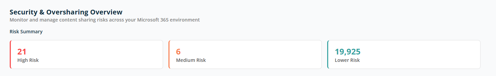
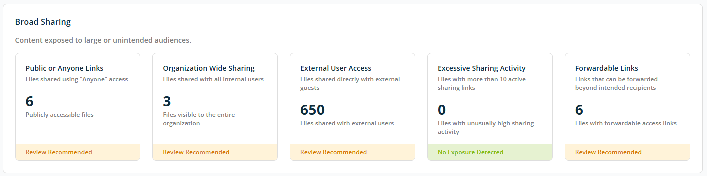
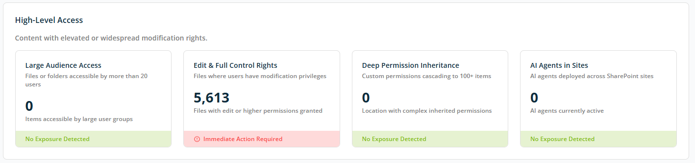
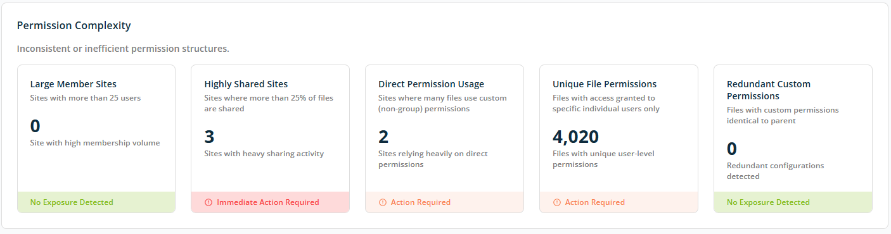

# Dashboard — Security & Oversharing

The **Security & Oversharing** tab of the dashboard summarises the content sharing risks in your workspace. It shows how many risky permissions there are at each severity, and groups the most common sharing and permission problems into cards so you can see at a glance where to investigate or remediate.

Open it from the **Security & Oversharing** tab at the top of the [Dashboard](./README.md). The page is headed **Security & Oversharing Overview**.

## Risk Summary

The **Risk Summary** cards show how many permissions on documents in the workspace are rated at each severity. How a severity is assigned is described in [Severity Allocations](../../appendix/severity-allocations.md).

- **High Risk** — the greatest exposure, such as anonymous sharing links and links shared with specific external users. Review these first.
- **Medium Risk** — sharing links that reach everyone in your organisation.
- **Lower Risk** — access limited to specific internal users or groups. Keep an eye on it so sharing does not grow unintentionally.

## How the Cards Work

The cards in the three sections below each show a short definition, a count and a status. Click a card to open the [Security & Oversharing](../../04-reports/security-oversharing/README.md) report filtered to the items the card counts; the filter appears as a chip with the card's name, which you can remove.

The status depends on the count and on the share of the workspace's items (or sites, for site cards) that it represents:

- **No Exposure Detected** — the count is zero.
- **Review Recommended** — less than 30% of items are affected.
- **Action Required** — 30% to less than 60%.
- **Immediate Action Required** — 60% or more.

## Broad Sharing

Content exposed to large or unintended audiences.

- **Public or Anyone Links** — files shared using "Anyone" access, so anyone with the link can open them without signing in.
- **Organization Wide Sharing** — files shared with all internal users.
- **External User Access** — files shared directly with external guests.
- **Excessive Sharing Activity** — files with more than 10 active sharing links, including links shared with specific people.
- **Forwardable Links** — files with links that can be forwarded beyond the intended recipients.

## High-Level Access

Content with elevated or widespread modification rights.

- **Large Audience Access** — files or folders accessible by more than 20 users.
- **Edit & Full Control Rights** — files where users have edit or higher permissions.
- **Deep Permission Inheritance** — folders and libraries with their own permissions that more than 100 documents inherit. The count is the number of these locations, and it matches what the report lists when you click the card.
- **AI Agents in Sites** — AI agents deployed across SharePoint sites.

## Permission Complexity

Inconsistent or inefficient permission structures.

- **Large Member Sites** — sites with more than 25 users.
- **Highly Shared Sites** — sites where more than 25% of files are shared.
- **Direct Permission Usage** — sites where many files use custom permissions granted to individuals rather than groups.
- **Unique File Permissions** — files with access granted to specific individual users only.
- **Redundant Custom Permissions** — files and folders that stopped inheriting permissions but whose own permissions are identical to those of a folder, library or site above them. An item is flagged only when every permission found on it could be resolved, so incomplete data does not produce a false match.

> **Note:** Redundant custom permissions are fixed by restoring inheritance, not by removing permissions. When you open the report from this card, its permission removal actions are disabled.

## Related

- [Dashboard — Overview](./README.md)
- [Security & Oversharing](../../04-reports/security-oversharing/README.md)
- [External Users](../../04-reports/external-users/README.md)
- [App Permissions](../../04-reports/app-permissions/README.md)
- [Severity Allocations](../../appendix/severity-allocations.md)
- [How to Remove Overshared Permissions](../../13-how-to-guides/09-remove-overshared-permissions.md)
