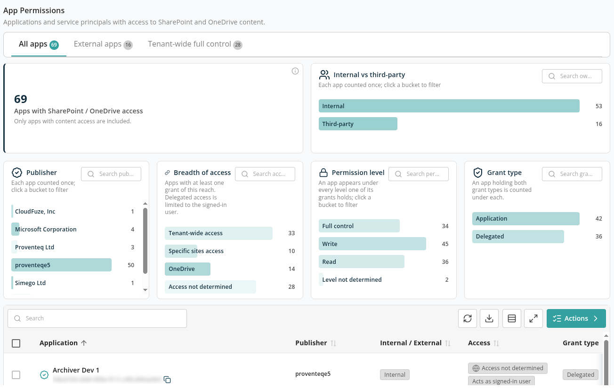
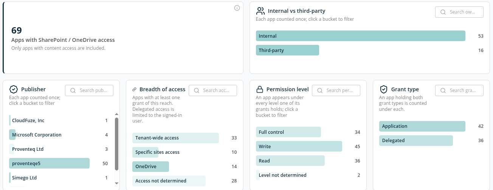
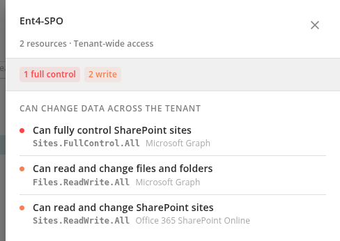
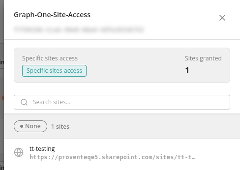

# App Permissions

The **App Permissions** report lists the applications and service principals in your Microsoft Entra ID that have been granted access to SharePoint or OneDrive content. For each app it shows who publishes it, whether it is your own or a third-party app, how far its access reaches (specific sites, the whole tenant, or only as the signed-in user) and its highest permission level. You can revoke an app's grants on specific sites directly from the report.

Open it from **Reports** → **Security & Oversharing** → **App Permissions**. The report is available in **Microsoft 365 Governance** workspaces.

## Who Can Use It

- Any user with a role on the workspace (**Workspace User** or higher) can view the report.
- Your license must include the **Permissions Report** and **Apps Report** features. Without them the menu item is hidden.
- Revoking site grants needs the **Workspace Admin** role (or **Tenant Admin**), and your license must include **Remove Apps** and **Execute Policy**. Without **Remove Apps**, the report has no **Actions** button and the side panel has no **Revoke** buttons.

## Where the Data Comes From

Every data refresh of a Microsoft 365 Governance workspace also discovers users, groups and applications from Entra ID. Two optional stages of that discovery feed this report. You choose them under **Entra ID discovery** on the **Define Your Workspace** step when you create the workspace:

- **Application permissions (tenant-wide)** — reads every application's tenant-wide and delegated permissions. Without it, the report has no **Application** or **Delegated** grants from Entra ID.
- **Application site grants** — checks every site collection in the tenant for grants given to an app on individual sites. Without it, the report has no **Specific sites access** rows, and the Security & Oversharing report has no Application rows. This is the slowest stage on large tenants.

Both stages are on by default and cannot be changed after the workspace is created. See [Workspaces](../../02-manage/workspaces/README.md).

The report includes only permissions that reach SharePoint or OneDrive content. Permissions to other data, such as mail or Teams chats, are not listed, and resource-specific consent granted per team or per site collection is not covered.

## Tabs

The tabs at the top split the apps into three views. The number on each tab is the number of apps it holds, taking the active filters and search into account.

- **All apps** — every app with SharePoint or OneDrive access.
- **External apps** — third-party apps only: apps that are not published by Microsoft and are not registered in your own tenant.
- **Tenant-wide full control** — apps that hold an application permission giving full control of every site, such as `Sites.FullControl.All`. These apps can read, change and delete content in every site without a user signing in, so review them first.

## Summary and Breakdowns

- **Apps with SharePoint / OneDrive access** — the number of apps in the current tab and filters. Each app is counted once, even if it holds both application and delegated permissions. Click the card to clear all filters.

Five breakdown panels sit next to the card. Each counts apps, not grants, and each has a search box. Click a bucket to filter the whole report, including the table; click it again to remove the filter. Active filters appear as chips next to **Active filters** at the top of the page; remove one chip, or click **Clear all**.

- **Internal vs third-party** — **Internal** apps are published by Microsoft or registered in your own tenant; **Third-party** apps belong to another organisation.
- **Publisher** — the publisher name of each app. An app with no publisher name shows **Unverified publisher** if it is third-party, or **Internal** if it is your own.
- **Breadth of access** — how far an app's grants reach. An app appears under every breadth that one of its grants has:
  - **Tenant-wide access** — an application permission that reaches every site, or every file in every site.
  - **Specific sites access** — grants on named sites only.
  - **OneDrive** — permissions to files, such as users' OneDrive files.
  - **Access not determined** — the reach could not be classified.
- **Permission level** — **Full control**, **Write**, **Read** or **Level not determined**. An app appears under every level that one of its grants holds. A delegated permission is never counted as full control, because the app can only do what the signed-in user can do.
- **Grant type** — **Application** (the app acts on its own, with no user signed in) or **Delegated** (the app acts only as the signed-in user who consented). An app holding both is counted under each.

## Apps Table

The table lists one row per app and grant type, so an app that holds both application and delegated permissions has two rows. It is sorted by application name and shows 50 rows per page (50, 100 or 250).

- **Application** — the app's display name and its ID, with a **Copy App ID** button.
- **Publisher** — the publisher, with a tick for a verified publisher (hover to see the verified name). A **Disabled** badge shows when the app is disabled in Entra ID.
- **Internal / External** — **Internal** or **Third-party**.
- **Access** — the breadth of the grant: **Tenant-wide access**, **Specific sites access**, **OneDrive** or **Access not determined**. Delegated rows also show **Acts as signed-in user**.
- **Grant type** — **Application** or **Delegated**.
- **Permissions** — what the app has been granted:
  - For site grants, the SharePoint permission levels, such as **Read**, **Write** or **Full Control**.
  - For Entra ID permissions, one chip per resource (for example Microsoft Graph or Office 365 SharePoint Online) with a count per level, such as **1 full control** or **2 write**. Click a chip to open the permission breakdown.
- **Sites** — for site grants, the number of sites and a **View** link that opens the site access panel. Otherwise **All sites** (tenant-wide), **OneDrive**, **Acts as user** (delegated) or a dash.

Permission colours: red is full control, orange is write, green is read, grey is not determined.

Above the table:

- **Search** — find an app by name or ID.
- **Refresh** — reload the report.
- **Export** — download the rows in the current tab and filters as a CSV file, with the application, app ID, publisher, ownership, verified publisher, access, grant type, permissions and site count.
- **Actions** — bulk actions for the selected rows (see [Revoking Site Grants](#revoking-site-grants)).

## Permission Breakdown

Click a permission chip in the table to see everything the app has been granted.

The panel shows the app name, the resource and the grant type, a count of permissions per level, and then lists the permissions in three sections, most powerful first:

- **Can change data across the tenant** — permissions that can create, change or delete content. For a delegated grant this reads **Can change data as the signed-in user**.
- **Can see data across the tenant** — read-only permissions. For a delegated grant: **Can see data as the signed-in user**.
- **Reach not determined** — permissions whose reach the report could not classify.

Each permission is described in plain English, for example "Can fully control SharePoint sites", with the Microsoft permission name beneath it. The total number of permissions is shown at the bottom.

## Site Access Panel

Click **View** in the **Sites** column of a site-grant row to see the sites the app can reach.

The panel shows the app name and ID, its access type and the number of **Sites granted**. The sites are grouped by permission level, each with its name and address. Use **Search sites…** to find a site.

If you can revoke grants, each site has a **Revoke** button and the panel has a **Revoke all access** button. See below.

## Revoking Site Grants

You can revoke only grants that an app holds on specific sites. Application and delegated permissions are held in Microsoft Entra ID and cannot be revoked from Proventeq365, so those rows cannot be selected.

- **One site** — open the site access panel and click **Revoke** next to the site.
- **All sites of one app** — open the site access panel and click **Revoke all access**.
- **Several apps** — select the rows in the table, click **Actions** and choose **Remove selected permissions** ("Revoke every permission held by the selected applications. This cannot be undone."). Confirm the warning.

> **Important:** Revoking cannot be undone. **Revoke** and **Revoke all access** in the side panel start straight away, without a confirmation step. Check with the app's owner before you remove access the app may still need.

When the request is accepted, the message **Permissions removal queued.** appears and the removal runs in the background. Check the report after the next data refresh to confirm the grants are gone.

## Related

- [How to Review Third-Party App Access](../../13-how-to-guides/18-review-third-party-app-access.md)
- [Security & Oversharing](../security-oversharing/README.md)
- [License](../../08-license/README.md)
- [Troubleshooting — The reports show old data and a warning banner](../../14-troubleshooting/README.md#the-reports-show-old-data-and-a-warning-banner)
