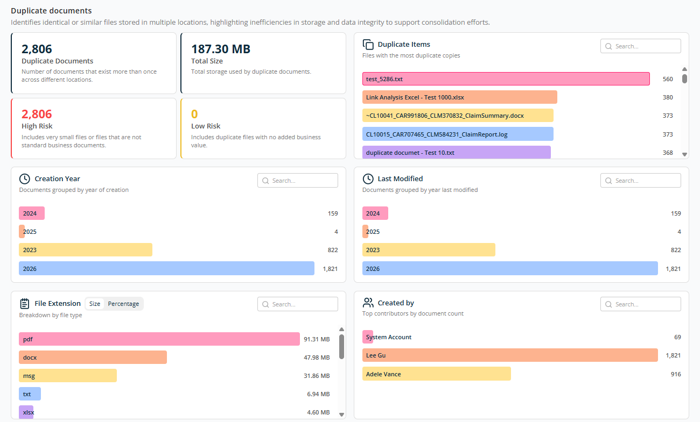
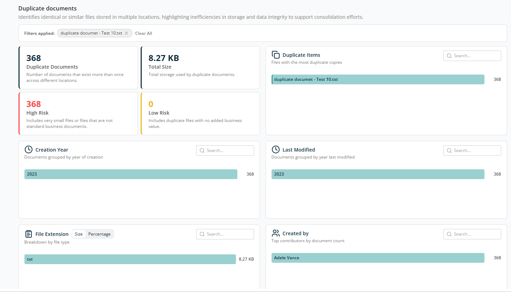
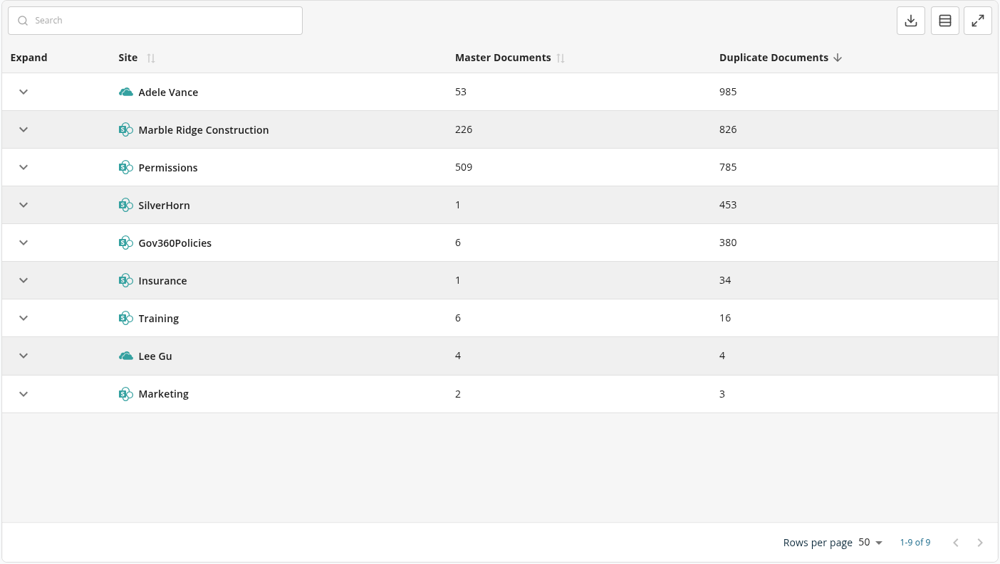
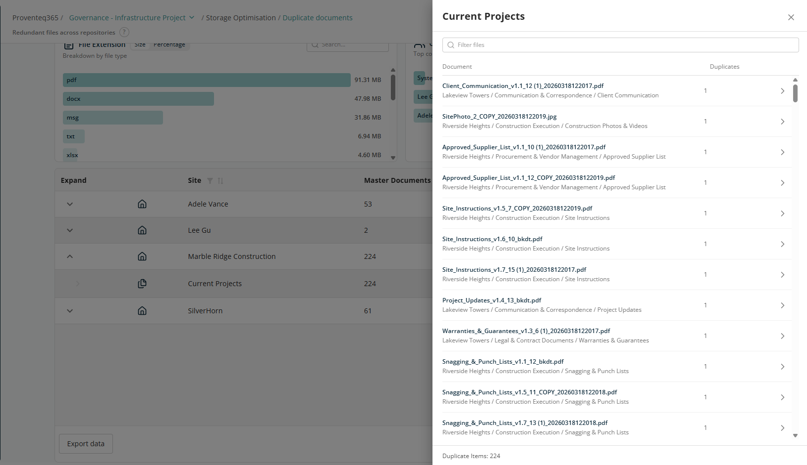
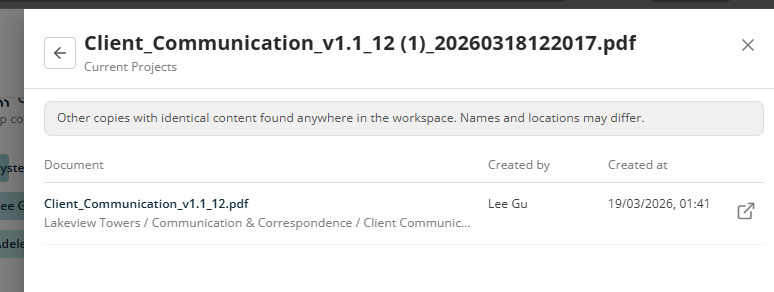

# Duplicate Documents Report

The **Duplicate documents** report helps you find identical files stored in more than one location across your environment. It highlights storage taken by redundant copies and possible confusion over which copy is the right one, so you can decide what to consolidate and clean up.

Open it from **Reports** → **Storage Optimisation** → **Duplicate documents**. For the storage overview of all ROT content, see [Storage Optimisation Overview](../storage-optimization/README.md).

## Who Can Use It

- Any user with a role on the workspace (**Workspace User** or higher) can view the report.
- Your license must include the **ROT Report** feature.

## How Duplicates Are Counted

Files are duplicates when their content is identical, even if their names and locations differ. Each set of identical files is counted under one **master document**; the other files in the set are its duplicate copies. The cards, the charts and the table all count duplicate copies, so their figures agree with each other.

## Overview

The cards at the top give a snapshot of duplicate content:

- **Duplicate Documents** — The number of duplicate copies found.
- **Total Size** — The storage used by the duplicate copies.
- **High Risk** — Copies in duplicate sets classed as high risk.
- **Low Risk** — Copies in duplicate sets classed as low risk.

Hover over the information icon on a risk card to see how the risk is decided:

- *A duplicate set is High Risk when any copy looks unusual: it is smaller than 1 KB or it is not a standard Word, Excel, PowerPoint, or PDF file (.doc, .docx, .xls, .xlsx, .ppt, .pptx, .pdf).*
- *A duplicate set is Low Risk when all copies look like standard business documents: each copy is at least 1 KB and uses one of the standard Word, Excel, PowerPoint, or PDF file types.*

Click **High Risk** or **Low Risk** to filter the whole report, including the table, to that risk level.

## Charts

Each chart has a **Search...** box to find a bar by name.

- **Duplicate Items** — Files with the most duplicate copies, highest first. Each bar is a file; the number is how many duplicate copies exist.
- **Creation Year** — Duplicates grouped by the year they were created.
- **Last Modified** — Duplicates grouped by the year they were last modified.
- **File Extension** — Duplicates by file type, such as PDF, DOCX or XLSX. Switch between **Size** (the storage used by each file type) and **Percentage** (each file type's share of the duplicates).
- **Created by** — The people who created the most duplicates.

## Filter the Report

Click a bar in any chart to filter the whole report — the cards, the other charts and the table — to that value. Click the same bar again to remove the filter. You can combine filters from several charts.

Active filters appear as chips next to **Active filters** at the top of the page. Remove one chip, or click **Clear all** to remove them all.

## Table View

The table lists duplicates by site or OneDrive, with the following columns:

- **Site** — The SharePoint site or OneDrive. Expand a row with the arrow to see the libraries in it that hold duplicates.
- **Master Documents** — The number of master documents in the site or library.
- **Duplicate Documents** — The number of duplicate copies of those master documents.

The table opens with the sites that have the most duplicate copies first. Click a column header to sort by it in ascending or descending order.

The toolbar above the table offers:

- **Search** — Find a site or OneDrive by name. Type at least 3 characters. The search term also appears as a chip next to **Active filters**.
- **Export** — Download the report as a CSV file. The file holds the duplicates that match the filters set with the cards and charts. Large reports can take several minutes to prepare; keep the tab open until the download starts.
- **Toggle density** and **Toggle fullscreen** — Change the row spacing, or show the table on the whole screen.

Choose how many rows to show per page — 50 (the default), 100, 250 or 500 — and page through the results with the arrows at the bottom of the table.

## Duplicates in a Library

In an expanded site, click the **Duplicate Documents** count of a library to open a side panel listing the master documents in that library that have duplicates, the most duplicated first. Each entry shows the document, its folder path and its number of **Duplicates**. Use **Filter files** to find a document by name or folder.

Click a document to see every copy of it. The panel explains that these are *Other copies with identical content found anywhere in the workspace. Names and locations may differ.* For each copy it shows:

- **Document** — The file name, with its location starting at the site name, for example *Finance / Shared Documents / Reports*, so you can tell copies in other sites from copies in the same site.
- **Created by** — Who created the copy.
- **Created at** — When the copy was created.
- **Open in new tab** — Opens the copy in SharePoint or OneDrive.

The footer shows how many copies are listed, for example *Showing 500 of 1200 duplicates*. Click **Load more** to list more. Use the back arrow to return to the library's list.

## Before the Report Has Data

The report shows data once the workspace's first data refresh has completed. Until then, and while a refresh is processing the data it collected, a progress card is shown instead. While a later refresh is still collecting data, the report keeps showing the data from the last completed refresh, and a **Data scan in progress** indicator appears at the bottom right of the page. If the latest refresh failed, the report shows the earlier data with the banner *The latest data refresh failed, so the figures shown come from an earlier refresh and may not be accurate.*

If the workspace has no duplicates, the report shows *There are no duplicate records. Your data is clean and consistent.* If the report can't be loaded, it shows *We couldn't load this report. Please try again.* with a **Try again** button.

## Related

- [Storage Optimisation Overview](../storage-optimization/README.md)
- [Dashboard — Storage Optimization](../../03-main/dashboard/storage-optimization.md)
- [Obsolete Documents Report](../obsolete-documents-report/README.md)
- [Trivial Documents Report](../trivial-documents-report/README.md)
- [How to Find and Clean Up ROT Content](../../13-how-to-guides/11-find-and-clean-up-rot-content.md)
- [Troubleshooting — Workspaces and Data Refresh](../../14-troubleshooting/README.md#workspaces-and-data-refresh)
