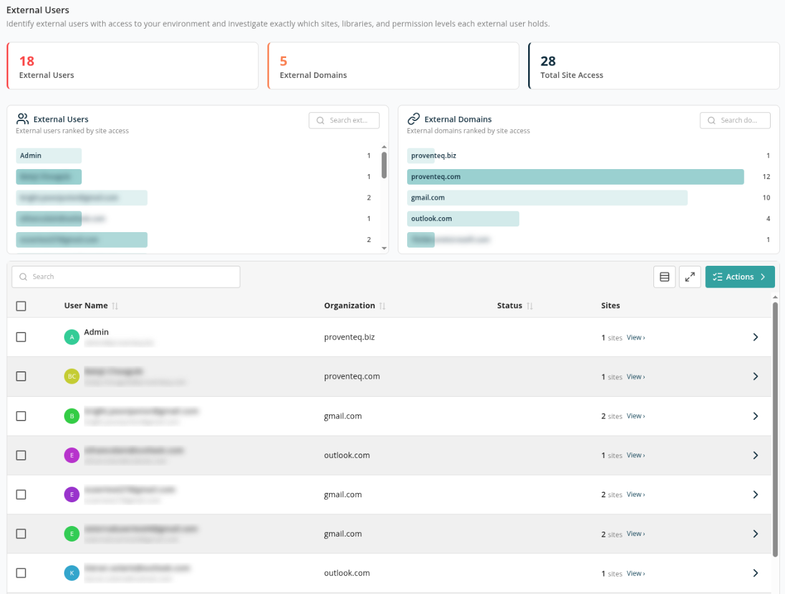

# External Users

The **External Users** report shows the users from outside your organisation who have access to content in the workspace. It tells you who they are, which domains they come from and how many sites each one can reach, lists those sites, and lets you remove, disable or enable external users.

Open it from **Reports** → **Security & Oversharing** → **External Users**. The report is available in **Microsoft 365 Governance** workspaces.

## Who Can Use It

- Any user with a role on the workspace (**Workspace User** or higher) can view the report.
- Your license must include the **Permissions Report** and **Users Report** features. Without them the menu item is hidden.
- Removing, disabling and enabling users needs the **Workspace Admin** role (or **Tenant Admin**). Other users see no **Actions** button and no checkboxes.

## Summary Cards

- **External Users** — the number of external users with access to the workspace.
- **External Domains** — the number of distinct email domains they come from, such as `gmail.com` or `outlook.com`.
- **Total Site Access** — the number of site accesses across all external users. A user who can reach three sites counts three.

## External Users and External Domains

Two panels rank the users and the domains by site access. Each has a search box: **Search external users** and **Search domains**.

- **External Users** — each bar is a user, with the number of sites they can reach. Click a user to open the [Security & Oversharing](../security-oversharing/README.md) report on its **External** tab, filtered to that user's permissions.
- **External Domains** — each bar is a domain, with the number of site accesses from it. Click a domain to filter the cards and the table to that domain; click it again to remove the filter. The filter appears as a chip next to **Active filters**; remove it, or click **Clear all**.

## External Users Table

The table lists one row per external user, 50 rows per page (50, 100, 250 or 500).

- **User Name** — the user's name and email address.
- **Organization** — the user's email domain. **No Domain Found** when the domain is not known.
- **Status** — **Active**, **Disabled** or **Deleted**.
- **Sites** — the number of sites the user can reach, with a **View** link that opens the sites panel.
- **>** — opens the Security & Oversharing report filtered to the user's permissions, the same as clicking the user in the chart.

Use the search box above the table to find a user by name or email address. Click the **User Name** or **Organization** header to sort by it.

## Sites Panel

Click **View** in the **Sites** column to see the sites an external user can access.

The panel shows the user's name and email address, and lists each site with its type icon and name, which opens the site, and how the user was granted access, for example **Direct** or **Specific people**. Use **Search sites** to find a site. The number of sites is shown at the bottom of the panel.

## Removing, Disabling and Enabling Users

1. Select one or more users with the checkboxes. Users with the status **Deleted** cannot be selected.
2. Click **Actions** above the table to open **Bulk actions**, and choose:
   - **Remove User** — removes the user from your tenant. *The user may still appear in the UI temporarily and will be removed after the next data refresh.*
   - **Disable User** — blocks the user from signing in, without deleting the account. Applies only to selected users who are not already disabled.
   - **Enable User** — lets a disabled user sign in again. Applies only to selected users who are not already active.
3. Confirm the action in the dialog.

When the request is accepted, a message such as **External user removal queued.** appears and the user's **Status** changes to **Deleted**, **Disabled** or **Active**. A removed user leaves the report after the next data refresh. You can act on up to 100 users at a time. The actions apply only to guest accounts in your Microsoft Entra ID.

> **Important:** **Remove User** deletes the guest account from your Microsoft Entra ID, which takes away all of that user's access in your tenant, not only the access in this workspace. Check with the site owners before you remove external collaborators.

## Related

- [Security & Oversharing](../security-oversharing/README.md)
- [App Permissions](../app-permissions/README.md)
- [How to Manage External User Access](../../13-how-to-guides/10-manage-external-user-access.md)
- [Error Messages: Policies and Remediation](../../15-error-catalog/03-policies-and-remediation.md#permissions-and-external-users)
- [License](../../08-license/README.md)
