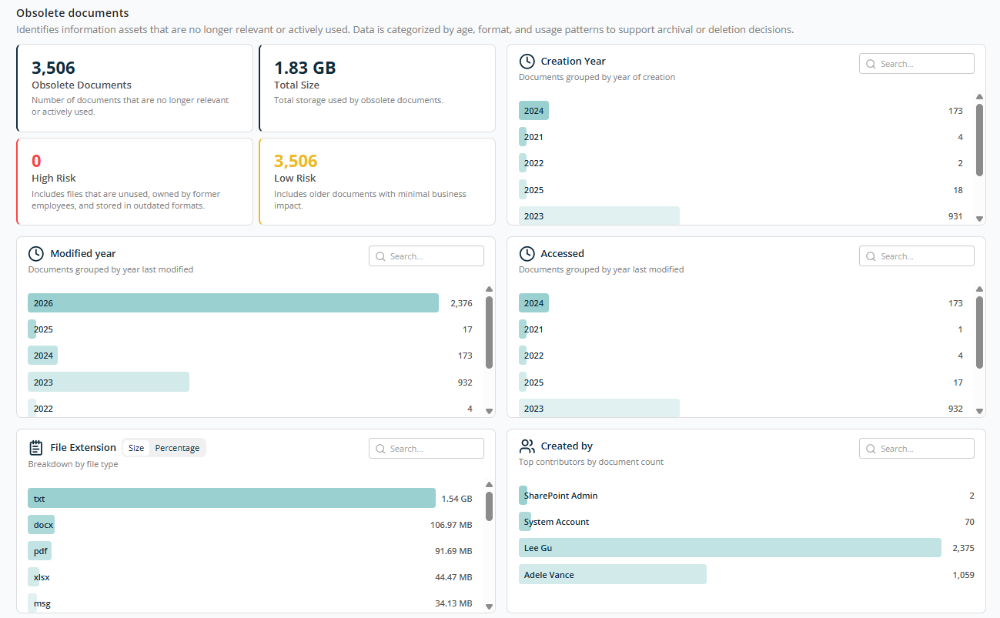
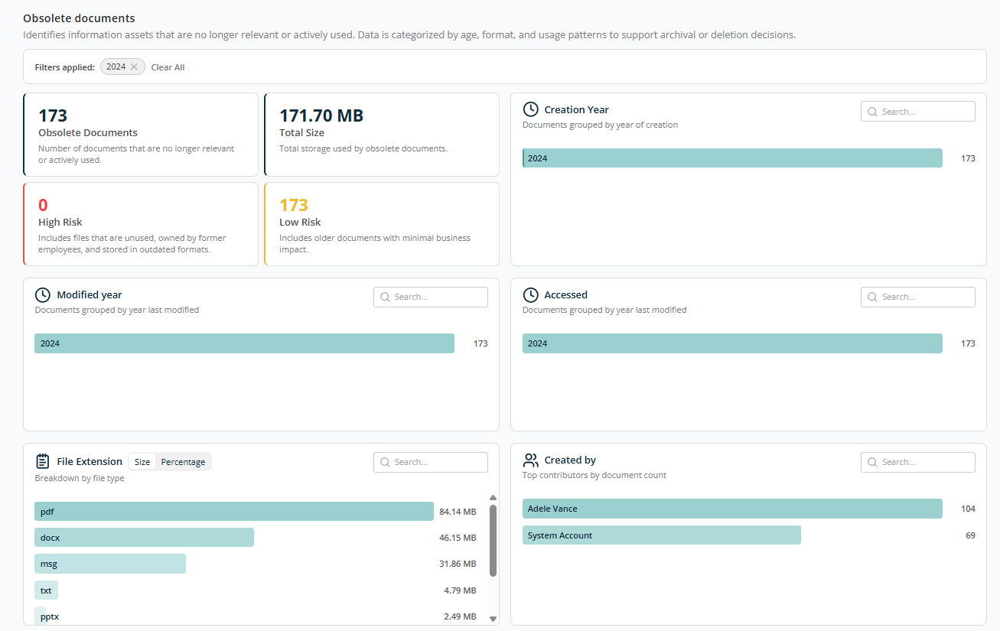
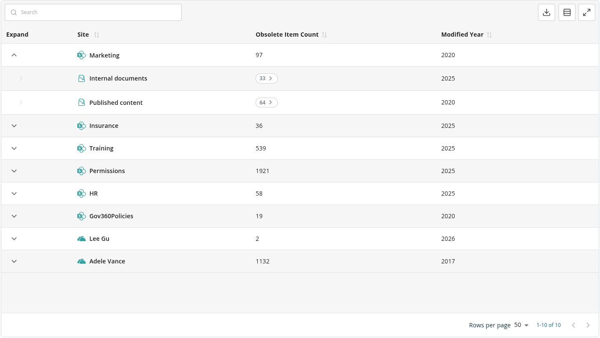
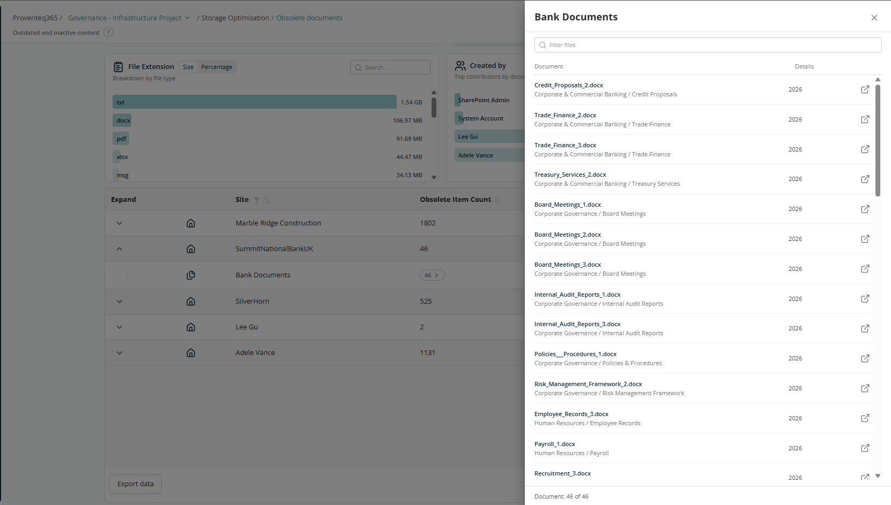

# Obsolete Documents Report

The **Obsolete documents** report helps you find files that are no longer relevant, actively used or required. It groups them by age, ownership and file format, so you can decide what to archive or delete. Documents are identified using the obsolete detection rules set on the workspace — the age in months and the file extensions. See [Workspaces — Analysis Configuration](../../02-manage/workspaces/README.md#analysis-configuration).

Open it from **Reports** → **Storage Optimisation** → **Obsolete documents**. For the storage overview of all ROT content, see [Storage Optimisation Overview](../storage-optimization/README.md).

## Who Can Use It

- Any user with a role on the workspace (**Workspace User** or higher) can view the report.
- Your license must include the **ROT Report** feature.
- Archiving from the report needs the **Workspace Admin** role (or **Tenant Admin**), the **Archive M365** license feature, and archiving set up for your organisation. See [Archive Selected Documents](#archive-selected-documents).

## Overview

The cards at the top summarise obsolete content:

- **Obsolete Documents** — The number of documents identified as obsolete.
- **Total Size** — The storage used by obsolete documents.
- **High Risk** — Obsolete documents classed as high risk.
- **Low Risk** — Obsolete documents classed as low risk.

Hover over the information icon on a risk card to see how the risk is decided:

- *An obsolete document is High Risk when all three signs are present: it is old or inactive based on the configured age rule, it is associated with a deleted or former user, and it uses a configured legacy or outdated file type.*
- *An obsolete document is Low Risk when only one or two obsolete signs are present, such as being old or inactive, linked to a former user, or using a legacy file type.*

Click **High Risk** or **Low Risk** to filter the whole report, including the table, to that risk level.

## Charts

Each chart has a **Search...** box to find a bar by name.

- **Creation Year** — Obsolete documents grouped by the year they were created. Shows how old the unused content is.
- **Modified year** — Obsolete documents grouped by the year they were last modified. Shows how long documents have stayed unchanged.
- **Accessed** — Obsolete documents grouped by the year they were last modified.
- **File Extension** — Obsolete documents by file type, such as PDF, DOCX or XLSX. Switch between **Size** (the storage used by each file type) and **Percentage** (each file type's share of the obsolete documents).
- **Created by** — The people who created the most obsolete documents.

## Filter the Report

Click a bar in any chart to filter the whole report — the cards, the other charts and the table — to that value. Click the same bar again to remove the filter. You can combine filters from several charts.

Active filters appear as chips next to **Active filters** at the top of the page. Remove one chip, or click **Clear all** to remove them all.

## Table View

The table lists obsolete documents by site or OneDrive, with the following columns:

- **Site** — The SharePoint site or OneDrive. Expand a row with the arrow to see the libraries in it that hold obsolete documents.
- **Obsolete Item Count** — The number of obsolete documents in the site or library.
- **Modified Year** — The oldest last-modified year among the obsolete documents in the site or library.

Click a column header to sort by it.

The toolbar above the table offers:

- **Search** — Find a site or OneDrive by name. Type at least 3 characters. The search term also appears as a chip next to **Active filters**.
- **Export** — Download the report as a CSV file. The file holds the obsolete documents that match the filters set with the cards and charts. Large reports can take several minutes to prepare; keep the tab open until the download starts.
- **Toggle density** and **Toggle fullscreen** — Change the row spacing, or show the table on the whole screen.

Choose how many rows to show per page — 50 (the default), 100, 250 or 500 — and page through the results with the arrows at the bottom of the table.

## Obsolete Documents in a Library

In an expanded site, click the **Obsolete Item Count** of a library to open a side panel listing its obsolete documents. Each entry shows the document, its folder path and, under **Details**, the year it was last modified. Click the **Open in new tab** icon to open a document in SharePoint or OneDrive. Use **Filter files** to find a document by name or folder.

The panel lists 100 documents at a time; click **Load more** to list the next 100. The footer shows how many documents are listed out of the library's total.

## Archive Selected Documents

You can archive individual obsolete documents from the side panel, without setting up a policy. When archiving is available to you, each document in the panel has a checkbox, and a bar above the list reads *Select obsolete documents to archive*.

1. Open a library's side panel as described above.
2. Tick the documents to archive. The bar shows how many are selected, for example *3 documents selected*. Folders and libraries can't be selected — only documents can be archived from this report.
3. Click **Archive selected**.
4. Check the **Archive obsolete documents** dialog and click **Confirm**.

Where the documents go depends on your organisation's archiving setup, and the dialog says which applies:

- **Archive storage connection** — *Each one is copied to your archive destination, removed from SharePoint, and replaced by a stub.* The dialog shows **Archiving to** and the name of the default destination set on [Archiving Connections](../../02-manage/connections/README.md#archiving-connections). Every version is archived. See [Proventeq365 Archiving](../../10-archive/01-proventeq365-archiving.md).
- **Microsoft 365 Archive** — *Each one is moved into Microsoft 365 Archive; no stub is left in SharePoint.* See [Microsoft 365 Archive](../../10-archive/02-microsoft-365-archive.md).

Only the documents you selected are archived. If archiving isn't set up, the checkboxes and **Archive selected** are not shown.

After you confirm, *Archiving has been initiated for the selected documents.* appears. The submitted documents are cleared from your selection. A document you have already submitted can't be selected again while you stay on the report — its checkbox is unavailable. Archiving runs in the background; follow it on the [Actions](../../02-manage/actions/README.md) page. The report shows the change after the next data refresh.

If the request fails, *Failed to archive the selected documents. Please try again.* appears and your selection is kept.

To archive obsolete content automatically or in bulk, use an **Obsolete Content Policy** with an archive action instead. See [How to Archive Obsolete Content](../../13-how-to-guides/07-archive-obsolete-content.md).

## Before the Report Has Data

The report shows data once the workspace's first data refresh has completed. Until then, and while a refresh is processing the data it collected, a progress card is shown instead. While a later refresh is still collecting data, the report keeps showing the data from the last completed refresh, and a **Data scan in progress** indicator appears at the bottom right of the page. If the latest refresh failed, the report shows the earlier data with the banner *The latest data refresh failed, so the figures shown come from an earlier refresh and may not be accurate.*

If the workspace has no obsolete documents, the report shows *There are no obsolete documents at the moment. Your files are current and well-maintained.* If the report can't be loaded, it shows *We couldn't load this report. Please try again.* with a **Try again** button.

## Related

- [Storage Optimisation Overview](../storage-optimization/README.md)
- [Dashboard — Storage Optimization](../../03-main/dashboard/storage-optimization.md)
- [Archiving](../../10-archive/README.md)
- [How to Archive Obsolete Content](../../13-how-to-guides/07-archive-obsolete-content.md)
- [Duplicate Documents Report](../duplicate-documents-report/README.md)
- [Trivial Documents Report](../trivial-documents-report/README.md)
- [How to Find and Clean Up ROT Content](../../13-how-to-guides/11-find-and-clean-up-rot-content.md)
