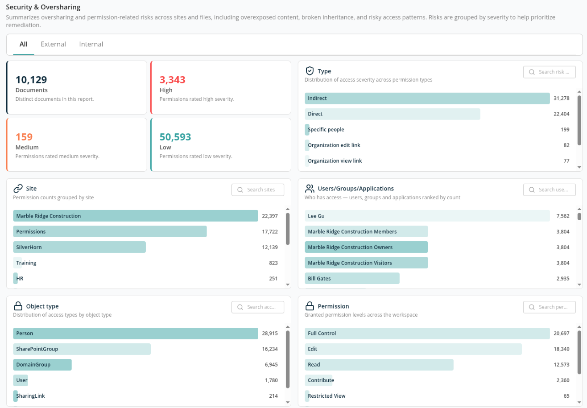
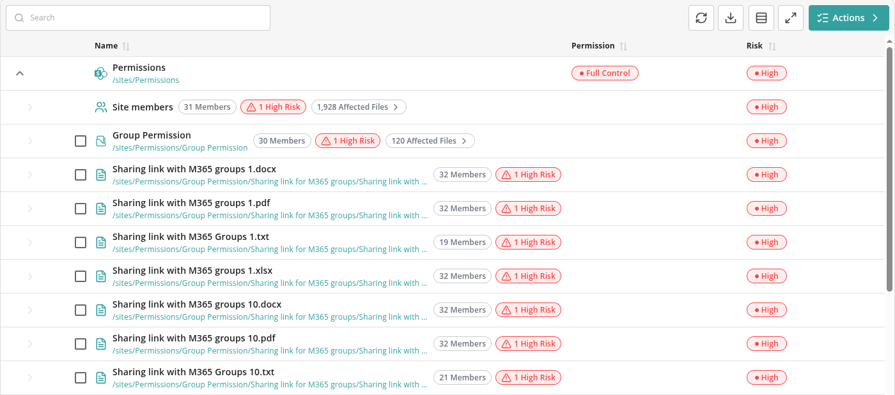
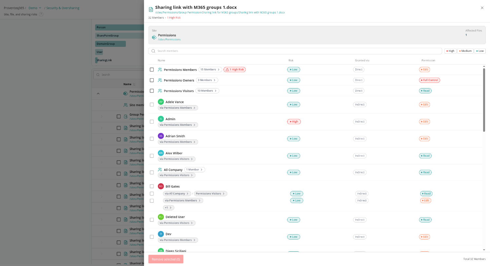

# Security & Oversharing

The **Security & Oversharing** report shows who can reach the content in your workspace and how risky that access is. It counts the risky permissions, breaks them down by access type, site, principal and permission level, and lists every site with the folders and files inside it that have their own permissions. For any item you can see everyone who has access, the whole path through which each person gets it, and remove direct grants and sharing links you no longer want.

Open it from **Reports** → **Security & Oversharing**. The menu item expands to the [External Users](../external-users/README.md) and [App Permissions](../app-permissions/README.md) reports. The report is available in **Microsoft 365 Governance** workspaces.

## Who Can Use It

- Any user with a role on the workspace (**Workspace User** or higher) can view the report.
- Your license must include the **Permissions Report** feature.
- Removing permissions needs the **Workspace Admin** role (or **Tenant Admin**), and your license must include **Execute Policy**. Without **Execute Policy**, the table has no **Actions** button and the access panel cannot remove access.

## What the Report Covers

- **Items with their own permissions** — the table lists sites, and the libraries, folders and files inside them that have unique permissions. Items that inherit their permissions are covered by the parent they inherit from.
- **People in groups** — group membership is expanded up to three levels below the group that holds the permission, so a person who gets access through a group inside another group is listed.
- **Applications** — apps that were granted access to individual sites appear as principals with the **Application** object type. An app that is not registered as internal in your Microsoft Entra ID counts as external. These rows need the **Application site grants** discovery stage; see [App Permissions](../app-permissions/README.md#where-the-data-comes-from).
- **Sharing links** — each link is a principal of its own: **Anyone with the link**, **Edit link** or **View link** (organisation-wide links), or **Sharing link** (links for specific people). Links that block download are listed with the **Restricted View** permission.
- **Unidentified principals** — access held by an account that could not be resolved is shown as **Unknown user**, **Unknown external user** or **Deleted user**, rather than left out.
- **Limited Access** — SharePoint adds this system level on parent folders and sites so people can reach an item shared further down. It gives no access to content, so the report does not list it.

## Scope Tabs

The tabs at the top scope everything on the page — the cards, the breakdown panels and the table:

- **All** — access held by anyone. Selected by default.
- **External** — access held by external users, and by apps that count as external.
- **Internal** — access held by people, groups and apps inside your organisation.

The tab you choose is kept in the page address, so it survives a reload and you can bookmark or share the filtered view.

## Summary Cards

- **Documents** — the number of distinct documents in the report. A document with several risky permissions is counted once.
- **High**, **Medium**, **Low** — the number of permissions rated at that severity. Click a card to filter the page by that severity; you can select more than one. Click it again to remove the filter.

Each card carries a short note saying what it counts. How a severity is assigned is described in [Severity Allocations](../../appendix/severity-allocations.md).

## Breakdown Panels

Five panels sit next to the cards. Each one ranks its entries by count and has a search box. Click an entry to filter the whole page, including the table; click it again to remove the filter. Active filters appear as chips next to **Active filters** at the top of the page; remove one chip, or click **Clear all**.

- **Type** — how access is granted: **Direct**, **Indirect** (through a group or inherited from a parent), **Specific people**, and sharing link types such as **Anonymous edit link**, **Anonymous view link**, **Organization edit link** or **Organization view link**.
- **Site** — the sites the permissions are on.
- **Users/Groups/Applications** — who has access: users, groups and applications, ranked by count.
- **Object type** — the kind of principal, for example **Person**, **SharePointGroup**, **DomainGroup**, **SharingLink** or **Application**.
- **Permission** — the permission levels granted, for example **Full Control**, **Edit**, **Contribute**, **Read** or **Restricted View**.

## Site Permissions Table

The table below the panels lists one row per site that matches the current tab and filters. Expand a site to list the items inside it that have their own permissions, and a **Site members** row for the site's own access list. Hover a column header to see what the column means.

- **Name** — the item's type icon and name, which opens the item in SharePoint. Next to the name:
  - On a file, the number of members who can reach it (for example **8 Members**) and, if any, how many of them are high risk (**5 High Risk**).
  - On a folder, library or **Site members** row, the number of documents these permissions reach (for example **1,125 Affected Files**). Click the pill to open the access panel.
- **Permission** — the permission level held on the site itself. Inside a site the level belongs to each person or group rather than to the item, so the column is blank there; open the row to see who holds what.
- **Risk** — **High**, **Medium** or **Low**, based on who can reach the item and how broadly it is shared.

Sites are shown 50 per page (25, 50 or 100). An expanded site loads its items a page at a time: click **Load more items** at the end of the list to see the next page; the count beside it shows how many have loaded, for example "50 of 230 items". A site with nothing to list shows **No items with unique permissions**.

Above the table:

- **Search** — find items whose address, site name or principal name contains the text you type (at least 3 characters). The search term also appears as a filter chip.
- **Refresh** — reload the table.
- **Export** — download every permission that matches the current tab, filters and search as a CSV file, one row per grant, with the item address, site, principal name and email, object type, whether the principal is external, how access is granted, the permission level and the severity. Large exports can take several minutes; keep the tab open until the file downloads.
- **Actions** — remove permissions (see [Removing Permissions](#removing-permissions)).

## Access Panel

Click a file, folder or **Site members** row, or an **Affected Files** pill, to open the panel that shows everyone who can reach the item.

The header shows the item's type icon and name, which opens the item, and the number of members, for example **8 Members**, with the number of high-risk members, for example **5 High Risk**. Below it are the **Site**, with a link to the site, and the number of **Affected Files**.

Use **Search members** to find a person, group or link, and the **High**, **Medium** and **Low** buttons to show only members at that risk; you can select more than one.

The list has four columns: **Name**, **Risk**, **Granted via** (for example **Direct**, **Indirect** or **Specific people**) and **Permission**. People with direct access are listed first, then people with indirect access, and sharing links last. Each person, group or link appears once.

- **Groups and sharing links** show how many members they have, for example **2 Members**, and how many of them are high risk. Click the pill to open the members. A path at the top of the panel shows where you are; click a step, or the back arrow, to go back. A group or link with no members found shows **No members discovered** and cannot be opened.
- **Access path** — a person who gets access through a group shows the whole path, for example *via Project Team / Visitors*. Click a step in the path to open that group or sharing link.
- **Several routes** — when someone has access in more than one way, each route is listed on its own line with its own risk, **Granted via** and permission. Each route shows the highest permission it grants and the highest risk among its grants. **Direct access** marks a grant made to the person directly; **Unresolved access path** groups access whose route could not be worked out, and is listed last. Two routes are shown at first; click **+N** to see the rest and **Show fewer** to collapse them.

The total number of members is shown at the bottom of the panel.

### Removing Access from the Panel

Checkboxes appear in the item's own access list and inside a **Specific people** sharing link, where they let you remove people who have redeemed the link.

1. Tick the people, groups, links or individual routes to remove.
2. Click **Remove selected (N)**, where N is the number of routes you ticked.
3. Check the summary in the **Remove Access to Files** dialog and click **Remove Access (N)**.

Only direct grants and sharing links can be removed. The checkbox is disabled, with a tooltip explaining why, for:

- Indirect access — remove it from the parent group or sharing link instead.
- Access that comes through a sharing link — manage the link itself.
- An **Unresolved access path** — the report could not work out how the access is granted.

## Removing Permissions

Removing a permission changes access in Microsoft 365 and cannot be undone. Check with the content owner before removing access people may still need.

Click **Actions** above the table to open **Bulk actions**:

- **Remove scoped permissions** — revoke every permission that matches the current tab, filters and search. Disabled while rows are ticked; clear the ticks first. Confirm *You're about to remove all scoped permissions.*
- **Remove selected permissions** — revoke the permissions on the rows you ticked. Expand a site and tick the folders and files to remove; sites themselves cannot be ticked. Ticks are kept when you collapse a site, and cleared when you change a filter, the search or the tab, and after a removal.

Both actions remove only direct grants and sharing links. Inherited access and access through a group are kept; change the group membership in Microsoft 365 or break inheritance on the item instead.

Before **Remove selected permissions** runs, the **Remove Access to Files** dialog shows what will be removed — the number of permission records, files and locations, the users, groups, applications or sharing links affected, and the access types and permission levels — counting only the grants the removal actually takes. A warning appears when some users have **Full Control** access. If nothing in the selection can be removed, the dialog says so and the **Remove Access** button is disabled.

When the request is accepted, the message **Permissions removal queued.** appears and the removal runs in the background. While it runs, the actions are disabled with *A removal is already in progress.* Check the report after the next data refresh to confirm the permissions are gone.

> **Note:** When you open the report from the **Redundant Custom Permissions** card on the dashboard, both actions are disabled: *Redundant custom permissions need a restore inheritance action, not permission removal.*

## Related

- [External Users](../external-users/README.md)
- [App Permissions](../app-permissions/README.md)
- [Dashboard — Security & Oversharing](../../03-main/dashboard/security-oversharing.md)
- [How to Remove Overshared Permissions](../../13-how-to-guides/09-remove-overshared-permissions.md)
- [Severity Allocations](../../appendix/severity-allocations.md)
- [Error Messages: Policies and Remediation](../../15-error-catalog/03-policies-and-remediation.md#permissions-and-external-users)
- [License](../../08-license/README.md)
- [Troubleshooting — The reports show old data and a warning banner](../../14-troubleshooting/README.md#the-reports-show-old-data-and-a-warning-banner)
