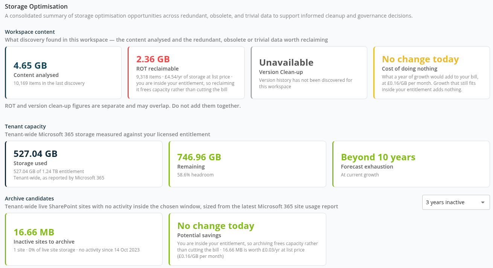
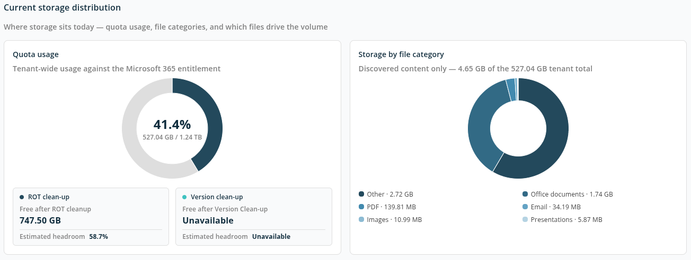
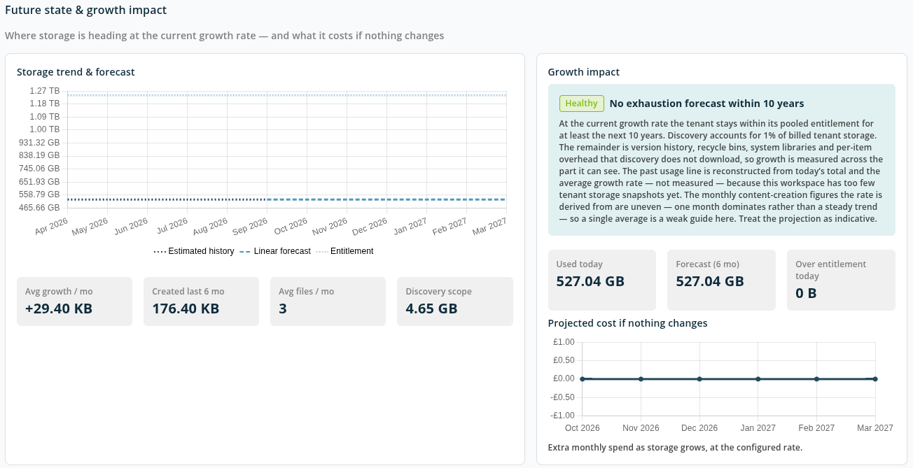

# Storage Optimisation Overview

The **Storage Optimisation** overview brings together where your Microsoft 365 storage sits today, how much of it you could reclaim, and where it is heading. It shows the content found in the workspace and how much of it is redundant, obsolete or trivial (ROT), old file versions you could trim, inactive sites you could archive, your tenant's storage against its entitlement, and a growth forecast with the cost of doing nothing.

Open it from **Reports** → **Storage Optimisation**. The menu item expands to the detailed [Duplicate](../duplicate-documents-report/README.md), [Obsolete](../obsolete-documents-report/README.md) and [Trivial](../trivial-documents-report/README.md) documents reports. The overview is available in **Microsoft 365 Governance** workspaces.

## Who Can Use It

- Any user with a role on the workspace (**Workspace User** or higher) can view the overview.
- Your license must include the **ROT Report** feature.

## How the Figures Are Valued

- **Storage price** — money figures value storage at a price per GB per month that is set for your Proventeq365 deployment, based on the list price of extra Microsoft 365 file storage. The hints on the cards show the rate in use. Ask Proventeq if your organisation pays a different rate.
- **List-price value and bill impact** — many cards give two figures. The value at list price is what that much storage would cost to buy. The bill impact is what you would actually stop paying: while your tenant is inside its storage entitlement, reclaiming space frees capacity but does not reduce the bill, so the cards say **No change today**.
- **Tenant storage** — tenant figures cover SharePoint's pooled tenant storage, as reported by Microsoft 365. OneDrive storage is a separate allowance and is not counted against it.
- **Unknown quota** — if the tenant storage entitlement cannot be read, the tenant figures fall back to the content found in the workspace, and bill impacts, headroom and the forecast show **Unknown**. Reading the entitlement needs the `Organization.Read.All` permission on the Proventeq365 app registration. See [Entra ID App Registration](../../12-deployment-prerequisites/04-entra-app-registration.md#api-permissions).

## Workspace Content

What the latest data refresh found in this workspace.

- **Content analysed** — the size of the content found, with the number of items.
- **ROT reclaimable** — the size of redundant, obsolete and trivial content, with the number of items, its yearly value at list price and the effect on your bill.
- **Version Clean-up** — the space taken by older file versions, and the share of your used storage that is version history. Shows **Unavailable** with "Version history has not been discovered for this workspace" when version history is not collected. Collecting version history is an option of your Proventeq365 deployment — ask Proventeq.
- **Cost of doing nothing** — what a year of storage growth would add to your bill. Growth that still fits inside your entitlement adds nothing, so the card shows **No change today**.

> **Note:** ROT and version clean-up figures are separate and may overlap. Do not add them together.

## Tenant Capacity

Tenant-wide Microsoft 365 storage measured against your licensed entitlement.

- **Storage used** — for example "240 GB of 1.24 TB entitlement".
- **Remaining** — the storage left, with the headroom as a percentage.
- **Forecast exhaustion** — the month the tenant is expected to run out of entitlement at the current growth rate. The colour shows the risk: red when it is 12 months away or less, orange when it is 3 years away or less, green otherwise. Other values:
  - **Beyond 10 years** — no exhaustion is expected within 10 years.
  - **No growth detected** — storage is not growing.
  - **Not enough history** — too few months of measured growth to forecast.
  - **Entitlement already exceeded** — the tenant already uses more than its entitlement.
  - **Unknown** — the entitlement could not be read.

## Archive Candidates

Live SharePoint sites across the tenant with no activity inside the chosen window, sized from the latest Microsoft 365 site usage report. Choose the **Inactivity window** — from **1 year inactive** to **10 years inactive**, default 3 years. The window is remembered in your browser.

- **Inactive sites to archive** — the storage these sites use, with the number of sites, their share of all live site storage and the date they have been inactive since.
- **Potential savings** — the yearly saving from archiving them. Archiving only cuts the bill while usage is over the entitlement, and by at most the overage; otherwise the card shows **No change today**.

The cards are green when inactive sites hold 5% of live site storage or less, orange up to 50%, and red above 50%.

The figures need the Microsoft 365 site usage report, which is captured during the data refresh only when your deployment is set up to do so and the app registration has the `Reports.Read.All` permission. Until a report has been captured, the cards show **Unknown** and "No site usage report has been captured for this workspace yet". Ask Proventeq to enable it.

## Current Storage Distribution

Where storage sits today.

- **Quota usage** — a ring chart of used and available tenant storage, with the percentage used. When the entitlement is known, two cards below it show the effect of a clean-up:
  - **ROT clean-up** — **Free after ROT cleanup**: the free space you would have after removing the ROT content in SharePoint, and the **Estimated headroom** as a percentage.
  - **Version clean-up** — **Free after Version Clean-up**: the free space after trimming old versions, with its **Estimated headroom**.
- **Storage by file category** — a ring chart of the content found, by file category, with the size of each. The note shows how much of the tenant total the workspace content covers.
- **File-size profile by category** — a table with, for each **Category**, the number of **Files**, **Total size**, **Median size**, **Smallest** and **Largest** file, and a **Profile**: **Heavy files** when the median file is over 10 MB or the largest is over 1 GB, otherwise **Bulk small**.

## Future State and Growth Impact

Where storage is heading at the current growth rate, and what it costs if nothing changes.

- **Storage trend & forecast** — a line chart of **Actual used** storage, a **Linear forecast** and your **Entitlement**. Below it: **Avg growth / mo**, the content created in the last months, **Avg files / mo** and the **Discovery scope**.
- **Growth impact** — a status badge (**Critical**, **At risk**, **Healthy** or **Unknown**) with the forecast, for example "Capacity exhausts around March 2028", and **Used today**, **Forecast (6 mo)** and **Over entitlement today**.
- **Projected cost if nothing changes** — the extra monthly spend as storage grows. If the entitlement is unknown, this chart is titled **Projected value of growth** and shows the notional cost of the added storage instead.

Notes under the forecast explain its limits, for example when the past usage line is estimated rather than measured (**Estimated history**), when the quota was estimated from license counts, when the workspace covers only part of the tenant's storage, or when growth is uneven from month to month.

## Redundant, Obsolete and Trivial Content

How much of the analysed content is ROT, and the yearly saving if it is reclaimed.

- **Total size**, **ROT size**, **ROT share** and **Annual bill impact** cards.
- **ROT vs storage by workload** — reclaimable ROT out of the storage found, for SharePoint, Teams and OneDrive. Sites are grouped by whether they are connected to a team, so the counts will not match the SharePoint admin centre. The Preservation Hold Library is not included.
- **Redundant, obsolete & trivial breakdown** — three ring charts with the share of ROT items flagged **Redundant**, **Obsolete** or **Trivial**. An item can be in more than one.
- **Content breakdown** — ROT documents by **File Extension**, **Created by** and **Creation Year**. Each panel has a search box.
- **Impact & reclaimable savings** — short findings: the capacity risk from the forecast, the **Opportunity** from reclaiming ROT (for example "18% of content is ROT"), or an **Insight** that no urgent storage action is needed.

To work through the ROT content itself, open the [Duplicate](../duplicate-documents-report/README.md), [Obsolete](../obsolete-documents-report/README.md) and [Trivial](../trivial-documents-report/README.md) documents reports.

## Version Clean-up

Version-history overhead captured by the data refresh, when version data is available.

- **Top sites by version overhead** and **Top libraries by version overhead** — the ten sites and libraries where older versions take the most space.

The sizes are estimated from current file sizes, because SharePoint does not report the exact size of each older version. To trim versions, add a policy with the **Trim versions** action under **Governance** → **Policies**. See [Policies](../../02-manage/policies/README.md).

## Main Offenders

The sites, libraries and people driving the most storage.

- **Biggest sites & OneDrives by storage** — the ten biggest sites and OneDrives, with their **Storage** and **ROT** side by side.
- **Top creators by storage** — the ten people whose files take the most storage.

## Related

- [How to Estimate Storage Savings](../../13-how-to-guides/19-estimate-storage-savings.md)
- [How to Find and Clean Up ROT Content](../../13-how-to-guides/11-find-and-clean-up-rot-content.md)
- [Dashboard — Storage Optimization](../../03-main/dashboard/storage-optimization.md)
- [Site Engagement](../site-engagement/README.md)
