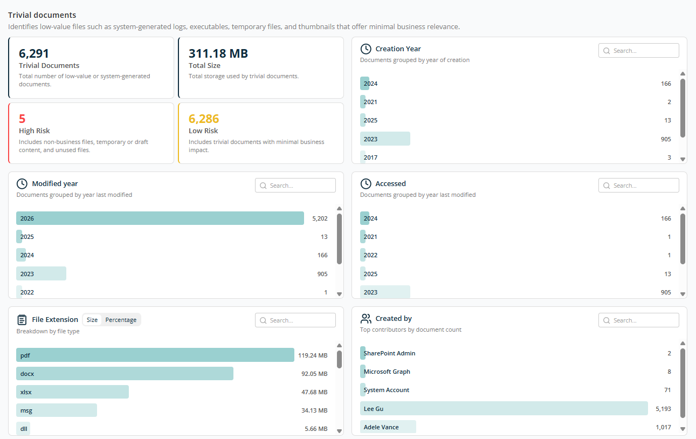
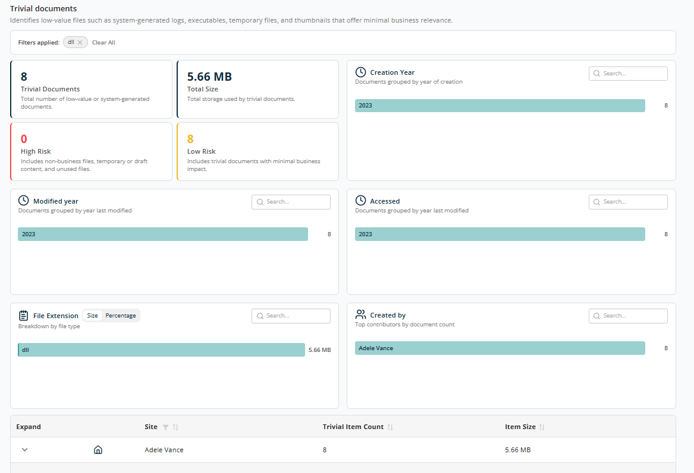
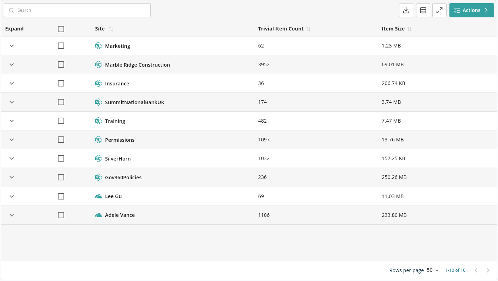
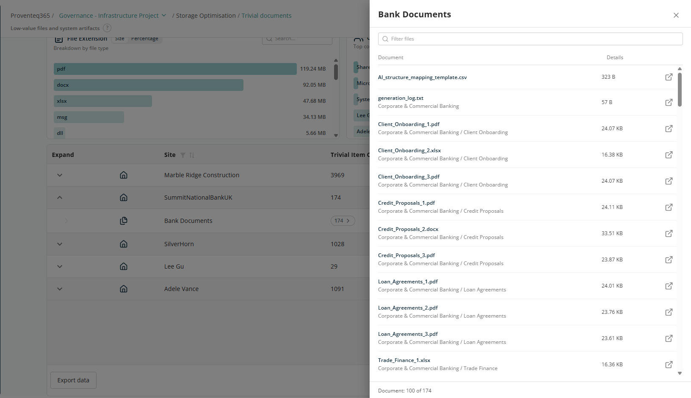

# Trivial Documents Report

The **Trivial documents** report helps you find low-value files that offer little business relevance — system-generated logs, executables, temporary files, drafts and thumbnails. They can usually be removed with little impact, which makes this report a good starting point for storage clean-up. Documents are identified using the trivial detection rules set on the workspace. See [Workspaces — Analysis Configuration](../../02-manage/workspaces/README.md#analysis-configuration).

Open it from **Reports** → **Storage Optimisation** → **Trivial documents**. For the storage overview of all ROT content, see [Storage Optimisation Overview](../storage-optimization/README.md).

## Who Can Use It

- Any user with a role on the workspace (**Workspace User** or higher) can view the report.
- Your license must include the **ROT Report** feature.
- Removing trivial data needs the **Workspace Admin** role (or **Tenant Admin**) and the **Execute Policy** license feature. Without the license feature, the table has no **Actions** button.

## Overview

The cards at the top summarise trivial content:

- **Trivial Documents** — The number of low-value or system-generated documents.
- **Total Size** — The storage used by trivial documents.
- **High Risk** — Trivial documents classed as high risk.
- **Low Risk** — Trivial documents classed as low risk.

Hover over the information icon on a risk card to see how the risk is decided:

- *A trivial document is High Risk when all three signs are present: it is empty or matches a configured low-value prefix or file type, its name matches a temporary or draft file pattern, and it has never been updated after creation.*
- *A trivial document is Low Risk when only one or two trivial signs are present, such as being empty or matching a low-value prefix or file type, matching a temporary or draft name, or never being updated after creation.*

Click **High Risk** or **Low Risk** to filter the whole report, including the table, to that risk level.

## Charts

Each chart has a **Search...** box to find a bar by name.

- **Creation Year** — Trivial documents grouped by the year they were created.
- **Modified year** — Trivial documents grouped by the year they were last modified.
- **Accessed** — Trivial documents grouped by the year they were last modified.
- **File Extension** — Trivial documents by file type, such as LOG, TMP or EXE. Switch between **Size** (the storage used by each file type) and **Percentage** (each file type's share of the trivial documents).
- **Created by** — The people who created the most trivial documents.

## Filter the Report

Click a bar in any chart to filter the whole report — the cards, the other charts and the table — to that value. Click the same bar again to remove the filter. You can combine filters from several charts.

Active filters appear as chips next to **Active filters** at the top of the page. Remove one chip, or click **Clear all** to remove them all.

## Table View

The table lists trivial documents by site or OneDrive, with the following columns:

- **Site** — The SharePoint site or OneDrive. Expand a row with the arrow to see the libraries in it that hold trivial documents.
- **Trivial Item Count** — The number of trivial documents in the site or library.
- **Item Size** — The storage the trivial documents use.

Click a column header to sort by it. Use the checkboxes to select sites or libraries for [removal](#remove-trivial-data).

The toolbar above the table offers:

- **Search** — Find a site or OneDrive by name. Type at least 3 characters. The search term also appears as a chip next to **Active filters**.
- **Export** — Download the report as a CSV file. The file holds the trivial documents that match the filters set with the cards and charts. Large reports can take several minutes to prepare; keep the tab open until the download starts.
- **Toggle density** and **Toggle fullscreen** — Change the row spacing, or show the table on the whole screen.
- **Actions** — Open the bulk actions for removing trivial data, with the number of selected rows.

Choose how many rows to show per page — 50 (the default), 100, 250 or 500 — and page through the results with the arrows at the bottom of the table.

## Trivial Documents in a Library

In an expanded site, click the **Trivial Item Count** of a library to open a side panel listing its trivial documents. Each entry shows the document, its folder path and, under **Details**, its size. Click the **Open in new tab** icon to open a document in SharePoint or OneDrive. Use **Filter files** to find a document by name or folder.

The panel lists 100 documents at a time; click **Load more** to list the next 100. The footer shows how many documents are listed out of the library's total.

## Remove Trivial Data

You can delete trivial documents in bulk from the report. Removal deletes the documents from SharePoint and OneDrive and cannot be undone, so review the report — and export it if the content owners need to check it — before you start.

1. Narrow the report with the cards and charts, so that it shows only the trivial documents you want to remove.
2. To remove only some sites or libraries, tick them in the table. Selecting a site includes all of its libraries.
3. Click **Actions**. The **Bulk actions** panel shows how many items are selected and offers:
   - **Remove all trivial data** — *Delete every trivial document matching the current filters. This cannot be undone.* Available only when no rows are selected.
   - **Remove selected trivial data** — *Delete the trivial documents on the rows you've selected. This cannot be undone.* Available only when rows are selected. The current filters still apply.
4. In the *Are you sure you want to proceed?* dialog, check the message — for example *You're about to remove 2 selected trivial item(s) with 1 filter(s) applied.* — and click **Confirm**.

*Trivial data removal queued* confirms that the removal has started. It runs in the background as a **Remove Trivial** action; follow it on the [Actions](../../02-manage/actions/README.md) page. The report shows the reduced counts after the next data refresh. If the removal can't be started, *Error queueing trivial data removal* appears — check that you have the **Workspace Admin** role and the **Execute Policy** license feature, then try again.

## Before the Report Has Data

The report shows data once the workspace's first data refresh has completed. Until then, and while a refresh is processing the data it collected, a progress card is shown instead. While a later refresh is still collecting data, the report keeps showing the data from the last completed refresh, and a **Data scan in progress** indicator appears at the bottom right of the page. If the latest refresh failed, the report shows the earlier data with the banner *The latest data refresh failed, so the figures shown come from an earlier refresh and may not be accurate.*

If the workspace has no trivial documents, the report shows *No trivial data detected. Your dataset is focused and efficient.* If the report can't be loaded, it shows *We couldn't load this report. Please try again.* with a **Try again** button.

## Related

- [Storage Optimisation Overview](../storage-optimization/README.md)
- [Dashboard — Storage Optimization](../../03-main/dashboard/storage-optimization.md)
- [Actions](../../02-manage/actions/README.md)
- [Duplicate Documents Report](../duplicate-documents-report/README.md)
- [Obsolete Documents Report](../obsolete-documents-report/README.md)
- [How to Find and Clean Up ROT Content](../../13-how-to-guides/11-find-and-clean-up-rot-content.md)
