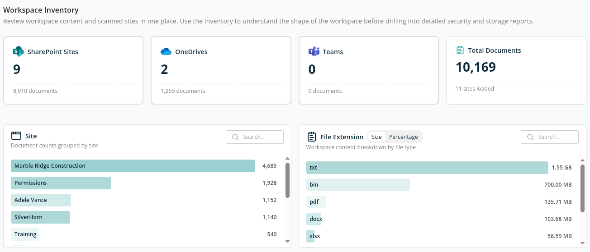

# Workspace Inventory

The **Workspace Inventory** screen provides a consolidated view of workspace content and scanned data. It helps you understand the overall structure, size, and risk posture of the workspace before reviewing detailed security or storage reports.

## Overview Cards

At the top of the screen, summary cards provide a snapshot of scanned content:

- **SharePoint Sites** — Number of SharePoint sites included in the workspace along with document counts.
- **OneDrives** — Number of OneDrive accounts analysed along with document counts.
- **Teams** — Number of Microsoft Teams included along with document counts.
- **Total Documents** — Total number of documents scanned across the workspace, along with the number of sites from which data was loaded.

These metrics reflect the current scan results for the workspace.

## Content Distribution

### Sites

Shows the number of documents grouped by site. Helps you identify where content is concentrated across the workspace.

### File Extension

Displays document distribution by file type, helping you understand which formats consume the most storage or are most prevalent. You can toggle between:

- **Size** — Storage consumed by each file type.
- **Percentage** — Storage consumed by each file type, as a percentage.

Both sections include a search box to filter data as needed. Filtering happens live as you type.

## Risk Summary

The risk cards provide a quick assessment of document risk levels:

- **High Risk** — Documents with significant governance or security concerns.
- **Medium Risk** — Documents requiring attention.
- **Lower Risk** — Documents with minimal risk.

These indicators help prioritise further review.

## Storage Insights

The storage insight cards highlight optimisation opportunities:

- **Duplicate documents** — Documents with identical content.
- **Obsolete documents** — Documents that may no longer be required, identified based on the analysis configuration criteria.
- **Trivial documents** — Low-value or insignificant documents, identified based on the analysis configuration criteria.

All these cards are interactive — click any card to drill down into the detailed report.

## Site-Level Table

Below the summary cards, a table lists every site and OneDrive in the workspace scan. It is shown for Microsoft 365 Governance workspaces when your license includes the **Archive M365** feature. Each row provides:

- **Name** — The site or OneDrive. The name links to the site.
- **Folders** — Number of folders within the site.
- **Documents** — Number of documents within the site.
- **Last Active** — The site's most recent activity.
- **Sensitivity Label** — The sensitivity label applied to the site, if any. If none is applied, the column shows **None**.
- **Owner Status** — For OneDrives only: **Active**, **Disabled**, **Unlicensed** or **Deleted**.
- **Size** — For a OneDrive, the storage it is using, including file versions and the recycle bin. For any other site, the combined size of the documents discovered in it.
- **Archive status** — **Not archived**, **Archiving**, **Archived** or **Failed**.

Click the **SharePoint Sites**, **OneDrives** or **Teams** card to show only that kind of site in the table.

Hover over the icon next to a site's name to see its type, for example **Communication Site**, **Team Site (No Teams)** or **Teams Channel Site**. The cards group the site types like this:

- **SharePoint Sites** — communication sites, team sites without a Microsoft 365 group, and **Team Site (No Teams)** sites: team sites whose Microsoft 365 group has no team in Microsoft Teams.
- **Teams** — team sites connected to a team in Microsoft Teams, and **Teams Channel Site** sites: the separate sites that private and shared channels use.

Workspace Admins can tick rows and click **Actions** to **Archive** or **Restore** the selected sites, and use **Restore all** above the table to restore everything archived in the workspace. Archive is offered when archiving is set up for your organisation — to Microsoft 365 Archive or to a Wasabi or Azure Blob Storage connection. Archiving and restoring need the **Workspace Admin** role (or **Tenant Admin**). Archiving needs the **Archive M365** license feature for either destination; restore also needs **Archive Items**. See [Microsoft 365 Archive](../../10-archive/02-microsoft-365-archive.md) and [Restore Archived Content](../../10-archive/03-restore-archived-content.md).

**Note:** To archive to Microsoft 365 Archive, it must be enabled in your Microsoft 365 tenant, with billing set up. For more information, see [Overview of Microsoft 365 Archive](https://learn.microsoft.com/en-us/microsoft-365/archive/archive-overview).

Clicking a site or OneDrive that has folders or documents opens a side panel with its libraries, folders and files. From the panel, Workspace Admins can archive the whole site (**Archive site**), archive selected libraries, folders or files (**Archive selected**), or restore archived content (**Restore selected**, **Restore site**).

