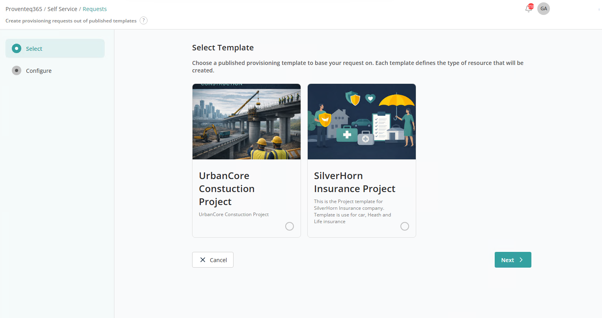
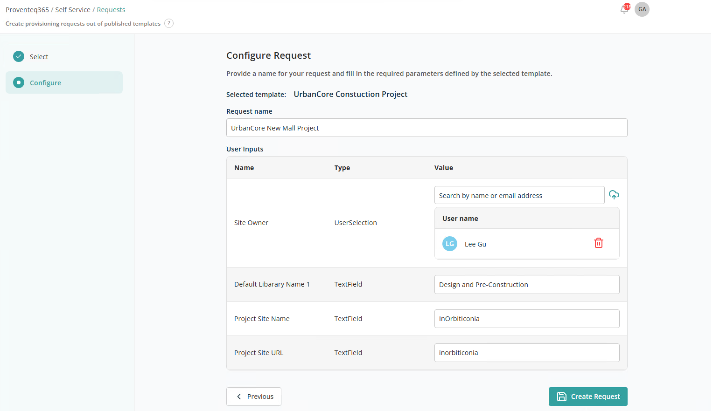

# New Request

The **New Request** screen creates a self-service provisioning request from a published template. The template decides what is created in Microsoft 365 — sites, teams, libraries, folders, channels or user accounts — and which values you need to provide.

Any signed-in user can raise a request, as long as your license includes both the **Provision** and the **Approvals** features — **Approvals** is needed to submit requests even when a template does not require approval. You see the published templates that are available to you: when a template has **Limit Template Access** turned on, only its requestors can see it. See [Templates](../templates/README.md#template-access--approvals).

Open **Self Service** → **New Request**. The screen has two steps, shown in the menu on the left: **Select** and **Configure**. Use **Next** and **Previous** to move between them, or **Cancel** on the first step to leave.

## Select Template

Choose a published provisioning template to base your request on. Each template card shows the template's image, name and description. Select a card and click **Next**.

If no template is available to you, the screen says *No published templates found*.

## Configure Request

The **Configure Request** step shows the selected template at the top.

- **Request name** — required. A name that helps you find and track the request (*Name is required* if it is empty).
- **User Inputs** — one row for each user input the template uses, with its **Name**, **Type** and **Value**.

How you enter the **Value** depends on the input's type:

- **Text Field** — type the value. A default value set in the template may be filled in already.
- **Teams Site Selection** — type at least three characters to search for a team and pick it. Its existing channels are listed below.
- **SharePoint Site Selection** — type at least three characters to search for a site and pick it.
- **Hub Site Selection** — type at least three characters to search for a hub site and pick it.
- **User Selection** — search for people by name or email and add them, or click **Upload CSV** to add several at once from a CSV file with one email address per line. You can add more than one person.
- **Generate Password** — click **Generate** to create a password.

Text, team, site and user values are required; an empty one shows *Value required for this user input*. If the template uses no user inputs, the table says *No user inputs found*.

Click **Create Request**. Before the request is created, Proventeq365 checks it against your tenant. If something is wrong, the request is not created and a **Request validation issues** panel lists the problems — for example *A SharePoint site with the name '…' already exists. Please choose a different site name.*, or a content type in the template that is no longer available. Change the values you entered, or ask the template owner to fix the template, and try again. See [Error Messages: Self-Service Provisioning](../../15-error-catalog/05-self-service-provisioning.md#raising-a-request).

When the request is created, you are taken to [Request History](../request-history/README.md), where you can follow its status.

**Note:** If the template has **Require Approval Before Provisioning** turned on, the request waits as **Awaiting approval** until one of the template's approvers decides it in [Approvals](../approvals/README.md). Otherwise provisioning starts straight away.

Tenant Admins can also open this screen as a test run of a draft template. It then shows a notice that the run provisions for real, and the button reads **Start Test Run**. See [Template Versions](../templates/template-versions.md#test-a-draft-before-publishing).

## Related

- [How to Request a New Site, Team or User](../../13-how-to-guides/13-request-a-site-team-or-user.md)
- [Request History](../request-history/README.md)
- [Approvals](../approvals/README.md)
- [Templates](../templates/README.md)
- [Error Messages: Self-Service Provisioning](../../15-error-catalog/05-self-service-provisioning.md)
