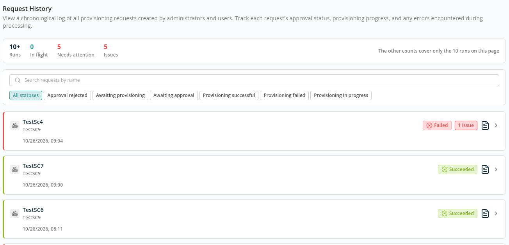
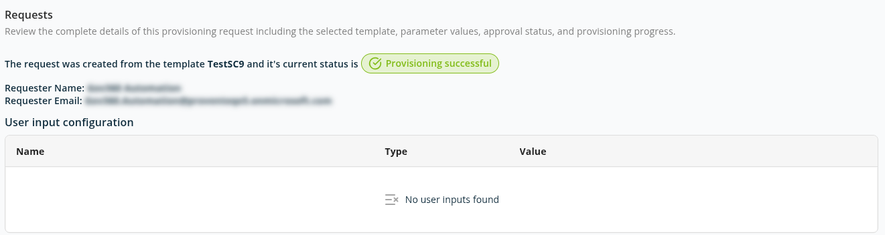
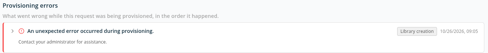

# Request History

The **Request History** screen lists the provisioning requests you have submitted, newest first, with their approval and provisioning progress. Use it to see whether a request is still waiting for approval, follow it while it is provisioned, open the site it created, or find out why it failed.

Request History is available to anyone whose organisation's license includes both the **Provision** and the **Approvals** features. Open it from **Self Service** → **Request History**. You are taken here automatically after you submit a request. Test runs of draft templates started by a Tenant Admin are listed here too.

## List View

The bar at the top counts your requests: **Runs**, **In flight** (waiting or being provisioned), **Needs attention** (failed or rejected) and **Issues**.

Use **Search requests by name** to find a request, and the status filters to show only requests with particular statuses. Choose **All statuses** to clear the filters.

Each request is a card showing the request name, the template it was created from, its status and when it was created. Cards have two actions:

- **View full request** — Opens the request's full details page.
- **Delete** — Removes the request. Available only while the request is **Awaiting approval** or **Approval rejected**. If the request was approved in the meantime, you see *Failed to remove request. It may have been approved already.*

## Request Statuses

- **Awaiting approval** — The template requires approval, and no approver has decided yet.
- **Approval rejected** — An approver rejected the request. Nothing was created.
- **Awaiting provisioning** — The request was approved, or its template does not require approval, and it is waiting to be provisioned.
- **Provisioning in progress** — Proventeq365 is creating the site, team, folders, libraries or user.
- **Provisioning successful** — Everything was created.
- **Provisioning failed** — Provisioning stopped with an error. See [Provisioning errors](#provisioning-errors).

## Request Details

Click a request card to open its details panel:

- **Overview** — The stages **Submitted**, **Approval** (only when the template requires approval), **Provisioning** and **Site ready**, together with the **Request ID**, who requested it, the **Template**, the **Provisioned site** once it exists and, after an approval, the **Approval wait**.
- **Issues** — The provisioning errors of a failed request, or the approver's rejection of a rejected request.

## Full Request Page

**View full request** opens a page with the template used and the request's current status.

- **Requester Name** and **Requester Email** — Who submitted the request.
- **User input configuration** — Each user input defined by the template, with its **Name**, **Type** and the **Value** entered when the request was created.

Approvers approve or reject requests from the **Approvals** screen. See [Approvals](../approvals/README.md).

### Provisioning Errors

When a request has failed, the page shows a **Provisioning errors** panel: *What went wrong while this request was being provisioned, in the order it happened.* Each error shows:

- The step that failed, for example **SharePoint site creation**, **Teams channel creation**, **Folder structure**, **Library creation**, **PnP template application**, **User creation** or **User termination**.
- What went wrong and what to do about it, for example *The SharePoint site could not be created because the URL already exists.* with *Choose a different URL for the site, or ask your administrator to remove the existing site.*
- **show technical details** — The **Error code** and the **Technical message** recorded by Microsoft 365. Include them when you contact your administrator or Proventeq support.

If a site was created before the failure, Proventeq365 removes it again; a failure of that clean-up is listed as **SharePoint site cleanup**. To try again, fix the cause and submit a new request.

## Related

- [New Request](../new-request/README.md)
- [Approvals](../approvals/README.md)
- [Error Messages: Self-Service Provisioning](../../15-error-catalog/05-self-service-provisioning.md)
