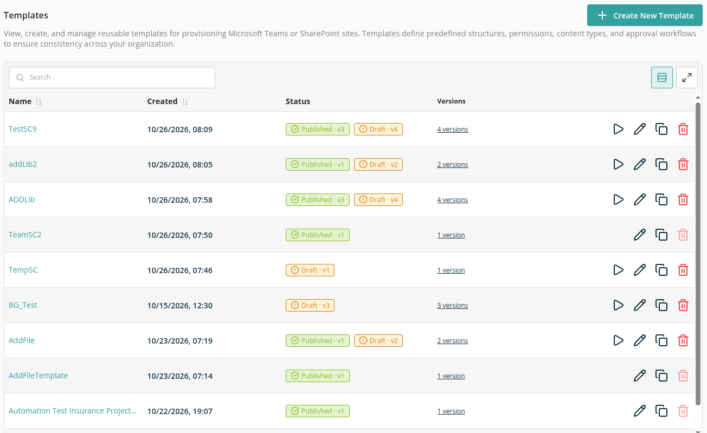
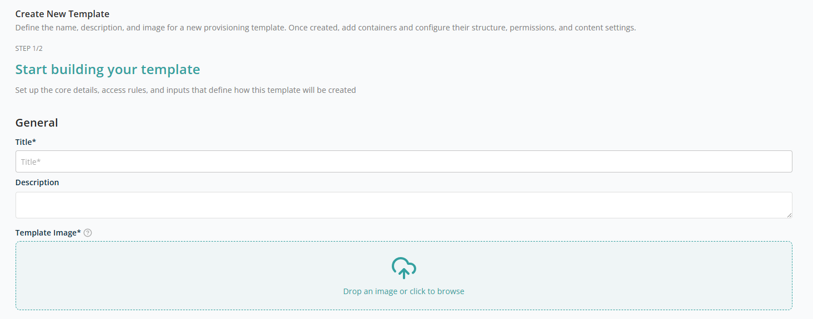
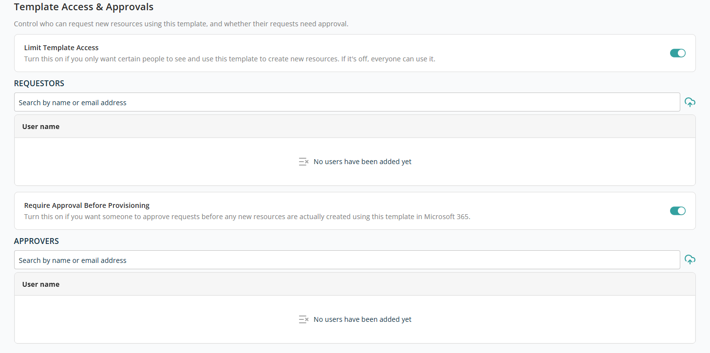
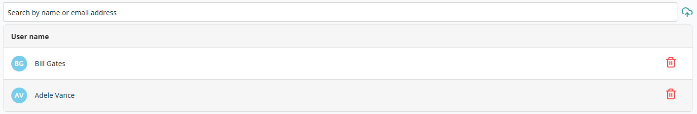
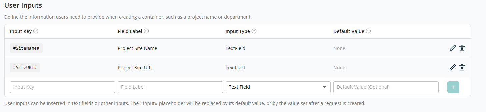
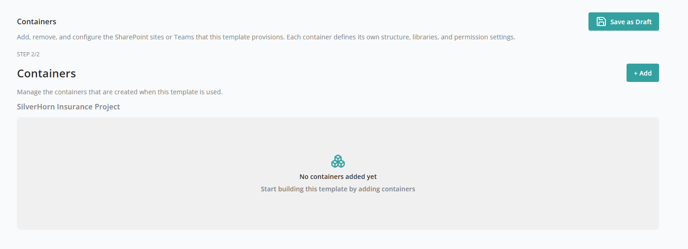
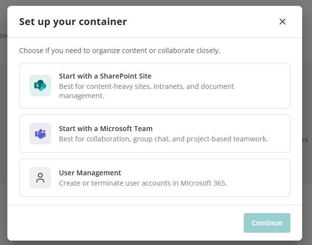

# Templates

The **Templates** screen allows administrators to create, view, and manage reusable provisioning templates for **Microsoft Teams** and **SharePoint**. Templates define standardised configurations and approval workflows to ensure consistency, governance, and control across self-service requests.

Managing templates needs the **Tenant Admin** role, and your license must include the **Provision** feature. Templates are versioned: users request from the published version while you prepare and test changes in a draft. See [Template Versions](./template-versions.md).

When you click on **Templates** in the menu, the following screen appears:

## Templates List

The main section of the page displays a list of all configured templates, one row per template. Each row includes:

- **Name** — The template name, typically reflecting the business or project context (for example, *Insurance Project* or *Construction Project*). Click it to open the template.
- **Created** — The date and time the template was created.
- **Status** — The status and number of the template's current version, for example **Published · v2**. When a draft is open, a second label shows the draft, for example **Draft · v3**. The statuses are:
  - **Draft** — Under configuration; not available for use in self-service requests. Only a draft can be edited.
  - **Published** — Finalised and available to users when raising new requests.
  - **Unpublished** — Not available for new requests: the version was taken out of use with **Unpublish**, or replaced when a newer version was published.
- **Versions** — How many versions the template has. Click it to open the template's **Version history**.
- **Actions** — Icons to manage each template:
  - **Test run the draft before publishing** — Shown only while the template has a draft. Opens a real test request for the draft. See [Template Versions](./template-versions.md#test-a-draft-before-publishing).
  - **Edit — creates a new draft version** — Starts a new draft from the current version. When a draft is already open, the icon reads **Continue editing the draft** and opens it.
  - **Copy to a new template** — Creates a separate template, as a draft, from the current version.
  - **Delete** — Deletes the template's draft, or the whole template when the draft is its only version. Available only while the template has a draft; published and older versions cannot be deleted.

To find a template, type in the **Search** box above the list. It matches template names, ignoring upper and lower case, across all templates — not only the current page. Type at least three characters; until then the box says *Type at least 3 characters to search*. Clear the box to show every template again.

Click the **Name** or **Created** column header to sort the whole list by that column; click again to reverse the order. The other columns cannot be sorted. Searching or sorting returns you to the first page.

At the bottom right of the list:

- **Rows Per Page** — 5, 10, 15, 20, 25, 30, 50, or 100. Default: 10.
- **Total Record Count** — Range and total record count.
- **Next/Previous Navigation** — Arrow icons to navigate.

## Create Template

The **Create New Template** button at the top right of the screen, above the list, opens the create template flow. This is the first step in creating a new **provisioning template** for Microsoft Teams or SharePoint. It allows you to define the core details, access controls, approval requirements, and user inputs.

### General Details

- **Title** — A clear, descriptive name for the template. This name is visible to users when they create a new request. Use a business-friendly name that reflects the purpose of the template. *Example: Project Workspace – Construction.* Required.
- **Description** — A brief description explaining what the template is used for. Optional.
- **Template Image** — Use the file import control to upload or select an image (PNG, JPEG, WebP, BMP, AVIF or SVG, up to 5 MB) for the template. The uploaded image displays here, with a Delete icon on hover to remove or replace it. Required.

### Template Access & Approvals

This section controls **who can use the template** and **whether approval is required** before provisioning.

- **Limit Template Access** — Controls who can see and use the template:
  - **Enabled** — Only the people you add under **Requestors** can see and use this template. If no requestors are chosen, the template is available to everyone.
  - **Disabled** — Everyone can use the template.
- **Require Approval Before Provisioning** — Controls whether a request must be approved before anything is created in Microsoft 365:
  - **Enabled** — Requests wait for a decision from one of the people you add under **Approvers**. The first approver to respond decides: approval starts provisioning, rejection ends the request with the status **Approval rejected**.
  - **Disabled** — Requests are provisioned without approval.

When a toggle is ON, its **Requestors** or **Approvers** list appears:

- **Search** — A text box to search users within the tenant. As you type, results are suggested. Click a result to add the user to the list (with Name and a Delete icon).
- **Upload CSV** — Add several people at once from a CSV file with one email address per line.

When you try to add an already-selected user, the search box result shows the text **"Already added"**.

### User Inputs

The **User Inputs** section lets users specify the information required when creating a request with this template. These inputs enhance the template's reusability, allowing a single template to accommodate multiple provisioning requests.

The following fields are available to add a new user input:

- **Input Key** — Text box for the new user input. Use letters and numbers only — no spaces or special characters. After adding, the value is enclosed with `#…#` to indicate it is a parameter, e.g. `#SiteName#`.
- **Field Label** — Text box for a simplified name to make the input easy to recognise.
- **Input Type** — Dropdown to select the input type: **Text Field**, **Teams Site Selection**, **SharePoint Site Selection**, **Hub Site Selection**, **User Selection** or **Generate Password**.
- **Default Value** — Text box for the default value. This is only editable for **Text Field** input types; for other types it is read-only.
- **Add button** — Saves the user input after all required fields are populated.

After adding a user input, the list has the following actions to manage each entry:

- **Edit** — Opens the input for editing; values auto-populate in the bottom controls. The key cannot be changed. After editing, click **Save changes**.
- **Delete** — Removes the user input.

After adding all required details, click **Continue** to be redirected to the screen where you add containers to the template.

## Containers

The **Containers** screen allows you to define and manage the **SharePoint sites or Microsoft Teams** that will be created when this template is used.

At the top of the screen, the template name (for example, *SilverHorn Insurance Project*) is displayed. All containers added here belong to this template and will be created together when the template is used.

If no containers have been added, the screen displays an empty state message **"No Containers Added Yet"**, prompting you to start building the template by adding containers.

To add a new container, click **+ Add**. This opens the **Set up your container** screen, where you choose the type of resource that will be created as part of this template. A container represents the primary Microsoft 365 object that users will work with — a SharePoint site, Microsoft Team, or User Management action.

From the main category, click **Continue** to open the subcategory for the container. The following container types are supported:

| Container | Subcategories |
| --- | --- |
| Start with a SharePoint Site | [Create a New Site](./containers/create-new-site.md), [Replicate an Existing Site](./containers/replicate-existing-site.md), [Create from a Template File](./containers/create-from-template-file.md), [Add Folders to an Existing SharePoint Library](./containers/add-folders-to-library.md), [Add Library to an Existing SharePoint Site](./containers/add-library-to-site.md) |
| Start with a Microsoft Team | [Create a New Team](./containers/create-new-team.md), [Add Channels to an Existing Team](./containers/add-channels-to-team.md) |
| User Management | [Create User](./containers/create-user.md), [Terminate User](./containers/terminate-user.md) |

## Container Reference

- [Create a New Site](./containers/create-new-site.md)
- [Replicate an Existing Site](./containers/replicate-existing-site.md)
- [Create from a Template File](./containers/create-from-template-file.md)
- [Add Folders to an Existing SharePoint Library](./containers/add-folders-to-library.md)
- [Add Library to an Existing SharePoint Site](./containers/add-library-to-site.md)
- [Create a New Team](./containers/create-new-team.md)
- [Add Channels to an Existing Team](./containers/add-channels-to-team.md)
- [Create User](./containers/create-user.md)
- [Terminate User](./containers/terminate-user.md)

## Related

- [Template Versions](./template-versions.md)
- [How to Create a Provisioning Template](../../13-how-to-guides/12-create-a-provisioning-template.md)
- [How to Update a Published Template](../../13-how-to-guides/27-update-a-published-template.md)
