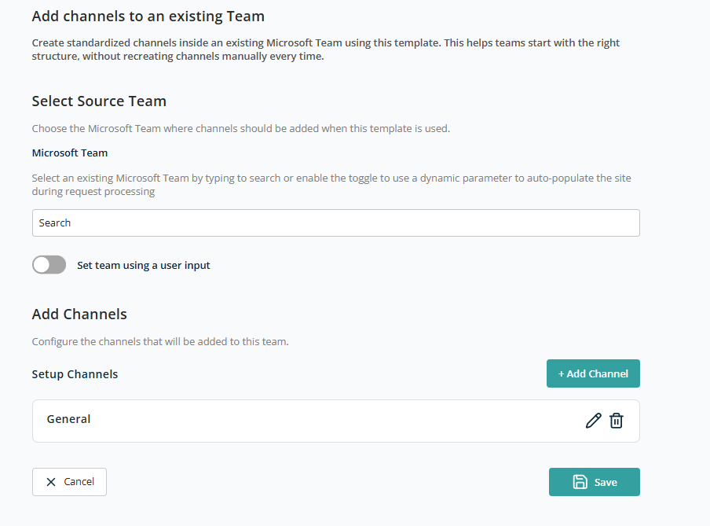
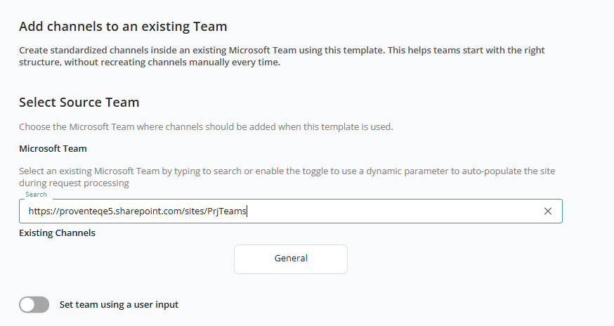
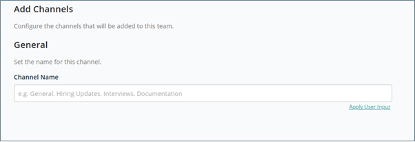
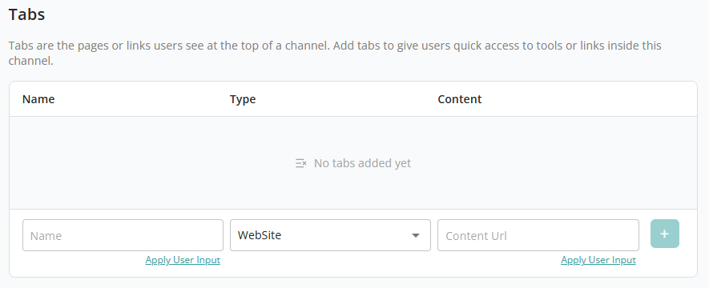

# Container — Add Channels to an Existing Team

This container adds standard channels — with tabs and folder structures — to a Microsoft Team that already exists, so teams start with the right structure without recreating channels by hand. To add it, open a template's **Containers** screen, click **+ Add**, choose **Start with a Microsoft Team** and then **Add Channels to existing Team**.

Configuring containers needs the **Tenant Admin** role, and your license must include the **Provision** feature. You can change containers only in a **Draft** version of a template; a container of a published or older version opens read-only. See [Template Versions](../template-versions.md#version-history).

The container has one step, **Setup Channels**, titled **Add channels to an existing Team**.

## Select Source Team

Choose the team the channels are added to:

- **Microsoft Team** — required. Type to search for an existing team and pick it from the results. When a team is selected, its existing channels are listed below the search box.
- **Set team using a user input** — turn on to let the requester choose the team. The field becomes an **Apply User Input** button that takes one input of type **Teams Site Selection** or **SharePoint Site Selection**; choosing another input replaces it, and **×** clears it. See [Using User Inputs](./create-new-site.md#using-user-inputs).

## Add Channels

The channels list shows the channels to create. A **General** channel entry is included by default. Each channel shows its number of tabs and folders, with an edit icon to change it and a delete icon to remove it. Channel names must be unique and not empty (*Channel names must be unique and non-empty*).

Click **+ Add Channel** to open the **Create Channel** screen.

### General

- **Channel Name** — required. Use **Apply User Input** to let the requester supply the name.

### Tabs

Tabs are the pages or links users see at the top of a channel. Enter the tab's **Name**, choose its **Type** and, where needed, a **Content Url**, then click **+**.

| Tab type | Content Url needed? |
| --- | --- |
| WebSite | Yes |
| DocumentLibrary | Yes |
| Wiki | No |
| Planner | No |
| MicrosoftStream | No |
| MicrosoftForms | No |
| Word | Yes |
| Excel | Yes |
| PowerPoint | No |
| PDF | Yes |
| OneNote | No |
| PowerBI | No |
| SharePointPageOrList | No |
| Custom | No |

Tab names and content URLs must be unique within a channel. Both can use user inputs.

### Files & Storage

Defines the folder structure where the channel's files are stored, and how permissions and labels apply to it.

`/` is the root of the channel's folder. Each folder has these controls; see [Folders](./create-new-site.md#folders) for details:

- **Inherited** / **Custom Permissions** — whether the folder uses its parent's permissions or its own.
- **Break Inheritance** — gives the folder its own permissions; **Reset Inheritance** goes back.

  

  

- **Apply retention label** — sets a retention label on the folder.

  

- **Import a file (max 100MB)** — uploads a file to the folder. Only the file types listed under the folder are accepted.

  

- **Add a new folder** — creates a sub-folder. The name can be fixed or use a user input.

  

Click **Create Channel** to add the channel to the container, or **Save Channel** when editing an existing one. When all channels are configured, click **Save** to add the container to the template.

## Related

- [Templates](../README.md)
- [Container — Create a New Team](./create-new-team.md)
- [Template Versions](../template-versions.md)
- [How to Create a Provisioning Template](../../../13-how-to-guides/12-create-a-provisioning-template.md)
