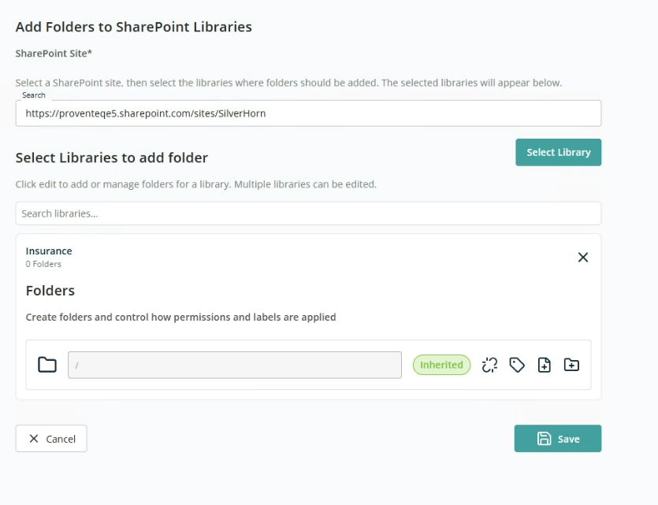

# Container — Add Folders to an Existing SharePoint Library

This container adds folder structures to one or more libraries of an existing SharePoint site, and controls how permissions and labels apply to those folders. To add it, open a template's **Containers** screen, click **+ Add**, choose **Start with a SharePoint Site** and then **Add folders to existing SharePoint library**.

Configuring containers needs the **Tenant Admin** role, and your license must include the **Provision** feature. You can change containers only in a **Draft** version of a template; a container of a published or older version opens read-only. See [Template Versions](../template-versions.md#version-history).

## Select the Site and Libraries

1. Under **SharePoint Site**, type at least three characters to search for the site and pick it from the results. Until a site is selected, the screen says *Select a site to add folders.*
2. Click **Select Library**. A dialog lists the site's existing libraries. Search with **Search libraries…**, tick the libraries you want (or click **Select All**; **Reset** clears the selection) and click **Apply**.

The selected libraries are listed below. The site in this container is fixed in the template; it cannot be set with a user input.

## Setup Folders

Each selected library has its own folder structure. Click **Edit** on a library to open its **Folders** section and build the folders for that library; click **Close** to collapse it. You can set up several libraries in the same container.

The folder controls are the same as in the [Create New Site](./create-new-site.md#folders) container: **Break Inheritance** / **Reset Inheritance**, **Apply retention label**, **Import a file (max 100MB)** and **Add a new folder**. Folder names can use user inputs.

Click **Save** to add the container to the template.

## Folders That Already Exist

The folders in this container must not already exist in the target library. If a folder with the same name is already there when the request is provisioned, the request ends with **Provisioning failed** and the error *A folder with that name already exists in the target location.* Rename the folder in the template — or use a user input for its name — or remove the existing folder, then submit a new request. See [Error Messages: Self-Service Provisioning](../../../15-error-catalog/05-self-service-provisioning.md#provisioning-errors).

## Related

- [Templates](../README.md)
- [Container — Create New Site](./create-new-site.md)
- [Container — Add Library to an Existing SharePoint Site](./add-library-to-site.md)
- [Request History](../../request-history/README.md)
