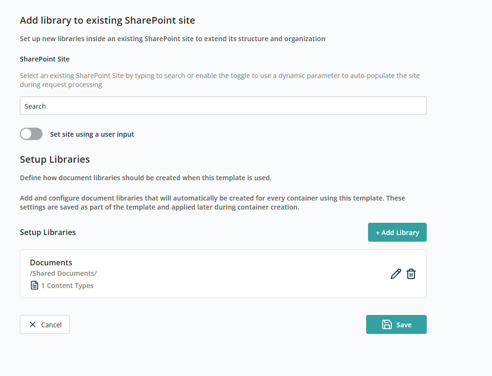

# Container — Add Library to an Existing SharePoint Site

This container adds one or more new document libraries to a SharePoint site that already exists. It extends the site's structure without creating a new site or changing existing content. To add it, open a template's **Containers** screen, click **+ Add**, choose **Start with a SharePoint Site** and then **Add library to existing SharePoint site**.

Configuring containers needs the **Tenant Admin** role, and your license must include the **Provision** feature. You can change containers only in a **Draft** version of a template; a container of a published or older version opens read-only. See [Template Versions](../template-versions.md#version-history).

## Select SharePoint Site

Choose the site where the libraries are added:

- **SharePoint Site** — required. Type at least three characters to search for an existing site and pick it from the results.
- **Set site using a user input** — turn on to let the requester choose the site. The field becomes an **Apply User Input** button that takes one input of type **SharePoint Site Selection** or **Teams Site Selection**. See [Using User Inputs](./create-new-site.md#using-user-inputs).

## Setup Libraries

Add and configure the libraries to create. A **Documents** library (path `/Shared Documents/`) is listed by default; edit it or add more with **Add Library**. Each library needs a name, and library names must be unique within the container.

Each library has the same sections as in the [Create New Site](./create-new-site.md#setup-libraries) container — **General**, **Content Types**, **Folders** and **Advanced Settings** — with two differences:

- **Enable Content Moderation** is off by default.
- Content types based on **Document Set** can be selected here, because the container has no **Features & Metadata** step. The target site must already have the **Document Sets** feature turned on: Proventeq365 checks the site's features when the request is provisioned, and the request fails if the feature is missing.

Click **Save** to add the container to the template. On a container you have just added, **Cancel** asks *Discard container?* before removing it.

## Related

- [Templates](../README.md)
- [Container — Create New Site](./create-new-site.md)
- [Container — Add Folders to an Existing SharePoint Library](./add-folders-to-library.md)
- [Template Versions](../template-versions.md)
