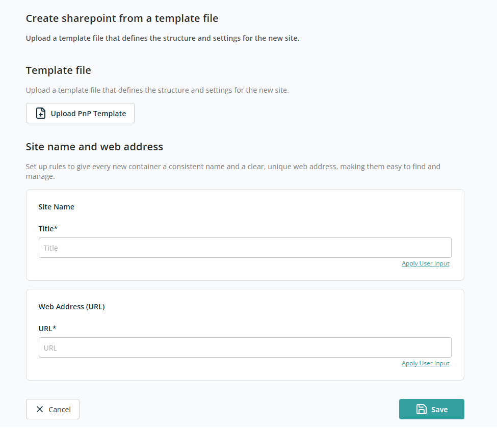

# Container — Create from a Template File

This container creates a new SharePoint site from a **PnP provisioning template** — an XML file that defines the site's structure, settings and configuration. To add it, open a template's **Containers** screen, click **+ Add**, choose **Start with a SharePoint Site** and then **Create from a template file**.

Configuring containers needs the **Tenant Admin** role, and your license must include the **Provision** feature. You can change containers only in a **Draft** version of a template; a container of a published or older version opens read-only. See [Template Versions](../template-versions.md#version-history).

## Template File

Click **Upload PnP Template** and choose the template file. Only `.xml` files are accepted (*Accepted file types: .xml*); any other file is refused with *The selected file type (…) is not supported. Supported file formats are .xml.* The file can be up to 100 MB.

Once uploaded, the file name is shown with a delete icon; delete the file to upload a different one. A template file is required: without it you see *You need to upload a template file*.

The template is applied as written, with all the content it contains.

## Site Name and Web Address

- **Title** — required. The display name of the new site.
- **URL** — required. The part of the address after `/sites/`.

Both can use **Apply User Input** with **Text Field** inputs, so the requester supplies them. See [Using User Inputs](./create-new-site.md#using-user-inputs).

The new site's name and URL must not already be used in your tenant. They are checked when you save the container (if they are fixed) or when a request is created (if they use user inputs). See [Name and URL Checks](./create-new-site.md#name-and-url-checks).

Click **Save** to add the container to the template.

## Related

- [Templates](../README.md)
- [Container — Replicate an Existing Site](./replicate-existing-site.md)
- [Container — Create New Site](./create-new-site.md)
- [Template Versions](../template-versions.md)
