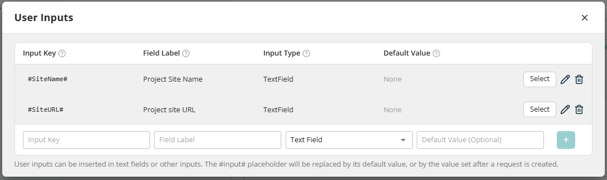
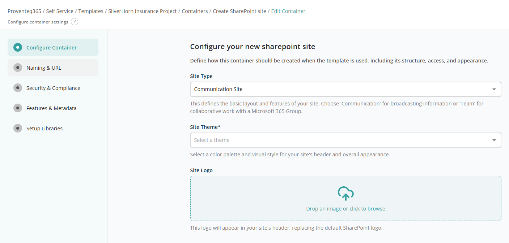
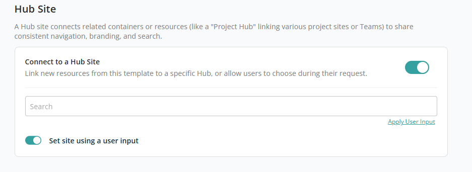
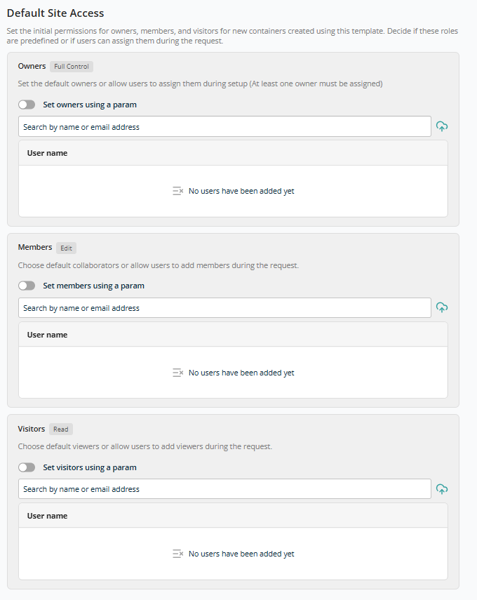
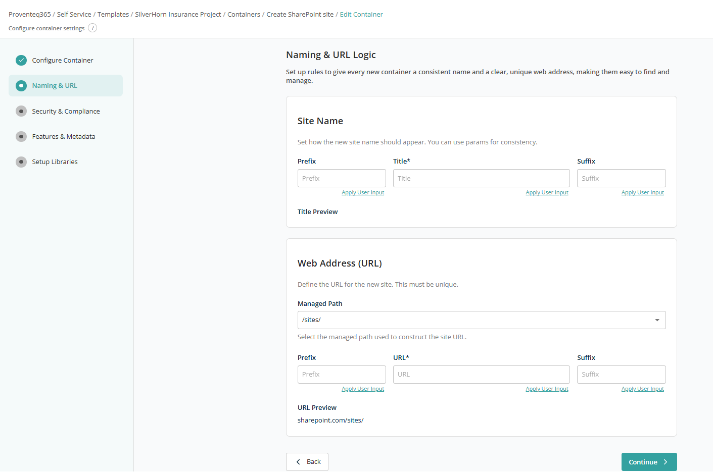
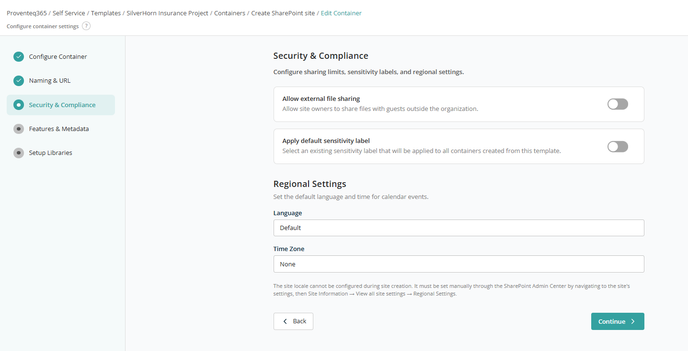
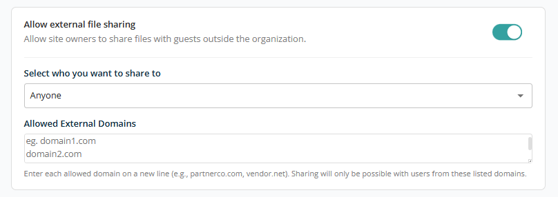
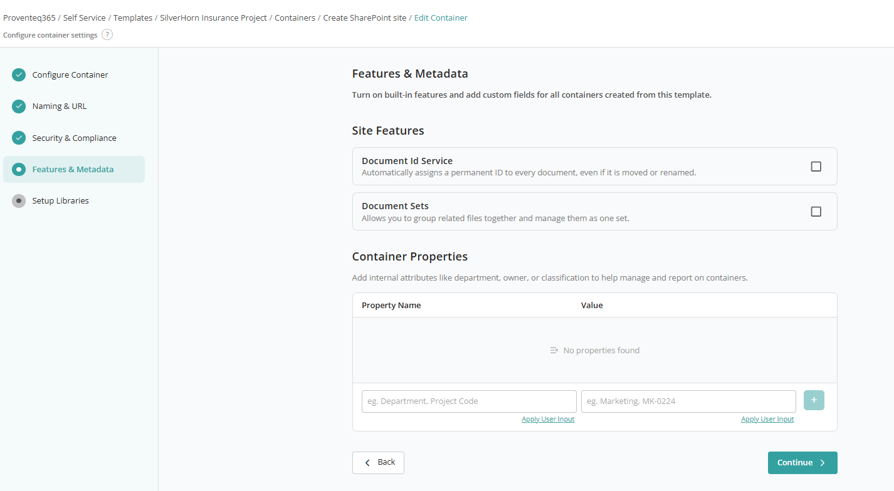
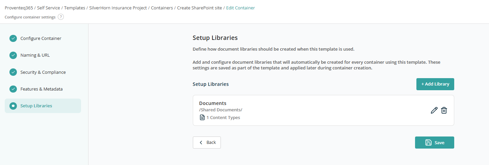
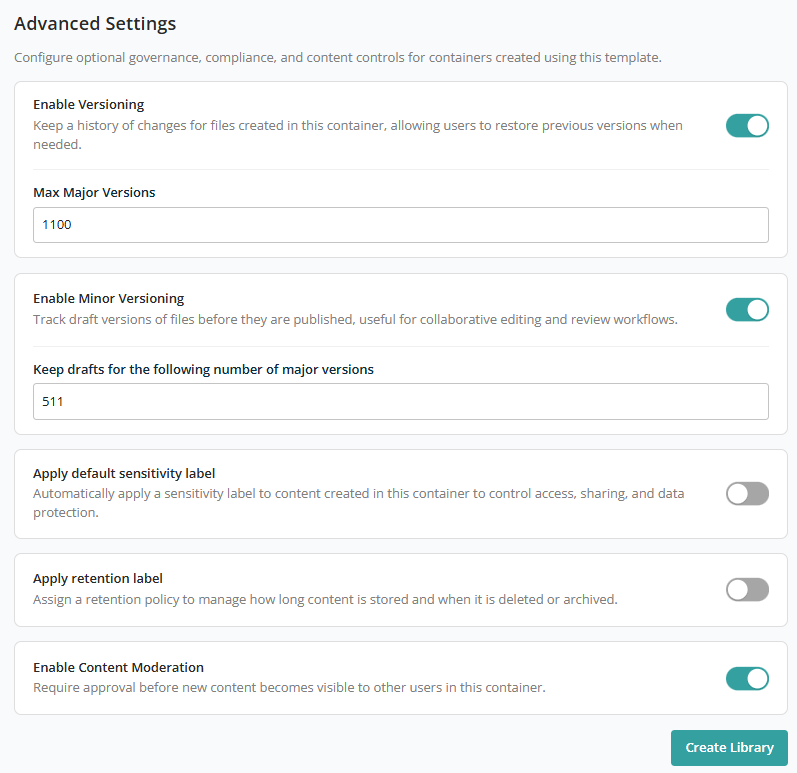

# Container — Create New Site

This container creates a brand-new SharePoint site with predefined settings, library structure, access and appearance. To add it, open a template's **Containers** screen, click **+ Add**, choose **Start with a SharePoint Site** and then **Create a new site**.

Configuring containers needs the **Tenant Admin** role, and your license must include the **Provision** feature. You can change containers only in a **Draft** version of a template. When you open a container of a published or older version, it is read-only and a notice offers **Edit in a draft** (or **Continue the open draft**). See [Template Versions](../template-versions.md#version-history).

The container opens with a menu of steps on the left: **Configure Container**, **Naming & URL**, **Security & Compliance**, **Features & Metadata** and **Setup Libraries**. Click **Continue** to check the current step and move to the next one. Each step in the menu is marked as complete or as having errors, and you can click a step to go back to it. **Save** appears on the last step: it checks every step, and if something is missing it opens the first step with an error and shows *Some required fields are missing. Please review the highlighted steps.*

On the first step of a container you have just added, the back button reads **Cancel**. Clicking it asks *Discard container?* — choose **Discard** to remove the unsaved container, or **Keep editing**.

## Using User Inputs

Most fields can take a value from a [user input](../README.md#user-inputs) instead of a fixed value, so the person raising a request supplies it. There are two kinds of field:

- **Text fields** (site title and URL parts, library names, folder names, property values and so on) have an **Apply User Input** link. The input you choose is added to the end of the field as its `#Key#` tag, so you can combine fixed text with inputs, for example `Project-#ProjectCode#`. These fields take **Text Field** inputs; the **Password** field of the [Create User](./create-user.md) container also takes **Generate Password** inputs.
- **Selection fields** with a *Set … using a user input* toggle (the hub site, owners, members and visitors) take exactly one input. When the toggle is on, the field becomes a single **Apply User Input** button: choosing an input replaces any earlier one, and **×** clears it. You cannot type into the field. Only inputs of the matching type are offered — for example **User Selection** for owners.

**Apply User Input** opens the **User Inputs** dialog:

- The list shows the template's user inputs of the types this field accepts. Click **Select** on a row to insert it into the field.
- To create an input and insert it in one go, fill in **Input Key**, **Field Label**, **Input Type** and, for a **Text Field** input, **Default Value (Optional)**, then click **Add & insert**. The input is saved to the template straight away. When the template has no matching inputs yet, the dialog says *No user inputs yet — create one below and it will be inserted straight into the field.*
- The **Input Key** can contain only letters and numbers. Otherwise you see *Input key can only contain letters and numbers — no spaces or special characters*.
- Use the edit icon to change an input's label, type or default value, then click **Save changes**. The key itself cannot be changed, because template fields already refer to it. Use the delete icon to remove an input from the template.

If a field refers to an input that no longer exists, or to an input of the wrong type, it shows *Invalid User Input*.

## Configure Container

The first step, titled **Configure your new sharepoint site**, sets the site's type, appearance, hub site and default access.

### Site Type and Branding

- **Site Type** — the kind of SharePoint site to create: **Communication Site**, **Team Site (With Microsoft365 Group)** (the default) or **Team Site (Without Microsoft365 Group)**. Choose a communication site for broadcasting information, and a team site for collaborative work.
- **Site Theme** — the colour palette and visual style of the site. Required: without it you see *Please select a theme*.
- **Site Logo** — optional. The logo replaces the default SharePoint logo in the site header. Drag an image onto the box or click to browse. PNG, JPEG and SVG files up to 5 MB are accepted. Once imported, a preview appears; hover over it to reveal the delete icon if you want to replace it.

### Hub Site

Associates the new site with an existing hub site, so it shares the hub's navigation, branding and search. See [Hub Site](../../../appendix/README.md#hub-site).

Turn on **Connect to a Hub Site**, then either:

- Type at least three characters of the hub site's name and pick it from the list, or
- Turn on **Set site using a user input** and use **Apply User Input** to choose a **Hub Site Selection** input, so the requester picks the hub site.

You must pick a hub site from the list. If you type a name without choosing a result, the field shows *Choose a hub site from the list, or insert a hub site user input*. Turning **Connect to a Hub Site** off clears the selection.

### Default Site Access

Defines who gets access to every site created from this template:

- **Owners** (**Full Control**) — full control of the site, including users, settings and content. At least one owner is required; otherwise you see *Owner is required*.
- **Members** (**Edit**) — can create, edit and manage content, without full control.
- **Visitors** (**Read**) — can view content only.

For each group, either:

- Search for people by name or email (type at least three characters) and pick them from the results, or click **Upload CSV** to add several people from a CSV file with one email address per line. Added people appear in the list below, with a delete icon.
- Turn on **Set owners using a user input** (or **Set members using a user input**, **Set visitors using a user input**) and use **Apply User Input** to choose one **User Selection** input. The requester then picks the people. An owners input counts as the required owner.

## Naming & URL

The **Site Name & URL** step sets rules that give every new site a consistent name and a unique web address.

### Site Name

- **Prefix** — optional text placed before the title, for example `Project - `.
- **Title** — required. Usually a user input, so each request gets its own name. Without it you see *Title is required*.
- **Suffix** — optional text placed after the title, for example ` - 2026`.

The title, prefix and suffix can each be up to 255 characters. **Title Preview** shows the combined name.

### Web Address (URL)

- **Managed Path** — the base path of the site address: `sites` or `teams`.
- **Prefix** — optional text placed before the URL part, up to 32 characters.
- **URL** — required, up to 64 characters. Enter only the part after the managed path: for `https://contoso.sharepoint.com/sites/Governance`, enter `Governance`. The URL cannot contain `/`.
- **Suffix** — optional text placed after the URL part, up to 32 characters.

**URL Preview** shows the complete address, for example `sharepoint.com/sites/project-hr-2026`.

Every text box has an **Apply User Input** link. See [Using User Inputs](#using-user-inputs).

### Name and URL Checks

Each site must have a unique name and URL. When the container's name and URL are fixed (they use no user inputs), Proventeq365 checks them against your tenant when you save the container. When they use user inputs, the check runs when a request is created, using the values the requester entered. If a site already exists, the save or the request is stopped with a message such as *A SharePoint site with the name '…' already exists. Please choose a different site name.* or *The SharePoint site URL '…' is already in use. Please modify the site name or URL configuration.* See [Error Messages: Self-Service Provisioning](../../../15-error-catalog/05-self-service-provisioning.md#raising-a-request).

## Security & Compliance

This step sets sharing limits and regional defaults for sites created from this template.

### Allow External File Sharing

**Allow external file sharing** is off by default. When you turn it on, site owners can share files with guests outside your organisation, and two more fields appear:

- **Select who you want to share to** — **Anyone**, **New and existing guests**, **Existing guests** or **Only people in your organization**.
- **Allowed External Domains** — shown for every option except **Only people in your organization**. Enter each allowed domain on a new line, for example `partnerco.com`. Sharing is then possible only with users from the listed domains.

### Regional Settings

- **Language** — the default language of the site. By default the site uses your organisation's default language.
- **Time Zone** — the default time zone for calendar events and dates. If set to **None**, the site has no predefined time zone.

**Note:** The site locale cannot be set while a site is created. If needed, set it in the SharePoint Admin Center under the site's settings: *Site Information → View all site settings → Regional Settings*.

## Features & Metadata

This step turns on built-in SharePoint features and adds metadata to every site created from this template.

### Site Features

Tick the features to activate on every new site:

- **Document ID Service** — gives every document a permanent ID, even if it is moved or renamed.
- **Document Sets** — lets users group related files and manage them as one set. Required for content types based on Document Set; see [Content Types](#content-types).

### Container Properties

Container properties are internal attributes of the site — such as department, owner or classification — that help you manage and report on sites.

- **Property Name** — for example `Department` or `Project Code`.
- **Value** — for example `Marketing` or `MK-0224`.

Click **(+)** to add the property to the list. Both the name and the value are required, and a property name can be used only once. Both text boxes accept user inputs, so the value can be supplied with each request.

## Setup Libraries

This step defines the document libraries created in every new site. They are saved with the template and applied when the site is provisioned.

The list shows each library with its name, path and content types, and an edit and a delete icon. A **Documents** library (path `/Shared Documents/`) is included by default; you can edit it. Library names must be unique and not empty; otherwise you see *Library names must be unique and non-empty*.

Click **Add Library** to open the **Create Library** screen:

### General

- **Library Name** — required.
- **Library Path** — optional.

Both accept user inputs, so the library name and path can be supplied with each request.

### Content Types

Controls which types of content users can create in the library. The table lists the library's content types; **Document** is there by default and is the default type.

- Use **Select a Content Type** to add a content type. The list offers only content types that can be used in a document library and are available in your tenant — the built-in ones and those published from your tenant's content type hub. Content types already in the library are not offered again.
- Content types based on **Document Set** are greyed out, with the note *Enable Document Sets under Features & Metadata.*, until you tick **Document Sets** under [Site Features](#site-features).
- Click **Set as Default** on a row to make it the default type. The default type is marked **Default** and cannot be removed while it is still available.
- Use the delete icon to remove a content type.

If a content type in the library is no longer available — for example, it was unpublished from the content type hub — an error appears on its row, such as *This content type is not available as a published content type in the tenant's hub. Publish it or remove it from the library configuration.* Remove it or publish it again. Proventeq365 repeats this check when you save the container, publish the template and create a request.

If the list cannot be loaded, you see *Content Types could not be loaded. Reopen this container to try again. Existing selections will be validated on the server when you save.*

### Folders

Defines the folder structure created in the library, with permissions and labels.

The path field shows the current location: `/` is the root of the library. Create folders under the root, or open a folder to manage its sub-folders. Each folder has these controls:

- **Inherited** — the folder takes its permissions from its parent (the library or a parent folder). A folder with its own permissions shows **Custom Permissions** instead.
- **Break Inheritance** — opens the **Break Permission Inheritance** dialog. Existing permissions are copied to the folder, and you then manage its access separately. Once broken, the folder lists its own permissions; use **Reset Inheritance** to go back.

- **Apply retention label** — sets a retention label on the folder. Choose the label from the list.

- **Import a file (max 100MB)** — adds a file to the folder. The file is uploaded to that folder in every site created from the template. Files can be up to 100 MB. The accepted types are listed under the folder (*Accepted file types: …*): `.jpg`, `.jpeg`, `.png`, `.gif`, `.webp`, `.bmp`, `.avif`, `.svg`, `.pdf`, `.doc`, `.docx`, `.xls`, `.xlsx`, `.ppt`, `.pptx`, `.odt`, `.ods`, `.odp`, `.txt`, `.csv` and `.xml`. Any other file is refused with *The selected file type (…) is not supported. Supported file formats are …*. An imported file can have its own retention label, or be removed with the delete icon.

- **Add a new folder** — creates a folder under the current path. The folder name can be fixed text or use a user input.

Each folder you add has the same controls, so you can build a folder hierarchy.

### Advanced Settings

Optional governance and compliance controls applied to the library.

- **Enable Versioning** — on by default. Keeps a history of file changes so users can restore earlier versions. **Max Major Versions** defaults to 1100.
- **Enable Minor Versioning** — on by default, and available only while versioning is on. Keeps draft versions before they are published. **Keep drafts for the following number of major versions** defaults to 511, which is also the maximum (*Max minor version cannot be more than 511*).
- **Apply default sensitivity label** — off by default. When on, choose a label from **Select default sensitivity label**. The list shows your tenant's sensitivity labels that apply to files; a sub-label is shown with its parent, for example `Confidential \ Finance`. A parent label that has sub-labels cannot be chosen itself.
- **Apply retention label** — off by default. When on, choose a label from **Select retention label**.
- **Enable Content Moderation** — on by default. New content must be approved before other users can see it.

Click **Create Library** to add the library to the container, or **Save Library** when editing an existing one.

When the container is complete, click **Save** on the last step to add it to the template.

## Related

- [Templates](../README.md)
- [Template Versions](../template-versions.md)
- [Container — Create a New Team](./create-new-team.md)
- [Container — Add Library to an Existing SharePoint Site](./add-library-to-site.md)
- [How to Create a Provisioning Template](../../../13-how-to-guides/12-create-a-provisioning-template.md)
- [Error Messages: Self-Service Provisioning](../../../15-error-catalog/05-self-service-provisioning.md)
