# Container — Create a New Team

This container creates a new Microsoft Team with a connected SharePoint site, channels and libraries. To add it, open a template's **Containers** screen, click **+ Add**, choose **Start with a Microsoft Team** and then **Create a new Team**.

Configuring containers needs the **Tenant Admin** role, and your license must include the **Provision** feature. You can change containers only in a **Draft** version of a template; a container of a published or older version opens read-only, with **Edit in a draft** (or **Continue the open draft**) in the notice at the top. See [Template Versions](../template-versions.md#version-history).

The steps in the left menu are **Configure Container**, **Naming & URL**, **Security & Compliance**, **Features & Metadata**, **Setup Channels** and **Setup Libraries**. They work as described for the [Create New Site](./create-new-site.md) container: **Continue** checks the current step, the menu marks each step as complete or as having errors, and **Save** on the last step checks every step before the container is added to the template.

Most fields accept a user input, so the requester can supply the value. See [Using User Inputs](./create-new-site.md#using-user-inputs).

## Configure Container

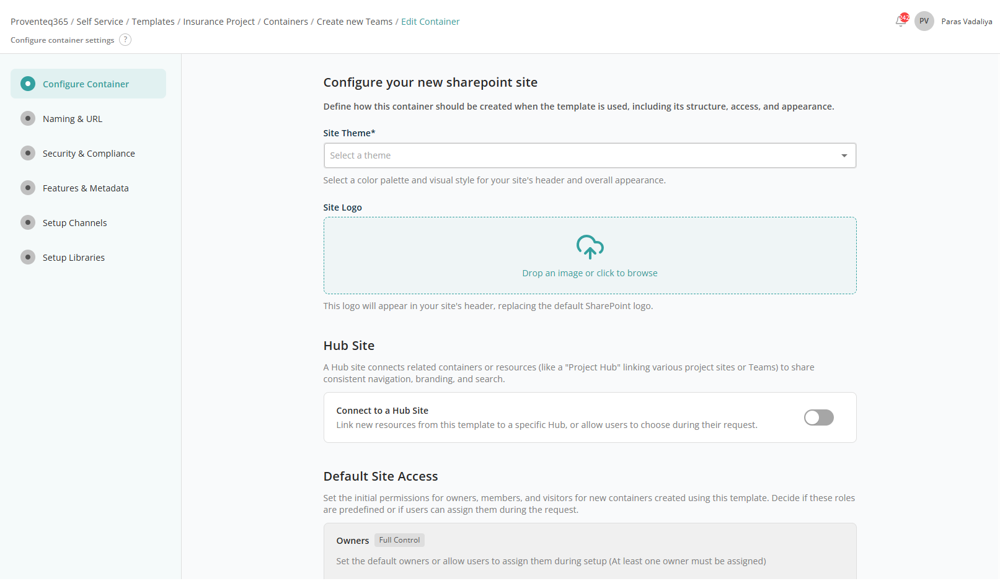

This step sets the appearance, hub site and default access of the team's SharePoint site. There is no **Site Type** field: a team always gets a team site with a Microsoft 365 group.

- **Site Theme** — required. The colour palette and visual style of the site.
- **Site Logo** — optional. PNG, JPEG and SVG files up to 5 MB are accepted.

### Hub Site

Turn on **Connect to a Hub Site** and pick a hub site from the search results (type at least three characters), or turn on **Set site using a user input** and choose a **Hub Site Selection** input with **Apply User Input**. A name typed without picking a result shows *Choose a hub site from the list, or insert a hub site user input*. See [Hub Site](../../../appendix/README.md#hub-site).

### Default Site Access

- **Owners** (**Full Control**) — at least one owner is required (*Owner is required*).
- **Members** (**Edit**) — can create, edit and manage content.
- **Visitors** (**Read**) — can view content only.

Search for people (at least three characters) or click **Upload CSV**, or turn on **Set owners using a user input** (and the matching toggles for members and visitors) to let the requester pick the people through a **User Selection** input.

## Naming & URL

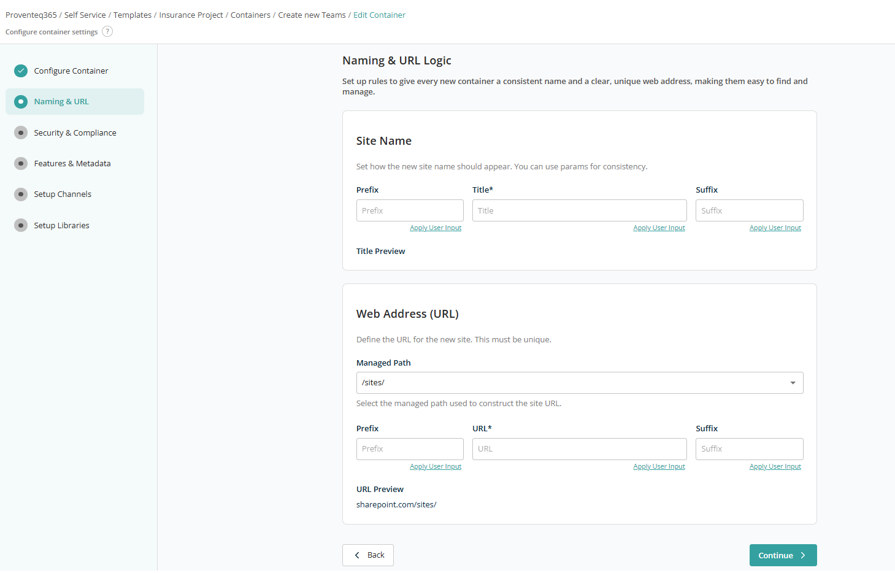

The **Site Name & URL** step builds the team's name from **Prefix**, **Title** (required) and **Suffix**, and its site address from **Managed Path** (`sites` or `teams`), **Prefix**, **URL** (required, no `/`) and **Suffix**. **Title Preview** and **URL Preview** show the result. Each text box has an **Apply User Input** link.

The name and URL must not already be used in your tenant. They are checked when you save the container (if they are fixed) or when a request is created (if they use user inputs). See [Name and URL Checks](./create-new-site.md#name-and-url-checks).

## Security & Compliance

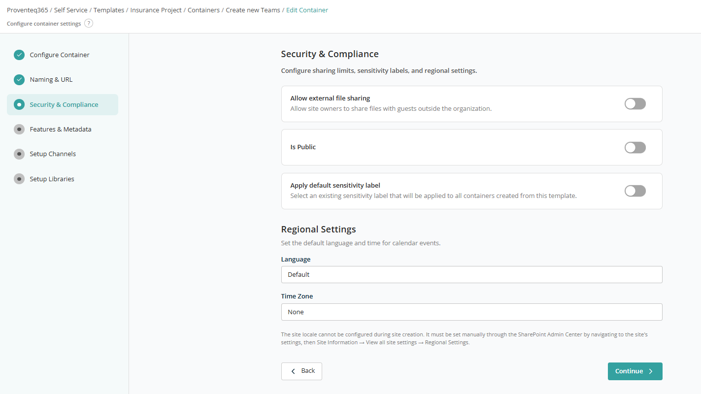

- **Allow external file sharing** — off by default. When on, choose who files can be shared with under **Select who you want to share to** (**Anyone**, **New and existing guests**, **Existing guests** or **Only people in your organization**). Except for **Only people in your organization**, you can limit sharing to the domains listed under **Allowed External Domains**, one per line.

- **Is Public** — when on, the team is visible to everyone in the organisation and anyone can join. When off, the team is private and only invited members can access it.

### Regional Settings

- **Language** — the default language of the site. By default, your organisation's default language.
- **Time Zone** — the default time zone. If set to **None**, the site has no predefined time zone.

**Note:** The site locale cannot be set while a site is created. If needed, set it in the SharePoint Admin Center: *Site Information → View all site settings → Regional Settings*.

## Features & Metadata

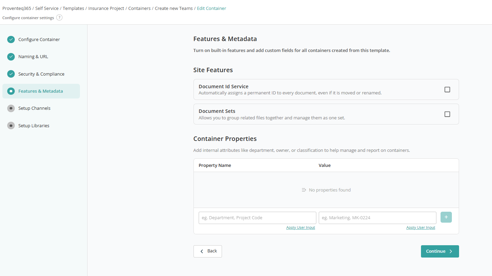

- **Site Features** — tick **Document ID Service** and **Document Sets** to activate them on every new team site. **Document Sets** is needed for content types based on Document Set.
- **Container Properties** — add internal attributes, such as department or classification, as **Property Name** and **Value** pairs, and click **(+)** to add each one.

See [Features & Metadata](./create-new-site.md#features--metadata) in the Create New Site container for details.

## Setup Channels

This step defines the Microsoft Teams channels created in the new team.

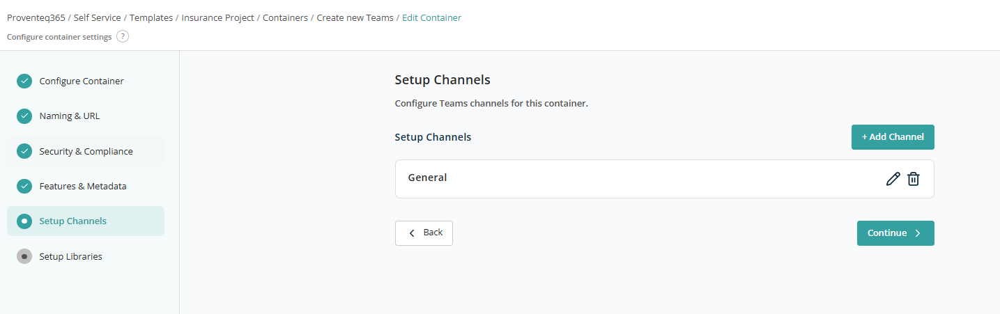

### Channels List

The list shows the channels that will be created. A **General** channel is included by default. Each channel shows how many tabs and folders it has, with an edit icon to change it and a delete icon to remove it. Channel names must be unique and not empty; otherwise you see *Channel names must be unique and non-empty*.

Click **+ Add Channel** to open the **Create Channel** screen:

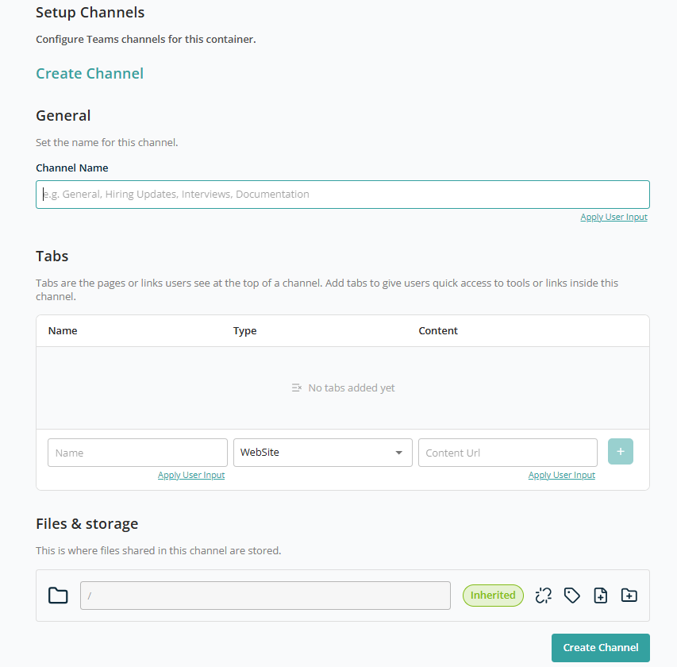

### General

- **Channel Name** — required. For example *Hiring Updates* or *Documentation*. Use **Apply User Input** to let the requester supply the name.

### Tabs

Tabs are the pages or links users see at the top of a channel. To add a tab, enter its **Name**, choose its **Type** and, for the types that need it, a **Content Url**, then click **+**.

| Tab type | Content Url needed? |
| --- | --- |
| WebSite | Yes |
| DocumentLibrary | Yes |
| Wiki | No |
| Planner | No |
| MicrosoftStream | No |
| MicrosoftForms | No |
| Word | Yes |
| Excel | Yes |
| PowerPoint | No |
| PDF | Yes |
| OneNote | No |
| PowerBI | No |
| SharePointPageOrList | No |
| Custom | No |

Tab names and content URLs must be unique within a channel. The name and content URL can both use user inputs.

### Files & Storage

Defines the folder structure where the channel's files are stored, with the same folder controls as a library: **Inherited** / **Custom Permissions**, **Break Inheritance**, **Apply retention label**, **Import a file (max 100MB)** and **Add a new folder**. See [Folders](./create-new-site.md#folders) for what each control does and which file types can be imported.

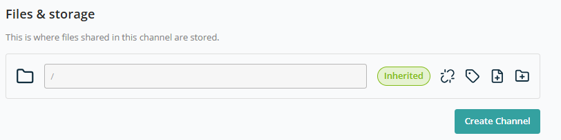

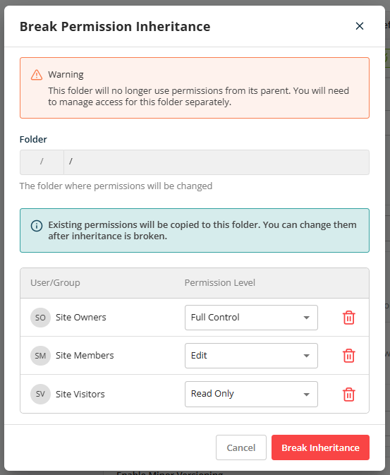

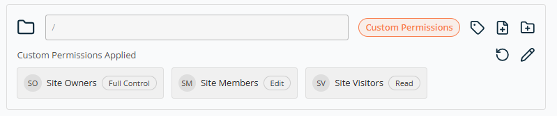

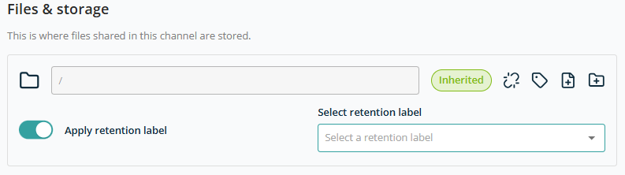

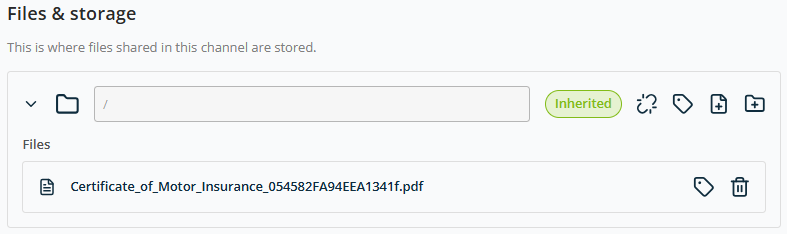

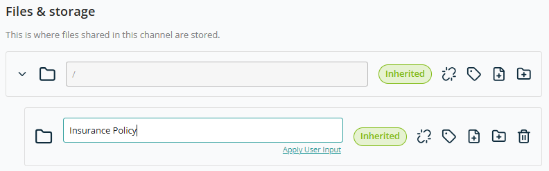

Click **Create Channel** to add the channel to the container, or **Save Channel** when editing an existing one.

## Setup Libraries

This step defines the document libraries created in the team's SharePoint site. A **Documents** library is included by default. Click **Add Library** to add another.

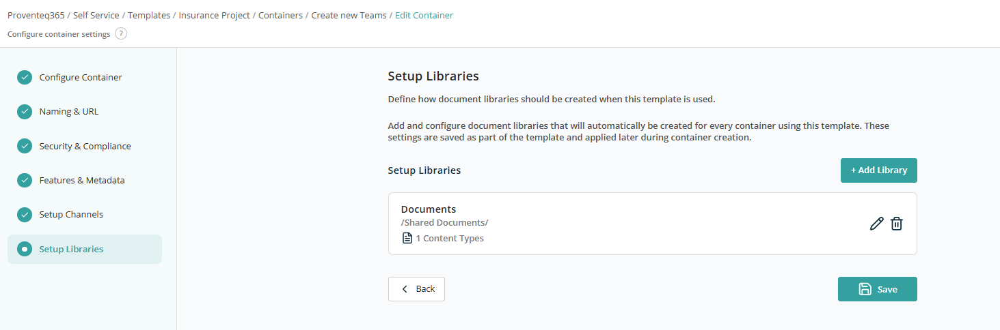

The library screen has the same sections as in the Create New Site container — see [Setup Libraries](./create-new-site.md#setup-libraries):

- **General** — **Library Name** (required) and **Library Path** (optional).

  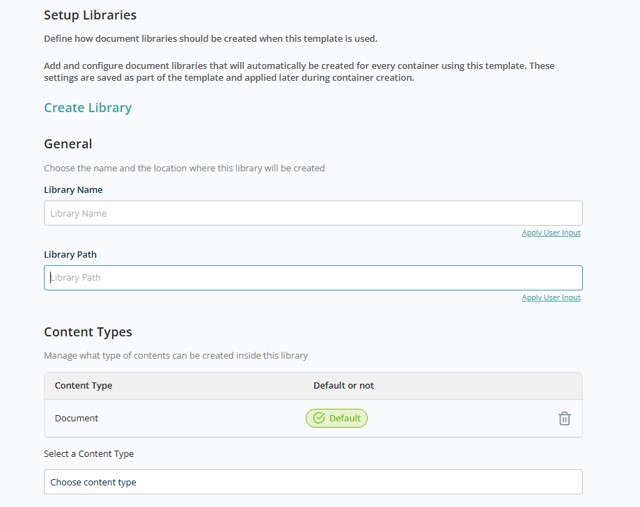

- **Content Types** — add content types that can be used in a document library and are available in your tenant, and choose the default one. Content types based on Document Set need **Document Sets** under **Features & Metadata**.
- **Folders** — the folder structure, with permissions, retention labels and imported files.

  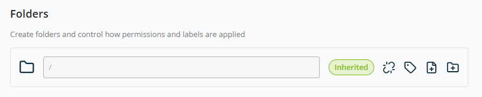

  

  

  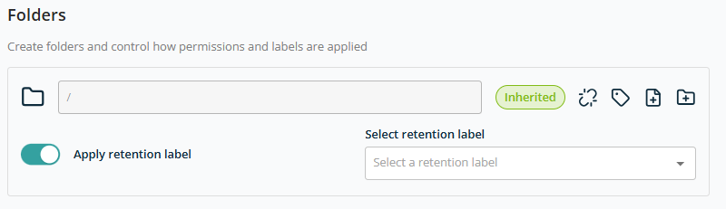

  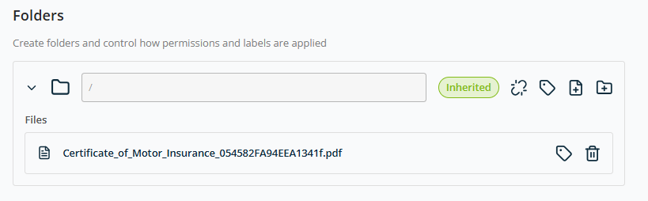

  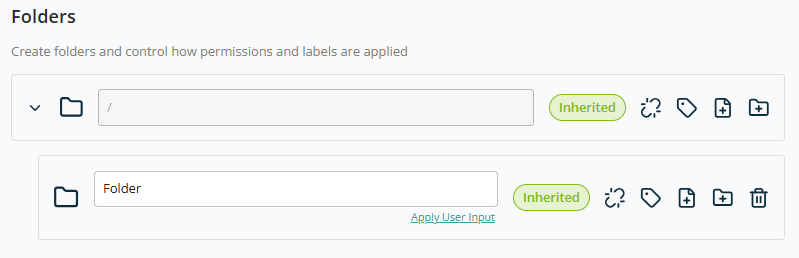

- **Advanced Settings** — versioning (**Max Major Versions** 1100 and up to 511 minor versions by default), a default sensitivity label, a retention label and **Enable Content Moderation**.

  

Click **Create Library** to add the library, then **Save** to add the container to the template.

## Related

- [Templates](../README.md)
- [Template Versions](../template-versions.md)
- [Container — Create New Site](./create-new-site.md)
- [Container — Add Channels to an Existing Team](./add-channels-to-team.md)
- [How to Create a Provisioning Template](../../../13-how-to-guides/12-create-a-provisioning-template.md)
