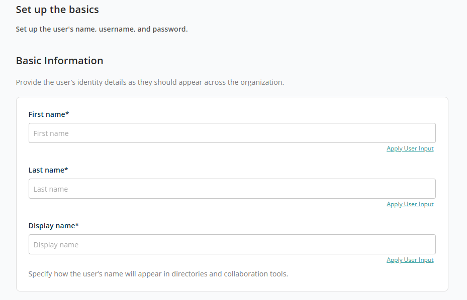
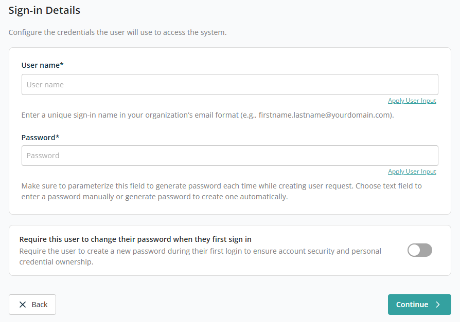
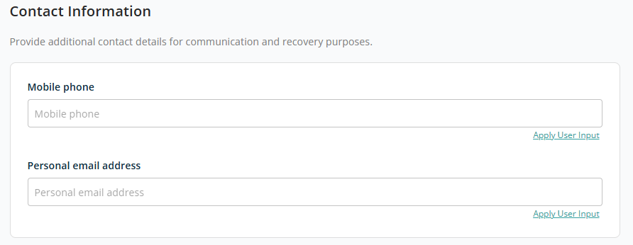
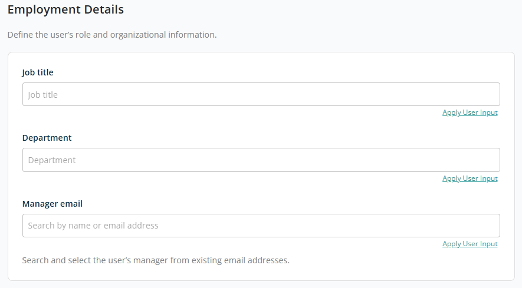
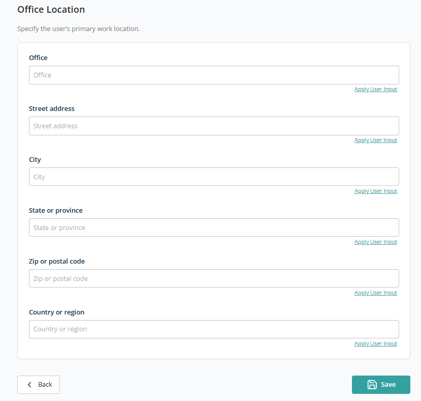

# Container — Create User

This container creates new Microsoft 365 user accounts in a structured, governed way. It captures the user's identity, sign-in, contact and organisational details through a guided set of steps. To add it, open a template's **Containers** screen, click **+ Add**, choose **User Management** and then **Create User**.

Configuring containers needs the **Tenant Admin** role, and your license must include the **Provision** feature. You can change containers only in a **Draft** version of a template; a container of a published or older version opens read-only. See [Template Versions](../template-versions.md#version-history).

The container has two steps in the left menu: **Set up the basics** and **User profile information**. Every field accepts a user input, so one template can create a different user with each request. Usually you bind most fields to user inputs. See [Using User Inputs](./create-new-site.md#using-user-inputs).

## Set Up the Basics

This step sets the user's name, sign-in name and password.

### Basic Information

The user's identity as it appears across the organisation:

- **First name** — required (*First name is required*).
- **Last name** — required (*Last name is required*).
- **Display name** — required. How the user's name appears in directories and collaboration tools.

### Sign-in Details

The credentials the user signs in with:

- **User name** — required. A unique sign-in name in your organisation's email format, for example `firstname.lastname@yourdomain.com`.
- **Password** — required, at least 8 characters (*Password must be at least 8 characters long.*). Bind this field to a user input so that each request gets its own password: a **Text Field** input lets the requester type a password, and a **Generate Password** input lets them click **Generate** to create one.
- **Require this user to change their password when they first sign in** — when on, the user must set a new password at first sign-in.

Click **Continue** to move on to **User profile information**.

## User Profile Information

This step adds contact details, job role and office location. All fields are optional.

### Contact Information

- **Mobile phone** — used for notifications and account recovery. It must be a valid phone number, for example `+44 20 7946 0958`; otherwise you see *Please enter a valid phone number (e.g., +44 20 7946 0958 or +1 555 123 4567)*.
- **Personal email address** — an alternative, non-work email address for account recovery.

### Employment Details

- **Job title** — the user's role.
- **Department** — the department the user belongs to.
- **Manager email** — type at least three characters to search for the user's manager and pick them from the results.

### Office Location

- **Office**
- **Street address**
- **City**
- **State or province**
- **Zip or postal code** — for example `12345`, `12345-6789` or `A1A 1A1`.
- **Country or region**

A field filled with spaces only is not accepted (*Value cannot contain only whitespace*).

Click **Save** to add the container to the template.

If the user name is already taken when the request is provisioned, the request fails with *The user account could not be created because it already exists.* See [Error Messages: Self-Service Provisioning](../../../15-error-catalog/05-self-service-provisioning.md#provisioning-errors).

## Related

- [Templates](../README.md)
- [Container — Terminate User](./terminate-user.md)
- [New Request](../../new-request/README.md)
- [Template Versions](../template-versions.md)
