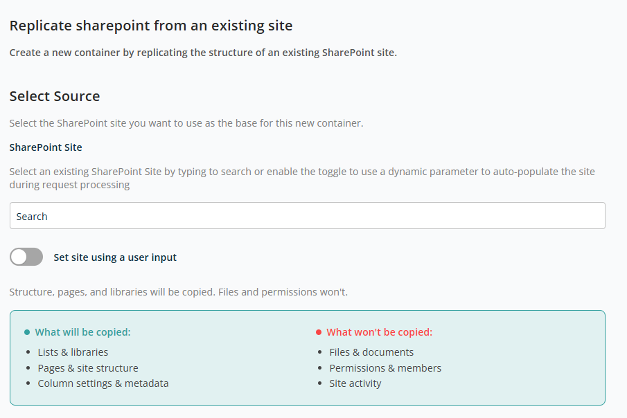
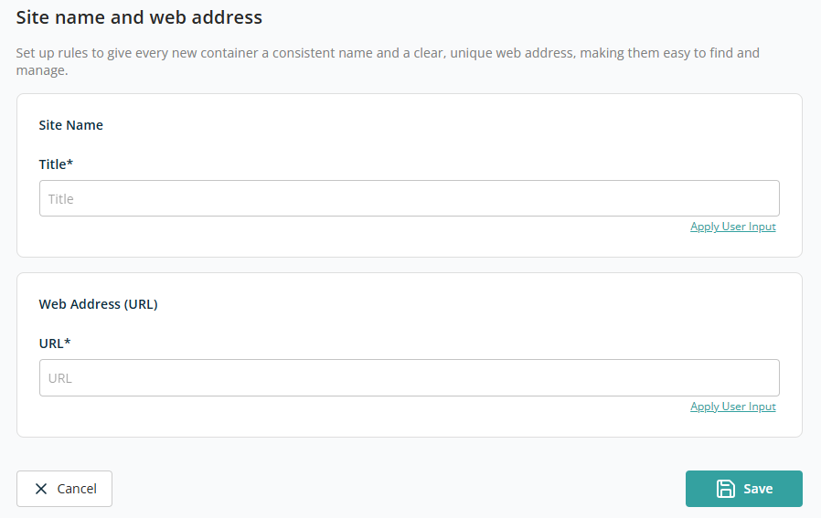

# Container — Replicate an Existing Site

This container creates a new SharePoint site by copying the structure of an existing site, so new sites start with a familiar layout without manual setup. To add it, open a template's **Containers** screen, click **+ Add**, choose **Start with a SharePoint Site** and then **Replicate an existing site**.

Configuring containers needs the **Tenant Admin** role, and your license must include the **Provision** feature. You can change containers only in a **Draft** version of a template; a container of a published or older version opens read-only. See [Template Versions](../template-versions.md#version-history).

## Select Source

Choose the site to use as the base for the new site:

- **SharePoint Site** — type at least three characters to search for the site and pick it from the results. Without a source site you see *You need to specify a site or use site as param*.
- **Set site using a user input** — turn on to let the requester choose the source site. The field becomes an **Apply User Input** button that takes one input of type **SharePoint Site Selection** or **Teams Site Selection**. See [Using User Inputs](./create-new-site.md#using-user-inputs).

## What Is Copied

Only the source site's structure is replicated:

- **What will be copied:** **Lists & libraries**, **Pages & site structure** (including navigation), and **Column settings & metadata**, such as site columns and content types.
- **What won't be copied:** **Files & documents**, **Permissions & members** and **Site activity**. The new site gets no list items and none of the source site's permission settings on lists, libraries, folders or pages. The source site's branding is not copied either.

## Site Name and Web Address

- **Title** — required. The display name of the new site.
- **URL** — required. The part of the address after `/sites/`.

Both can use **Apply User Input** with **Text Field** inputs, so the requester supplies them.

The new site's name and URL must not already be used in your tenant. They are checked when you save the container (if they are fixed) or when a request is created (if they use user inputs). See [Name and URL Checks](./create-new-site.md#name-and-url-checks).

Click **Save** to add the container to the template.

## Related

- [Templates](../README.md)
- [Container — Create from a Template File](./create-from-template-file.md)
- [Container — Create New Site](./create-new-site.md)
- [Template Versions](../template-versions.md)
