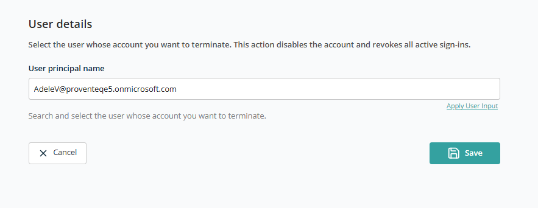

# Container — Terminate User

This container terminates one or more Microsoft 365 user accounts, for example when people leave the organisation. To add it, open a template's **Containers** screen, click **+ Add**, choose **User Management** and then **Terminate User**.

Configuring containers needs the **Tenant Admin** role, and your license must include the **Provision** feature. You can change containers only in a **Draft** version of a template; a container of a published or older version opens read-only. See [Template Versions](../template-versions.md#version-history).

## User Details

Choose the users whose accounts are terminated. At least one user is required; otherwise you see *User principal name is required*. Either:

- Search for users by name or email (type at least three characters) and pick them from the results, or click **Upload CSV** to add several users from a CSV file with one email address per line. Every user in the list is terminated by each request made from the template.
- Turn on **Set users to terminate using a user input** and use **Apply User Input** to choose one **User Selection** input. The requester then picks the users — one or several — when raising the request. See [Using User Inputs](./create-new-site.md#using-user-inputs).

Click **Save** to add the container to the template. On a container you have just added, **Cancel** asks *Discard container?* before removing it.

## What Termination Does

When the request is provisioned, Proventeq365 does the following for each user:

- Blocks sign-in by disabling the account.
- Revokes the user's active sign-in sessions.

The account itself is not deleted.

Each user is processed separately. If a user cannot be found or cannot be terminated, the other users are still processed, but the request ends with **Provisioning failed** and its **Provisioning errors** panel lists the users that failed — for example *The user account this step needed could not be found.* See [Request History](../../request-history/README.md).

## Related

- [Templates](../README.md)
- [Container — Create User](./create-user.md)
- [Request History](../../request-history/README.md)
- [Error Messages: Self-Service Provisioning](../../../15-error-catalog/05-self-service-provisioning.md#provisioning-errors)
