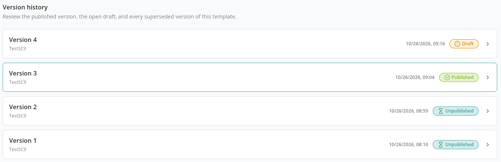

# Template Versions

Every provisioning template in Proventeq365 keeps a history of versions. Users always request from the one **Published** version, while you prepare changes in a separate **Draft** version, test it with a real test run and publish it when it is ready. Older versions stay in the template's **Version history**, and any of them can be restored as a new draft.

Managing templates and their versions needs the **Tenant Admin** role, and your license must include the **Provision** feature.

## Version Statuses

Each version has a number (v1, v2, …) and one of three statuses:

- **Draft** — A version being prepared. Only a draft can be edited. Users cannot request it, but you can test it with a [test run](#test-a-draft-before-publishing).
- **Published** — The version users request from under **New Request**.
- **Unpublished** — A version that is not available for requests: either it was replaced when a newer version was published, or it was taken out of use with **Unpublish**.

A template has at most one **Published** version and at most one **Draft** version at any time.

On the **Templates** screen, the **Status** column shows the template's current version, for example **Published · v3**, and, when a draft is open, the draft as well, for example **Draft · v4**. The **Versions** column shows how many versions the template has; click it to open the version history.

## Version History

The **Version history** screen lists every version of the template, newest first. Each row shows the version number, the template title in that version, when it was last changed and its status. The version you came from is highlighted.

- Click a row to open that version. A version that is not a draft is read-only: when you open one of its containers, the notice *Only a draft version can be edited, so this version cannot be changed.* offers a button to edit it in a draft instead.
- **Restore this version — creates a new draft from it** — Creates a new draft with the next version number and the content of the version you chose. The version you restored from is not changed. This action is hidden while the template already has a draft.

## Edit a Published Template

A published version cannot be changed directly. To change it:

1. On the **Templates** screen, click **Edit — creates a new draft version** in the template's row. This creates a draft with the next version number, copied from the current version. If the template already has a draft, the same button is called **Continue editing the draft** and opens it.
2. Change the draft — its details, access and approvals, user inputs and containers.
3. Optionally, [test the draft](#test-a-draft-before-publishing).
4. Open the draft and choose **Publish** from the menu next to its status.

When the draft is published, it becomes the **Published** version and the previously published version becomes **Unpublished**. New requests use the new version straight away.

You can also start a draft from a read-only container: click **Edit in a draft** (or **Continue the open draft**) in the notice at the top of the container.

## Test a Draft Before Publishing

While a template has a draft, its row on the **Templates** screen shows **Test run the draft before publishing**. It opens the request form for the draft with this notice:

> *This is a test run of an unpublished draft. It provisions for real, so use it to check the template before you publish it. If the template requires approval, the run waits for an approver first.*

Fill in the request name and user inputs and click **Start Test Run**. The test run creates real sites, teams or users in Microsoft 365, exactly as a normal request would. It is listed in your **Request History**, where you can follow it and check any provisioning errors. Clean up anything it created that you do not want to keep.

Only Tenant Admins can start a test run, and only for a draft. Users cannot request a draft. Because a test run is submitted as a request, your license must include the **Approvals** feature as well as **Provision**.

## Publish and Unpublish

- **Publish** — Available for a draft, and for an unpublished version that is still the template's latest published version. Every container must be configured first. Proventeq365 validates the template and, if anything is wrong, says *Template contains validation errors* and lists the problems per container. When it succeeds you see *Template published successfully*.
- **Unpublish** — Available for the published version. It takes the template out of use: it no longer appears under **New Request**. You can publish the same version again later.
- An older version that was replaced by a newer published version cannot be published again directly. Restore it as a new draft and publish that draft instead.
- A version cannot be moved back to **Draft**. Start a new draft instead.

## Copy a Template

**Copy to a new template** creates a separate template from the current version. The copy starts at version 1 as a **Draft**, its title ends with *(copy)*, and it keeps the original's containers, user inputs, access and approval settings. The copy and the original then change independently.

## Delete a Draft or a Template

Only a draft can be deleted:

- On the **Templates** screen, the delete icon is available only while the template has a draft. It deletes the draft. If the draft is the template's only version, it deletes the whole template.
- In an open draft, choose **Delete** from the menu next to its status.

A draft cannot be deleted while one of its test runs is still awaiting approval or being provisioned. Approve, reject or remove the test run first, or wait for it to finish. Published versions, and older versions that form the template's history, cannot be deleted.

## Related

- [Templates](./README.md)
- [How to Update a Published Template](../../13-how-to-guides/27-update-a-published-template.md)
- [How to Test a Template Before Publishing](../../13-how-to-guides/28-test-a-template-before-publishing.md)
- [Request History](../request-history/README.md)
- [Error Messages: Self-Service Provisioning](../../15-error-catalog/05-self-service-provisioning.md#template-versions-and-test-runs)
