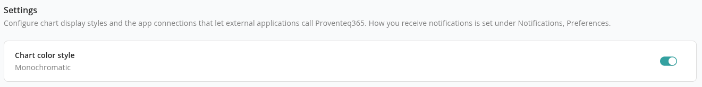
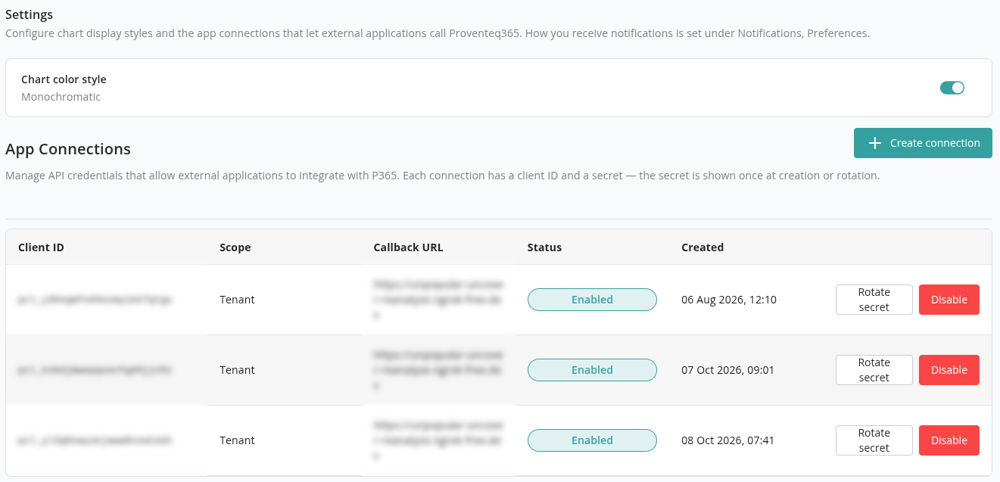

# Settings

The **Settings** screen holds application-level options: the colour style of report charts and, when your license includes provisioning, the **App Connections** that let other systems use the Proventeq365 Public API. Settings are available to the **Tenant Admin** role. Open them from **Systems** → **Settings**.

## Chart Color Style

This setting controls the colour scheme used for data in reports throughout Proventeq365.

- **Monochromatic** — When the toggle is **ON**, data is displayed using shades of a single colour. This is the default.
- **Colorful** — When the toggle is **OFF**, data is displayed using multiple colours to differentiate data points clearly.

## App Connections

App Connections let another system — for example a service desk or an onboarding workflow — submit self-service provisioning requests to Proventeq365 through the [Public API](./public-api.md). Each connection is a **Client ID** and a secret that the other system uses to sign its requests, plus the **Callback URL** where Proventeq365 reports the outcome.

The **App Connections** section appears only when your license includes the **Provision** feature.

### Connection List

- **Client ID** — The connection's identifier, which the other system sends with every request.
- **Scope** — **Tenant** when the connection can be used for any request in your organisation, or **Workspace** when it is restricted to one workspace.
- **Callback URL** — Where Proventeq365 sends the result of each request.
- **Status** — **Enabled** or **Disabled**.
- **Created** — When the connection was created.

### Create a Connection

1. Click **Create connection**.
2. Enter the **Callback URL**. It must be a valid `https://` address that is reachable from the internet; addresses such as `localhost`, private network addresses and `.local` or `.internal` hosts are not accepted.
3. Optionally, enter a **Workspace ID** to restrict the connection to one workspace — the identifier shown in the browser's address bar when the workspace is open. Leave it blank for tenant-wide access.
4. Click **Create**.

The **App Connection Secret** dialog shows the **Client ID** and the **Secret**. *This secret is shown once and cannot be retrieved later. Copy it now and store it securely.* Click **Copy**, store the secret in the other system's secure configuration, then click **Done**.

### Rotate a Secret

Click **Rotate secret** on an enabled connection and confirm. *The current secret stops working immediately and the new one is shown only once.* Update the other system with the new secret straight away; requests signed with the old secret are refused.

### Disable a Connection

Click **Disable** on an enabled connection and confirm. *It will stop working immediately.* The Public API refuses all requests from a disabled connection and no longer sends its callbacks. A disabled connection cannot be enabled again — create a new connection instead.

The callback URL and workspace of a connection cannot be changed after it is created. To change them, create a new connection and disable the old one.

## What the Public API Does

The Public API lets the other system create a provisioning request from one of your published templates, exactly as if a user had raised it under **New Request**:

- Requests are signed with the connection's secret (HMAC-SHA256), so Proventeq365 can verify where they come from and that they were not changed or replayed.
- The request is created on behalf of the Tenant Admin who created the connection. It follows the template's rules, including approval, and appears in that admin's **Request History**.
- When the request is provisioned, fails or is rejected, Proventeq365 sends a signed callback to the connection's **Callback URL**.
- Each connection can send up to 60 requests per minute by default.

For the technical details, see [Public API](./public-api.md).

## Related

- [Public API](./public-api.md)
- [How to Connect Another System with the Public API](../13-how-to-guides/30-connect-another-system-with-the-public-api.md)
- [Templates](../05-self-service/templates/README.md)
- [Error Messages: Settings, Notifications and Public API](../15-error-catalog/06-settings-and-notifications.md)
