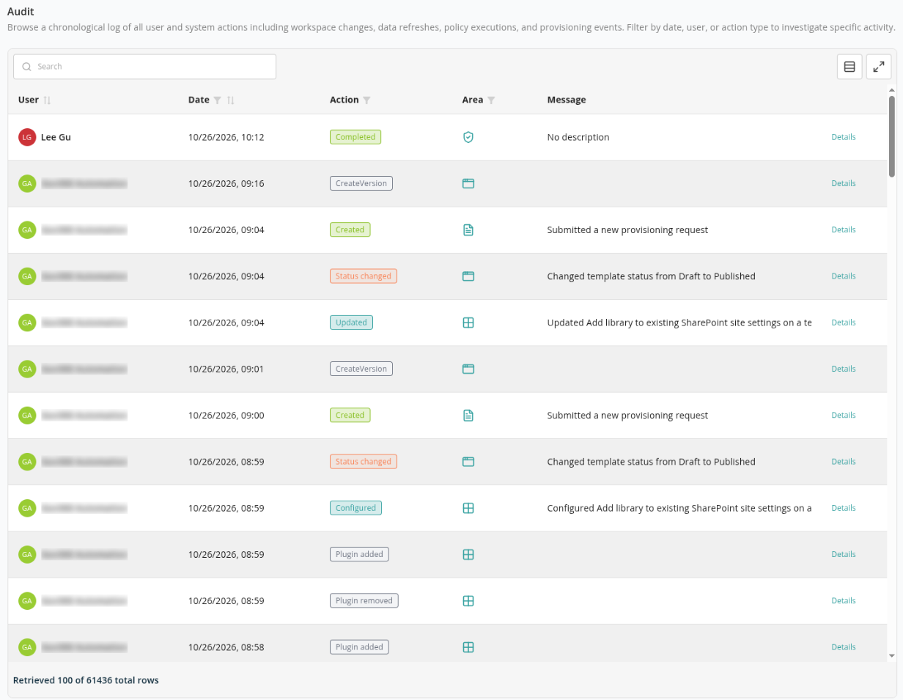
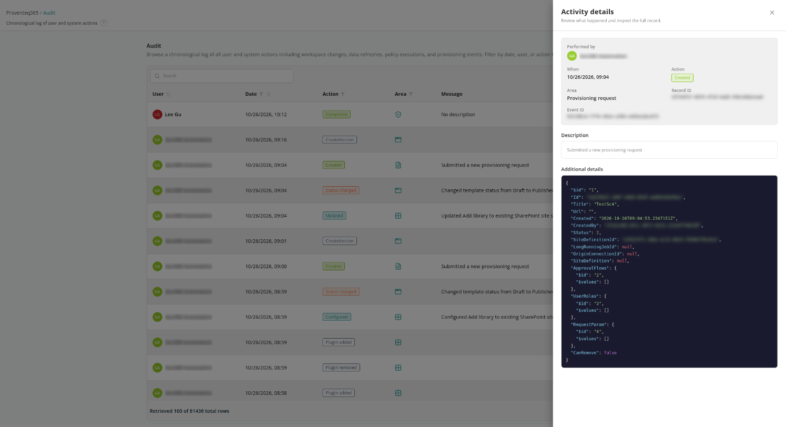

# Audit Log

The **Audit** screen is a chronological log of user and system activity in Proventeq365 — for example workspace changes, data refreshes, template and provisioning events, archiving, license uploads and Public API activity. It helps administrators and compliance teams track actions, investigate issues and maintain accountability.

Open it from **Audit log** at the bottom of the menu. The screen is available to the **Tenant Admin** role only.

The log lists the newest entries first. More entries load as you scroll, and the line below the table shows how many you have loaded, for example *Retrieved 100 of 245 total rows*. The total counts only the entries that match your filters.

## Columns

- **User** — the person who performed the action, by display name. An entry whose user can't be identified in your directory reads *Unknown User*. The name is the one the user had when the action was recorded; renaming a user later doesn't change past entries.
- **Date** — the date and time of the action.
- **Action** — what happened, as a coloured badge, for example **Created**, **Updated**, **Removed**, **Completed**, **Stopped**, **Archived** or **License uploaded**.
- **Area** — the part of the product affected, shown as an icon. Hover over the icon to see its name, for example **Workspace**, **Data refresh**, **Template**, **Provisioning request**, **Site archive**, **License** or **App connection**.
- **Message** — a short description, for example *Created workspace "Insurance project"*, *Data refresh completed*, *Removed 12 permissions* or *Uploaded a new license*. Hover over a long message to read all of it. If there is no description, it reads *No description*.
- **Details** — opens the full record. See [Activity Details](#activity-details).

## Search, Filter and Sort

- **Search by user** — type in the **Search** box above the table to show only entries whose user name contains the text. Type at least three characters; the search isn't case-sensitive.
- **Filter by date** — use the filter in the **Date** column header to choose a start date, an end date or both. Both days are included in full.
- **Filter by action or area** — use the filter in the **Action** or **Area** column header and tick one or more values. The table shows entries that match any ticked value. Options are listed alphabetically.
- **Sort** — click the **User** or **Date** column header to sort by it. The **Action**, **Area** and **Message** columns can't be sorted. Entries with the same value stay newest first.

Filters combine: for example, a user search with a date range shows that user's entries in that period.

## Activity Details

Click **Details** on an entry to open the **Activity details** panel (*Review what happened and inspect the full record.*). It shows:

- **Performed by** — the user who performed the action.
- **When** — the date and time.
- **Action** — the action badge.
- **Area** — the part of the product affected.
- **Record ID** — the unique identifier of this audit entry. Quote it in support requests.
- **Event ID** — the identifier of the event the entry was recorded from.
- **Description** — the same message as in the **Message** column.
- **Additional details** — the full data captured with the action, formatted as JSON. If none was captured, it reads *No additional details available*.

## Related

- [How to Review the Audit Log](../13-how-to-guides/17-review-the-audit-log.md)
- [License](../08-license/README.md)
- [Settings](../06-settings/README.md)
- [Navigation Menu](../01-navigation-menu/README.md)
