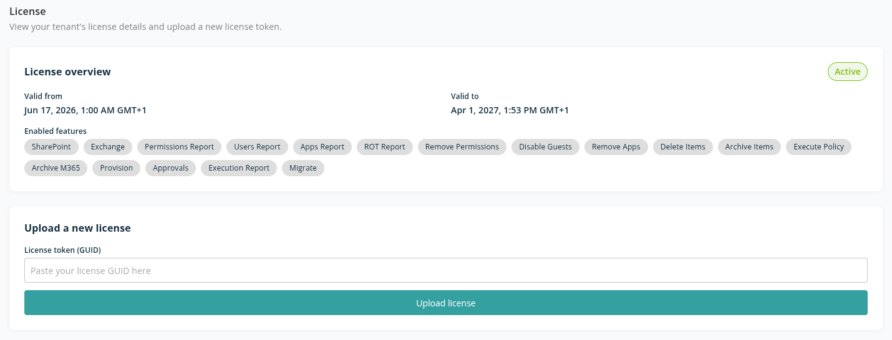

# License

The **License** screen shows whether your Proventeq365 license is active, how long it is valid and which features it enables. You also upload a new license token here when you renew.

Open it from **License** at the bottom of the menu. The screen is available to the **Tenant Admin** role only.

## License Overview

The **License overview** card shows the current license:

- Status — a badge next to the card title:
  - **Active** — the license is valid for more than 30 days.
  - **Expiring soon** — the license expires within 30 days. A banner reads *Your license expires in N days. Upload a new license to avoid disruption.*
  - **Expired** — the **Valid to** date has passed. A banner reads *Your license has expired. Upload a new license to restore access.*
- **Valid from** — the date and time the license starts, in your local time zone.
- **Valid to** — the date and time the license expires, in your local time zone.
- **Enabled features** — one tag for each feature the license includes. See [License Features](#license-features). If the license includes none, the card reads *No features are enabled by this license.*

If no license has been uploaded yet, the card reads *No active license was found for this installation.*

## Upload a New License

To renew or change the license, use the **Upload a new license** card:

1. Paste the token you received from Proventeq into **License token (GUID)**. The token has the form `xxxxxxxx-xxxx-xxxx-xxxx-xxxxxxxxxxxx`.
2. Click **Upload license**.

Proventeq365 checks the token with Proventeq's licensing service. When it is accepted, the message *License uploaded successfully.* appears and the overview shows the new dates and features. If the upload fails, one of these messages appears:

- *Invalid license format. The token must be a valid GUID.* — the value isn't a GUID.
- *The license token is invalid or could not be processed.* — the licensing service rejected the token.
- *Something went wrong. Please try again.* — the licensing service could not be reached.

Every upload that reaches the licensing service, successful or not, is recorded in the [Audit Log](../07-audit-log/README.md) as **License uploaded** in the **License** area.

See [How to Renew Your Proventeq365 License](../13-how-to-guides/16-renew-your-license.md) and [Error Messages: Sign-in, Access and License](../15-error-catalog/01-sign-in-access-and-license.md#license).

## License Features

Each feature in your license unlocks part of Proventeq365. When a feature is missing, its menu items are hidden. If you open such a screen from a link, Proventeq365 shows the **License required** screen instead (see below).

| Feature on the License screen | What it unlocks |
| --- | --- |
| **SharePoint** | Workspaces. Creating, opening and managing workspaces of any type needs this feature. |
| **Exchange** | The **Emails** and **Links** reports of an **Exchange Monitoring** workspace. |
| **Permissions Report** | The **Security & Oversharing** report. It is also needed for **External Users** and **App Permissions**. |
| **Users Report** | The **External Users** report, together with **Permissions Report**. |
| **Apps Report** | The **App Permissions** report, together with **Permissions Report**. |
| **Remove Apps** | Revoking app site grants from the **App Permissions** report, together with **Execute Policy**. |
| **ROT Report** | **Storage Optimisation** and its **Duplicate documents**, **Obsolete documents** and **Trivial documents** reports. |
| `optimization.engagement.report.sites` | The **Site Engagement** report. The License screen currently shows this feature by its technical name. |
| **Archive M365** | The site table on **Workspace Inventory**, and archiving from it and with **Archive selected** on the **Obsolete documents** report — to Microsoft 365 Archive or to a Wasabi or Azure Blob connection. Archive actions in policies need **Execute Policy** instead. |
| **Archive Items** | Opening archived files and restoring archived content. |
| **Provision** | **Self Service**: **Templates**, **New Request** and **Request History**. Also the **App Connections** section of **Settings**, which gives other systems access to the Public API. |
| **Approvals** | The **Approvals** screen for provisioning requests. Submitting requests and listing them in **Request History** also need this feature. |
| **Execution Report** | **Policies**, policy reports, **Policy Rules**, and the policy step when you create a workspace. |
| **Execute Policy** | Running actions — from policy reports, from **Security & Oversharing** and from **Trivial documents** — and approving policy reports. Also **Connections** and the default archive destination, and, together with **Execution Report**, the **Actions** screen. |
| **Migrate** | The **Content Migration** screen, which belongs to the separate Proventeq content migration product. |
| **Remove Permissions**, **Disable Guests**, **Delete Items** | Shown when your license includes them. No screen depends on them today. |

The pages for each screen say which features they need, and which role.

## License Required Screen

Proventeq365 shows the **License required** screen in place of the page you asked for when:

- **No license is active** — no license has been uploaded, or the license has expired. Every screen shows this page, with the notice *No active license was found for this installation.* The heading reads **License required** and the text *Your tenant does not have an active license for this area.*
- **Your license doesn't include a feature** — for example, you open a bookmark to a report your license doesn't cover. The heading names the area, such as **Oversharing reports**, **ROT analysis**, **Site engagement**, **Self-service provisioning** or **Governance policies**, with a short description of what it offers. For other areas it reads **License required**.

What you can do depends on your role:

- **Tenant Admin** — the screen includes the **License token (GUID)** field and **Upload license** button. After a successful upload, Proventeq365 reloads and opens the start page.
- **Other users** — the screen reads **License required** — *A valid license is required. Please contact your tenant administrator.* Ask a Tenant Admin to upload a valid license.

For a missing feature, contact Proventeq to add it to your license.

## Related

- [How to Renew Your Proventeq365 License](../13-how-to-guides/16-renew-your-license.md)
- [Error Messages: Sign-in, Access and License](../15-error-catalog/01-sign-in-access-and-license.md)
- [Audit Log](../07-audit-log/README.md)
- [Navigation Menu](../01-navigation-menu/README.md)
- [Settings](../06-settings/README.md)
