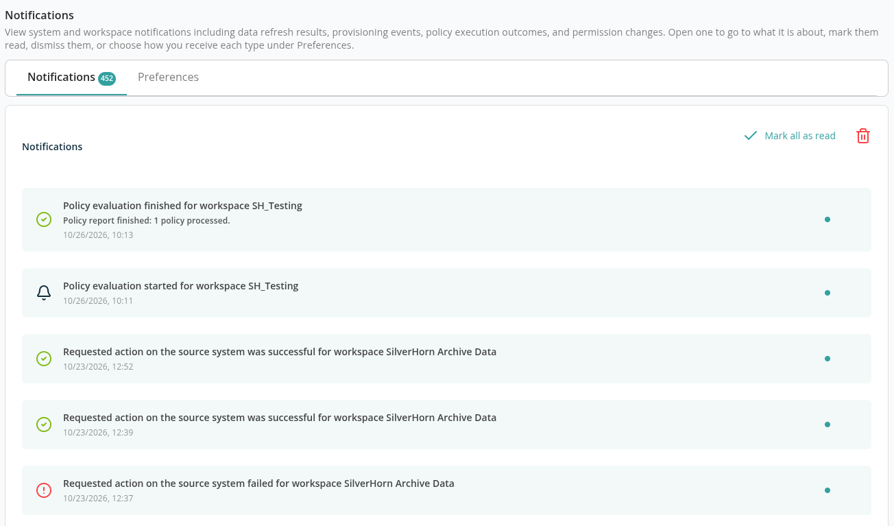
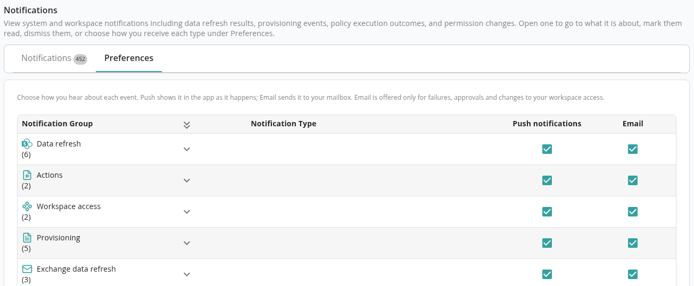

# Notifications

Proventeq365 notifies you about events in your workspaces and requests — for example a data refresh that finished or failed, a policy waiting for your approval, or a site request that was provisioned. Notifications appear in the app as they happen, are kept in your notifications inbox, and can also be sent to you by email. On the **Preferences** tab you choose, for each event, how you want to hear about it.

Every signed-in user has their own notifications. You receive the notifications of the workspaces you are a member of — directly or through a group — and the notifications addressed to you personally, such as the outcome of your provisioning request.

## Bell and Inbox

The **bell** icon next to your name at the top of every screen shows how many unread notifications you have (up to **99+**). Click it to open the **Notifications** screen.

New notifications also appear briefly as a pop-up message while you are using the app. Failures are shown as error messages.

The **Notifications** tab lists your notifications, newest first. Each one shows:

- **Title** — What happened, followed by the workspace or site it concerns, for example *Scan of the source system failed for workspace Finance*.
- **Detail** — For a failure, the reason. For a provisioning decision, whether the request was **Approved** or **Rejected**. For a policy approval, the policy and how many items are waiting for your decision.
- **Time** — When it happened.

Unread notifications are marked with a dot, and the tab shows the unread count. Click a notification to mark it as read and go to what it is about — for example the run that failed, the policy approval or your request. Use:

- **Mark all as read** — Marks every notification as read.
- **Dismiss** — Removes one notification from your inbox.
- **Dismiss all** — Removes all of them.

Reading or dismissing a notification affects only your own inbox; other members of the workspace keep theirs. The inbox keeps your 100 most recent notifications.

## Preferences

The **Preferences** tab lists every notification type, grouped by area, with two checkboxes:

- **Push notifications** — Show it in the app as it happens, and keep it in your inbox.
- **Email** — Send it to your mailbox.

Tick or clear the boxes for each **Notification Type**, or for a whole **Notification Group** at once. *Email is offered only for failures, approvals and changes to your workspace access.* For the other events — progress and success — the **Email** box is unavailable. Until you change them, you receive every event in the app and by email wherever email is offered.

> **Note:** Email is sent from a mailbox in your own Microsoft 365 tenant that your administrator sets up when Proventeq365 is deployed. If no notification mailbox is set up, no emails are sent; notifications in the app still work. See [Notification Mailbox](../12-deployment-prerequisites/07-run-post-deployment-script.md#notification-mailbox-optional).

## Notification Types

| Group | Events | Email available for |
| --- | --- | --- |
| **Data refresh** | Scan of the source system requested, triggered, in progress, successful or failed; transformation of the data finished; permission remediation finished; trivial data remediation finished; a workflow step approved or declined | *Scan of the source system failed*, and a workflow step approved or declined |
| **Azure data refresh** | Entra ID data refresh triggered, stage completed, finished or failed | *Azure data refresh failed* |
| **Exchange data refresh** | Exchange data refresh triggered, stage completed, finished or failed | *Exchange data refresh failed* |
| **Policies** | Policy evaluation started, evaluated, finished or failed; **Approval requested** for a policy's actions | *Policy evaluation failed*, *Approval requested* |
| **Actions** | Requested action on the source system successful or failed | *Requested action on the source system failed* |
| **Workspace access** | **Access granted** or **Access removed** for a workspace | Both |
| **Provisioning** | *Site request awaiting your approval* (to approvers); *Your site request was reviewed* (to the requester); site provisioning in progress, completed or failed | *Site request awaiting your approval*, *Your site request was reviewed*, *Site provisioning failed* |
| **Archive restore** | Restoring an archived item | — |

Approvers of a provisioning request are notified when it is raised and reminded once a day while it waits, up to three notifications in total.

## Related

- [Workspace Runs](../02-manage/workspaces/workspace-runs.md)
- [Request History](../05-self-service/request-history/README.md)
- [How to Choose Which Notifications You Get by Email](../13-how-to-guides/29-choose-which-notifications-you-get-by-email.md)
- [Error Messages: Settings, Notifications and Public API](../15-error-catalog/06-settings-and-notifications.md)
