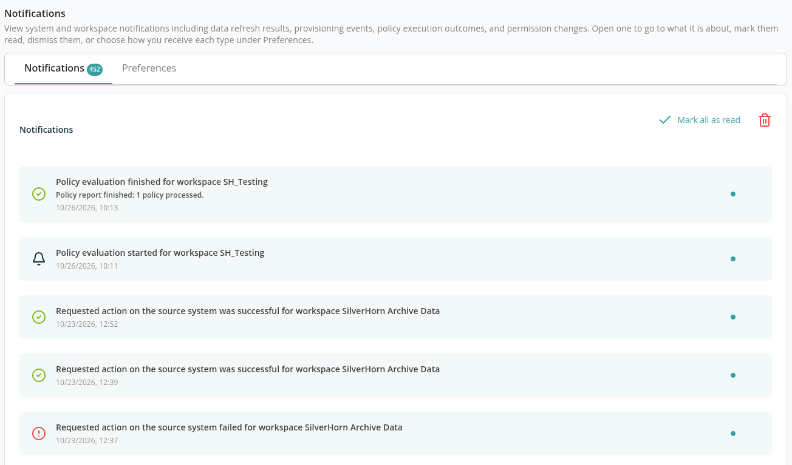

# Notification

The **Notifications** screen provides a centralised view of system-generated alerts and activity updates related to your Proventeq365 environment. It helps you monitor background processes, track execution status, and stay informed about key system events.

At the top of the screen, before your User Name, there is a **Bell** icon along with a count. Click the Bell icon to open the Notifications screen:

## Notification List

The main section displays a chronological list of notifications. Each notification includes:

- **Icon** — A bell icon indicating a system-generated notification.
- **Message** — A short description of the event or action.
- **Timestamp** — The date and time when the event occurred.
- **Delete Individual Notification** — Each notification includes a delete (trash) icon to remove a specific notification without affecting others.

The **delete (trash) icon** at the top right of the panel clears all notifications at once.

## Types of Notifications

You may see notifications for:

- **Scan Activities** — Requested, triggered, in progress, or completed scans of source systems.
- **Transformation Status** — Completion of data transformation processes.
- **Provisioning Events** — Workspace or resource setup activities.
- **Policy Execution** — Results of governance or compliance actions.
- **Permission Changes** — Updates to access or sharing settings.

## Email Notifications

Notifications about failures, approvals and changes to your workspace access can also be sent to your mailbox. To choose which ones, open the **Notifications** screen, select the **Preferences** tab, and tick or clear **Email** for each **Notification Type**. **Push notifications** controls whether the same type appears in the app as it happens.

Email is sent only when your Proventeq365 deployment has a sender mailbox:

- **Proventeq365 SaaS service:** emails come from Proventeq's mailbox, `notifications.proventeq365@proventeq.com`. There is nothing to set up.
- **Hosted deployment:** your administrators set up a mailbox in your own tenant. See [Notification Email](../12-deployment-prerequisites/08-notification-email.md).
