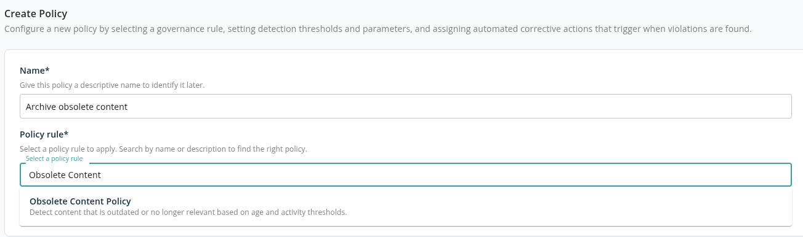
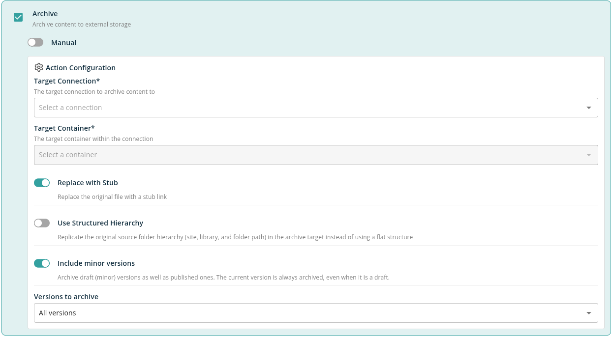
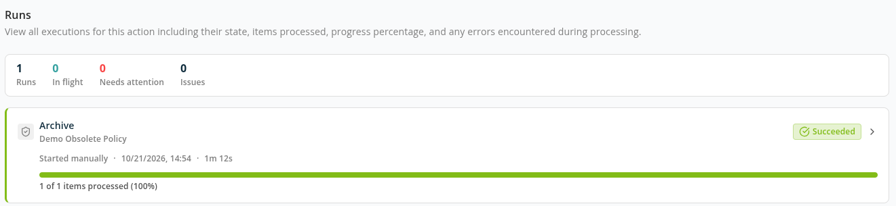
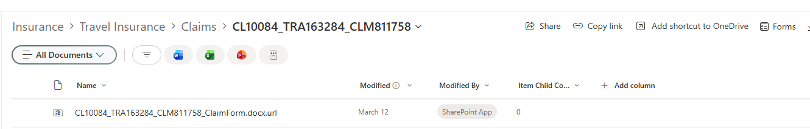
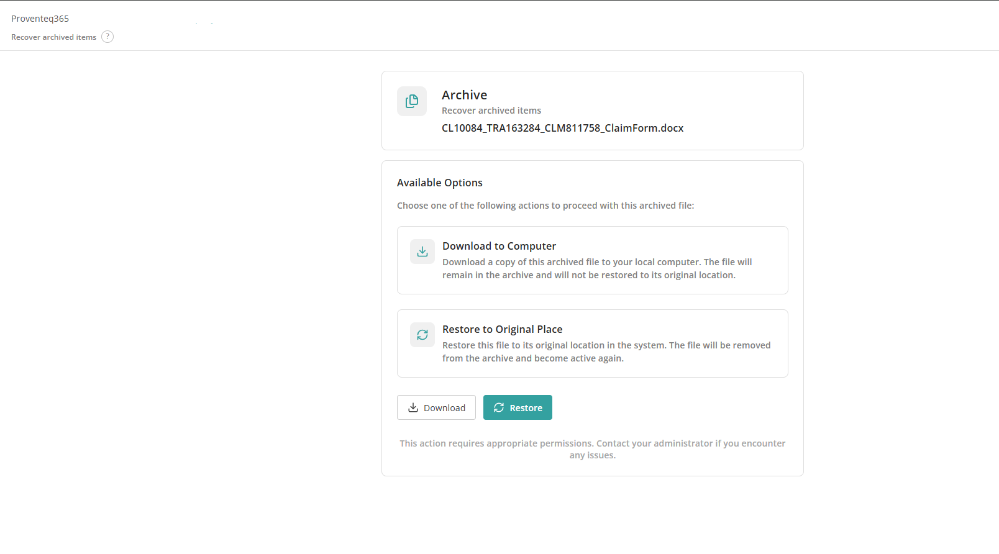

# Proventeq365 Archiving

**Proventeq365 Archiving** is the archiving capability built into Proventeq365. It moves inactive or obsolete content out of SharePoint and OneDrive into low-cost storage you own — **Wasabi** object storage or **Azure Blob Storage**. Each archived file is copied with the versions you choose, removed from SharePoint, and can be replaced by a **stub link** at the same address. Anyone who can open the stub can download, preview or restore the file. For Microsoft's own archive tier in SharePoint, see [Microsoft 365 Archive](./02-microsoft-365-archive.md); for how the two compare, see [Archiving](./README.md).

## Ways to Archive

- **Archive action of a policy** — The **Archive** action ("Archive content to external storage") is offered on the **Obsolete Content Policy**, the **Excessive Versions Policy** and the **Inactive OneDrives** policy. It archives the items the policy finds, to the connection and container set in the policy. This page describes this route.
- **Workspace Inventory** — Archive the files of whole sites and OneDrives, or of selected libraries and folders, from the site table, when your tenant's archiving is set up to use a storage connection. The site table is described on [Microsoft 365 Archive](./02-microsoft-365-archive.md#site-table-on-workspace-inventory).
- **Obsolete Documents report** — Select obsolete documents in a library's item list and click **Archive selected**.

Archiving from Workspace Inventory and the Obsolete Documents report doesn't use a policy. When it archives to a storage connection, it writes to the default destination set on [Archiving Connections](../02-manage/connections/README.md#archiving-connections), always leaves a stub, and archives every version.

## What You Need

- An archive connection with a container. See [Connections](../02-manage/connections/README.md) and [How to Add an Archive Connection](../13-how-to-guides/06-add-an-archive-connection.md).
- Proventeq365 deployed in **Read-write** mode, so it can change content. See [Deployment Mode](../12-deployment-prerequisites/02-microsoft-365-prerequisites.md#deployment-mode).
- **Tenant Admin** to create and run the policy; **Workspace Admin** (or Tenant Admin) to start a manual archive from the policy report.
- License features: **Execute Policy** to run actions, and **Archive Items** to open archived files and restore them.

## How Archiving Works

1. The policy finds content that matches its rule — for the Obsolete Content Policy, the workspace's obsolete rules (age in months and file extensions).
2. The archive action runs — automatically when the policy runs, or when someone starts it from the policy report.
3. Each file's selected versions are written to the target container, together with the file's metadata. With **Use Structured Hierarchy**, the site, library and folder path is recreated in the container.
4. Proventeq365 reads the archived copy back to check it. Only when the check passes is the SharePoint file replaced or deleted. If the check fails, the SharePoint file is left untouched and the item is reported as an error.
5. With **Replace with Stub**, the original file is replaced **in place** by a stub link. The stub keeps the file's address, so bookmarks and existing sharing links keep working. The original's content and version history are removed from SharePoint and are **not** kept in the recycle bin. Without **Replace with Stub**, the original file is deleted.

Items that are already archived, and items that no longer exist, are **skipped** rather than reported as errors. Existing stub links are never archived. Folders, libraries and sites are not archived themselves — their files are.

## Set Up the Archive Action

Create or edit a policy under **Manage** → **Policies** and choose a policy rule that offers **Archive**, for example the **Obsolete Content Policy**.

Select the **Archive** action and choose its execution mode:

- **Manual** — The policy report lists the items; a Workspace Admin starts the archive.
- **Automatic** — Items are archived whenever the policy runs, with no further input. Automatic actions run in the background and can't be undone.

Then set the action's parameters under **Action Configuration**:

- **Target Connection** — The connection to archive content to. Required.
- **Target Container** — The container within the connection. Required.
- **Replace with Stub** — Replace the original file with a stub link. On by default.
- **Use Structured Hierarchy** — Replicate the original source folder hierarchy (site, library and folder path) in the archive target instead of using a flat structure. Off by default.
- **Include minor versions** — Archive draft (minor) versions as well as published ones. On by default. The current version is always archived, even when it is a draft.
- **Versions to archive** — **All versions** (the default), **Last N versions** or **Versions from the last N months**. For the last two, enter the number:
  - **Keep last N versions** — Archive the most recent N versions, counting the current one.
  - **Keep versions from the last N months** — Archive only versions modified within the last N months. The current version is always archived.

The source is always your tenant's SharePoint connection; it is not shown in the form. You can set a version count or a number of months, not both.

> **Important:** Only the versions selected here are archived. A version that is not archived can't be restored from the archive, and it is removed from SharePoint together with the original. When you save a policy that doesn't archive every version, Proventeq365 asks you to confirm with **Save anyway**.

Click **Add Policy** to save. See [How to Archive Obsolete Content](../13-how-to-guides/07-archive-obsolete-content.md) for the full steps.

## Run the Archive

Enabled policies run at the end of every workspace data refresh, and a Tenant Admin can run one at any time with **Run Policy**. When the run finishes, click **View** in the policy's row to open the policy report.

The report shows the policy name and description, the items found and, under **Available Actions**, a card for each of the policy's actions. The **Archive** card offers:

- **Execute on All Items** — Archives every item in the report.
- **Execute on Selection** — Archives the items you ticked. The button shows how many are selected.
- **View Executions** — Opens the history of this action's runs.

Both execute buttons ask you to confirm. They are offered only for a **Manual** action and only to a Workspace Admin. If the policy needs approval, the action waits until an approver releases the report.

### Executions

**View Executions** lists every run of the action with its status, progress, duration and errors.

An execution's status is one of:

- **Queued** — The run has been accepted and will start shortly.
- **Running** — Items are being archived.
- **Succeeded** — Every item was archived or skipped.
- **Partially completed** — Some items were archived and at least one failed.
- **Failed** — The run did not complete, or no item succeeded.
- **Stopped** — The policy was disabled before the action ran.

Open an execution to see its **Items** tab. Filter by **Succeeded** or **Failed** to see each item's outcome and error, and use **Export CSV** to download the list. For what an error means, see [Error Messages: Connections, Archiving and Restore](../15-error-catalog/04-connections-and-archiving.md#archiving).

## Archived Files in SharePoint

After archiving with **Replace with Stub**, the file's original location in SharePoint holds a stub link with the same name and address.

Opening the stub takes you to the archived file's page in Proventeq365.

## Archived File Page

The page is titled **Archive** — **Recover archived items**. It lists **Available Options** for the file, then its **Version history**.

### Who Can Open It

- If the file has a stub, you can open the page when you have permission to open the stub in SharePoint.
- If the file was archived without a stub, you need a role on the workspace the file belongs to.
- Other users see **Access denied - you do not have permission to download this item**.
- Your organisation's license must include the **Archive Items** feature.

### Available Options

- **Preview in Browser** — Shown for audio and video files (for example MP4, WebM, MP3, WAV, M4A). Plays the file in your browser without downloading it. Playback streams on demand and stops when you close the player.
- **Download current version** — Saves the current archived version to your computer. The file stays in the archive and is not restored to its original location.
- **Restore to Original Place** — Puts the file back in its original location with its archived versions. The file is removed from the archive and becomes active again. Progress is shown on the page, and **Open restored file** appears when it has finished. A restore can take a few minutes. See [Restore Archived Content](./03-restore-archived-content.md).

### Version History

Every version archived with the file is listed with its **Version**, **Modified (UTC)**, **Modified by**, **Size** and **Check-in comment**. The current version is marked **Current**. Use **Download this version** to save any version, or **Preview this version** for audio and video files.

## Related

- [Archiving overview](./README.md)
- [Microsoft 365 Archive](./02-microsoft-365-archive.md)
- [Restore Archived Content](./03-restore-archived-content.md)
- [Connections](../02-manage/connections/README.md)
- [How to Archive Obsolete Content](../13-how-to-guides/07-archive-obsolete-content.md)
- [How to Restore an Archived File](../13-how-to-guides/08-restore-an-archived-file.md)
- [Error Messages: Connections, Archiving and Restore](../15-error-catalog/04-connections-and-archiving.md)
