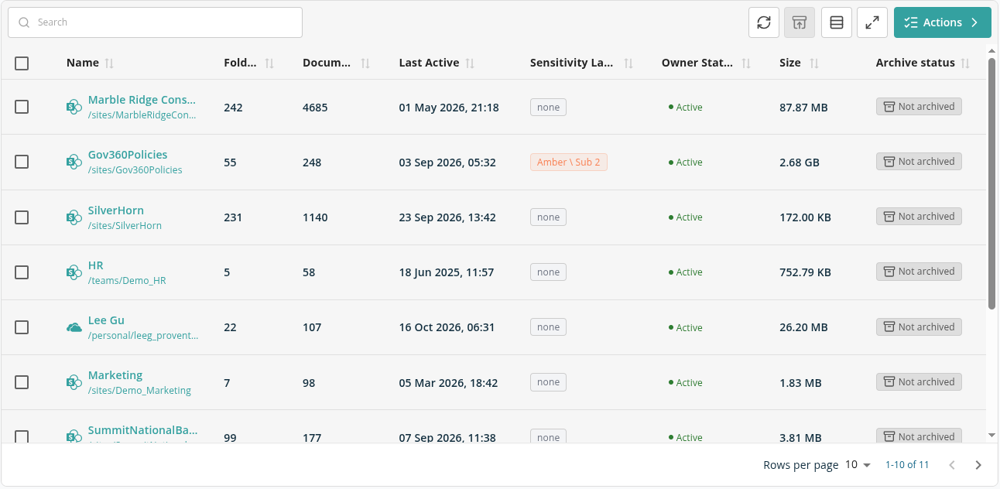
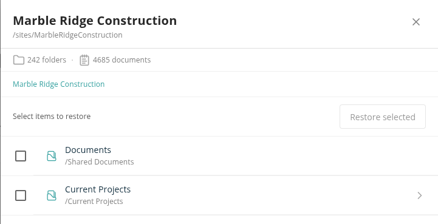

# Microsoft 365 Archive

Microsoft 365 Archive is Microsoft's low-cost storage tier for SharePoint content you no longer use but must keep. Proventeq365 can move whole SharePoint sites and OneDrives, or selected libraries, folders and files, into it — from the site table on **Workspace Inventory**, or with the **M365 Archive** action of a policy. Content moved into Microsoft 365 Archive stays in your tenant and is archived in place: no stub link is left behind.

## Before You Start

- **Microsoft 365 Archive** must be enabled in your Microsoft 365 tenant, with billing set up. See Microsoft's [Overview of Microsoft 365 Archive](https://learn.microsoft.com/en-us/microsoft-365/archive/archive-overview).
- Proventeq365 must be deployed in **Read-write** mode. See [Microsoft 365 Prerequisites](../12-deployment-prerequisites/02-microsoft-365-prerequisites.md#archiving).
- The workspace must be a **Microsoft 365 Governance** (SharePoint) workspace.
- Your license must include the **Archive M365** feature. Without it, the site table is not shown on Workspace Inventory.
- You need the **Workspace Admin** role (or Tenant Admin) to archive. Workspace Users can view the site table and statuses.

## Where Archived Content Goes

The **Archive** actions on Workspace Inventory, and **Archive selected** on the Obsolete Documents report, follow your organisation's archiving setup in Proventeq365:

- **Microsoft 365 Archive** — The site, OneDrive or file is moved into Microsoft 365 Archive where it is. No stub is left in SharePoint.
- **An archive storage connection** (Wasabi or Azure Blob Storage) — Each file is copied with all its versions to the default destination set on [Archiving Connections](../02-manage/connections/README.md#archiving-connections), removed from SharePoint and replaced by a stub link. The confirmation dialog shows **Archiving to** and the connection's name. See [Archive](./README.md).

If archiving isn't set up, the **Archive** actions are not offered.

> **Note:** Microsoft 365 Archive isn't one of the options on the Archiving Connections screen. To archive from Workspace Inventory to Microsoft 365 Archive, ask Proventeq to set it up for your Proventeq365 tenant. The **M365 Archive** policy action below always uses Microsoft 365 Archive.

## Site Table on Workspace Inventory

Open **Workspace Inventory** for the workspace. Below the summary cards, the site table lists every site and OneDrive in the workspace scan.

- **Name** — The site or OneDrive. The name links to the site.
- **Folders** and **Documents** — How many were discovered.
- **Last Active** — The site's most recent activity.
- **Sensitivity Label** — The site's sensitivity label, or **None**.
- **Owner Status** — For OneDrives only: **Active**, **Disabled**, **Unlicensed** or **Deleted**.
- **Size** — For a OneDrive, the storage it is using, including file versions and the recycle bin. For any other site, the combined size of the documents discovered in it.
- **Archive status** — **Not archived**, **Archiving**, **Archived** or **Failed**.

Click the **SharePoint Sites**, **OneDrives** or **Teams** card at the top of the page to show only that kind of site; click it again to show all. Use the search box to filter the table and **Refresh** to reload it.

## Archive Sites and OneDrives in Bulk

1. Tick the sites and OneDrives to archive.
2. Click **Actions** above the table. The **Bulk actions** dialog lists what you can do with the selection.
3. Click **Archive**. Sites that are already **Archived** or **Archiving** are left out. **Archive** is listed only when archiving is set up for your tenant; otherwise the dialog offers **Restore** only.
4. Read the **Archive sites** dialog. It warns that archiving is irreversible and long-running, and that each site becomes read-only once archived. Click **Confirm**.

The dialog starts the sites one by one and shows its progress. Click **Stop** to start no more; sites already started continue in the background. When it finishes, a message says how many sites archiving was started for, or how many failed to start.

## Site Detail Panel

Click a site or OneDrive that has folders or documents to open its side panel. It shows the site's folder and document counts and its libraries; click a library or folder to open it, and use the path at the top to go back up. Each item shows its path, and tags such as **Archived**, **M365 Archived** or **Restored** show what has been done to it. A count such as **3 / 10** on a folder shows how many of its items carry a tag. Large folders load in pages — click **Load more** to see the rest.

### Archive a Whole Site or OneDrive

Click **Archive site** at the top of the panel. The **Archive Site** (or **Archive OneDrive**) dialog asks you to confirm; click **Confirm**. The button isn't shown for a site that is already archived or being archived.

### Archive Selected Libraries, Folders and Files

1. Tick the libraries, folders and files to archive. Ticking a library or folder archives every file in it.
2. Click **Archive selected**.
3. If the folders you selected hold more than half of the site's documents, Proventeq365 warns: *You are about to archive more than 50% of this site's content. Archiving the whole site would be faster. Continue with item archiving anyway?* Continue, or cancel and use **Archive site** instead.

## After You Archive

Archiving runs in the background as an action. Follow it on the **Actions** page, where each run shows its status and, on its **Items** tab, any item that failed. Items already in Microsoft 365 Archive, and items that no longer exist, are skipped rather than archived again.

The site's **Archive status** changes to **Archiving** and then **Archived**, or **Failed** if it could not be archived. Changes in Microsoft 365 also appear in Proventeq365 after the next data refresh of the workspace.

## Archive with a Policy

The **M365 Archive** action — "Archive files to Microsoft 365 Archive (low-cost storage tier)" — is offered on the **Obsolete Content Policy**, the **Inactive Sites Policy** and the **Inactive OneDrives** policy. It has no settings: the items the policy finds are moved into Microsoft 365 Archive. Like other actions it can be **Manual** or **Automatic**, and you follow its runs with **View Executions** on the policy report. See [How to Add a Governance Policy](../13-how-to-guides/05-add-a-governance-policy.md).

## Reactivate Content from Microsoft 365 Archive

Proventeq365 doesn't bring content back from Microsoft 365 Archive. Reactivate archived sites and files in Microsoft 365 — see Microsoft's [Overview of Microsoft 365 Archive](https://learn.microsoft.com/en-us/microsoft-365/archive/archive-overview). The **Restore** actions on Workspace Inventory restore content that was archived to a Wasabi or Azure Blob Storage connection; see [Restore Archived Content](./restore-archived-content.md).

## Related

- [How to Archive Sites to Microsoft 365 Archive](../13-how-to-guides/24-archive-sites-to-microsoft-365-archive.md)
- [Workspace Inventory](../04-reports/workspace-inventory/README.md)
- [Archive](./README.md)
- [Restore Archived Content](./restore-archived-content.md)
- [Error Messages: Connections, Archiving and Restore](../15-error-catalog/04-connections-and-archiving.md#workspace-inventory-and-microsoft-365-archive)
