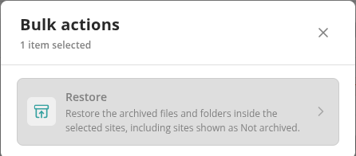

# Restore Archived Content

Restoring puts an archived file back in its original SharePoint or OneDrive location with the versions that were archived, and removes it from the archive. You can restore one file from its stub link, restore many files at once from the policy report of an archiving policy, or restore everything archived in selected sites, folders or a whole workspace from **Workspace Inventory**. Restore applies to content archived to a **Wasabi** or **Azure Blob Storage** connection.

## Ways to Restore

| Where | What it restores | Who can do it |
| --- | --- | --- |
| [Archived file page](#restore-one-file) (opened from the stub link) | One file | Anyone who can open the stub in SharePoint |
| [Policy report](#restore-from-a-policy-report) | Selected archived items, or every archived item in the report | **Workspace Admin** |
| [Workspace Inventory](#restore-from-workspace-inventory) | Everything archived in selected sites, libraries, folders or files, in one site, or in the whole workspace | **Workspace Admin** |

A Tenant Admin can do everything a Workspace Admin can. Your license must include the **Archive Items** feature. Restoring from a policy report also needs **Execute Policy**, and the site table on Workspace Inventory needs **Archive M365**.

## What a Restore Does

- Every archived version is put back, in order, at the file's original location. Versions that were not archived can't be restored.
- If the file was replaced by a stub, the stub is replaced by the restored file.
- Only when the restored file has been checked are the archive copy and its record deleted. After that, the file is no longer in the archive and its stub link no longer opens the archived file page.
- A restore runs in the background and can take a few minutes.

A restore stops without changing anything when:

- A file with the same name is now at the original location. Move or rename it, then restore again.
- The archive holds several versions but the destination library has versioning turned off. Turn versioning on (**Library settings** → **Versioning settings**), then restore again.
- Another archive or restore of the same file is already running.

Content moved into Microsoft 365 Archive is not restored by Proventeq365. See [Microsoft 365 Archive](./microsoft-365-archive.md#reactivate-content-from-microsoft-365-archive).

## Restore One File

1. Open the stub link that replaced the file in SharePoint. The archived file page opens.
2. Click **Restore to Original Place**.
3. The page shows the restore's progress. When it has finished, click **Open restored file**.

The page also lets you download any archived version, or preview audio and video, without restoring. See [Archived File Page](./README.md#archived-file-page) and [How to Restore an Archived File](../13-how-to-guides/08-restore-an-archived-file.md).

If the file was archived without a stub, you need the **Workspace Admin** role to restore it on its own; otherwise restore it in bulk as described below.

## Restore from a Policy Report

The policy report of a policy with the **Archive** action shows a **Restore from archive** card under **Available Actions** when the report holds archived items. The card is shown even if the policy is now disabled.

- **Execute on Selection** — Restores the archived items behind the rows you ticked. The count on the button is the number of archive records, not rows: rows without an archive record are skipped, and the card says how many. At most **1,000** archive records are restored at a time; the card tells you how many of your selection will be left for the next run.
- **Restore all** — Restores every archived item in the report, not only the rows loaded on screen. You are asked to confirm.
- **View Executions** — Opens the history of restore runs.

After you start a restore, the message *Restore queued. Track it on the Actions page.* appears, and each row being restored shows its progress, for example *Restoring version 2.0 — 2 of 3* or *Restoring — Waiting for SharePoint (step 6 of 8)*. The steps are **Validating**, **Resolving users**, **Planning**, **Uploading**, **Submitting**, **Waiting for SharePoint**, **Verifying** and **Completed**; **Resubmitting** appears if SharePoint needs a second attempt. When restores finish, the report refreshes and a message says how many completed. A restore that stops part-way is reported as no longer running, and you can start it again.

See [How to Restore Archived Content in Bulk](../13-how-to-guides/25-restore-archived-content-in-bulk.md).

## Restore from Workspace Inventory

The site table on **Workspace Inventory** and its site detail panel offer restore to Workspace Admins. Before a **Restore** action becomes available, Proventeq365 checks the selection for archived items (*Checking the selection for archived items…*); if there are none, the action stays unavailable and says why.

- **Restore selected sites** — Tick sites, click **Actions**, then **Restore**. It restores the archived files and folders inside the selected sites, including sites shown as **Not archived**, since a live site can hold archived files. You can restore up to **1,000** sites at a time.
- **Restore all** — Above the table. Restores every archived item in the workspace. It is unavailable when nothing in the workspace is archived.
- **Restore selected** — In a site's side panel, tick libraries, folders or files and click **Restore selected**. Everything archived under them is restored. Up to **1,000** files and **1,000** folders at a time.
- **Restore site** — In the side panel of a site whose status is **Archived**. Restores every archived item in the site.

Each restore asks you to confirm, then shows *Restore queued. Track it on the Actions page.* Only one restore runs at a time from this page, and the restore buttons stay unavailable until it finishes. When it finishes, a message says **Restore completed.**, or that it completed with failures — open the run on the **Actions** page to see the items that did not restore. When a site has no archived content left, its **Archive status** returns to **Not archived** (when your archiving uses a storage connection).

## Follow a Restore

Restores appear on the **Actions** page with the other actions of the workspace. Open a run to see its status and, on the **Items** tab, each item with the outcome of its restore. Filter by **Failed** and select **Full error** to see why an item did not restore. For what a message means, see [Error Messages: Connections, Archiving and Restore](../15-error-catalog/04-connections-and-archiving.md#opening-and-restoring-archived-files).

## Related

- [Archive](./README.md)
- [Microsoft 365 Archive](./microsoft-365-archive.md)
- [How to Restore an Archived File](../13-how-to-guides/08-restore-an-archived-file.md)
- [How to Restore Archived Content in Bulk](../13-how-to-guides/25-restore-archived-content-in-bulk.md)
- [Workspace Inventory](../04-reports/workspace-inventory/README.md)
