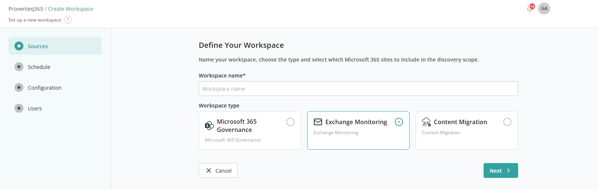
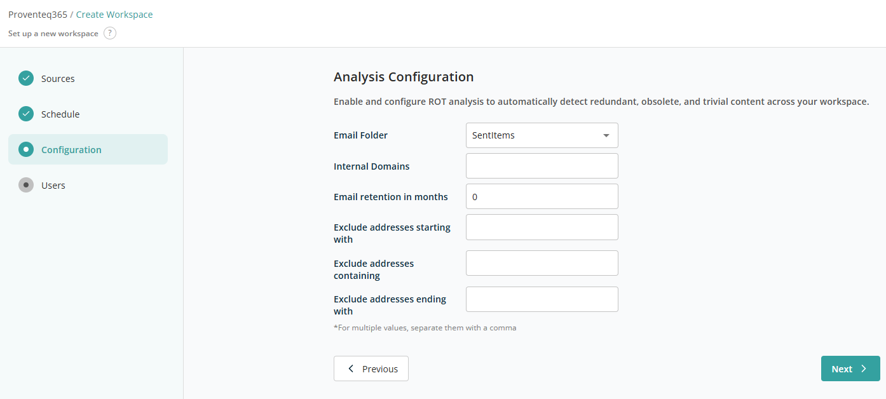

# Create Exchange Monitoring Workspace

You need the **Tenant Admin** role to create a workspace. Open **Manage** → **Workspaces** and click **+ Create New Workspace**. The wizard has four steps: **Sources**, **Schedule**, **Configuration** and **Users**.

## Define Your Workspace

On the **Sources** step, enter a **Workspace name**, select the **Exchange Monitoring** card and click **Next**. An Exchange Monitoring workspace has no site scope to choose: every eligible mailbox in the tenant is in scope, apart from the ones you exclude on the **Configuration** step.

## Data Refresh Schedule

Choose **One time** or **Recurring** and set when the email scan runs. Scheduling works the same as for a Microsoft 365 Governance workspace. See [Data Refresh Schedule](../02-manage/workspaces/README.md#data-refresh-schedule). Click **Next**.

## Analysis Configuration

The **Analysis Configuration** step defines the Exchange email analysis settings:

- **Email Folder** — The mailbox folder to scan in each mailbox. Only emails in this folder are counted. Default: **SentItems**, which counts each email once, in the sender's mailbox. The reports name the folder they were measured from.
- **Internal Domains** — Your organisation's email domains, for example *contoso.com*. Type a domain and press Enter or a comma, or paste a list. Domains can contain only letters, numbers, dots and hyphens. The list is used twice:
  - An email counts as external when at least one of its **To** recipients is outside these domains.
  - A link counts as internal when its host name contains one of these domains, or when it is a OneDrive for Business link whose owner's address is on one of these domains. A SharePoint host such as *contoso.sharepoint.com* does not contain *contoso.com*, so add your SharePoint host name to the list as well if links to your own sites should count as internal.
- **Email retention in months** — How many months of email to scan, counted back from the day of the scan. Older emails are not read and do not appear in any figure. Enter `0` (the default) to scan all email in the folder, or for example `12` to scan the last 12 months. The value must be a whole number of 0 or more.
- **Exclude addresses starting with** — Leaves out mailboxes whose user name (the part of the address before the @) starts with this text, for example *noreply*.
- **Exclude addresses containing** — Leaves out mailboxes whose user name contains this text, for example *support*.
- **Exclude addresses ending with** — Leaves out mailboxes whose user name ends with this text, for example *-svc*. The match is on the part before the @, so a domain such as `@contoso.com` never matches.

For the three exclusion fields, type a pattern and press Enter or a comma, or paste a list. Patterns cannot contain spaces or commas. Guest accounts and accounts without a mailbox address are always left out.

Click **Next**.

## Workspace Users

Add the people who can use the workspace and choose their role, as for any workspace. See [Workspace Users](../02-manage/workspaces/README.md#workspace-users).

Click **Create Workspace**. Proventeq365 opens the new workspace on the [Email Report](./email-report.md), which shows the progress of the first email scan until its data is ready. Exchange Monitoring workspaces have no dashboard.

## Change the Settings Later

A **Workspace Admin** can change the schedule, the analysis configuration and the users with **Edit** on the workspace. Changes apply from the next data refresh. Changing the **Email Folder** or **Email retention in months** changes what the next scan measures, so figures before and after the change are not directly comparable. When the change makes the figures jump between two refreshes, the **History** view of the Email Report fades the earlier bars and explains why.

## Related

- [Exchange Monitoring](./README.md)
- [Email Report](./email-report.md)
- [Link Report](./link-report.md)
- [Workspaces](../02-manage/workspaces/README.md)
- [How to Monitor Exchange Links and Attachments](../13-how-to-guides/15-monitor-exchange-links-and-attachments.md)
