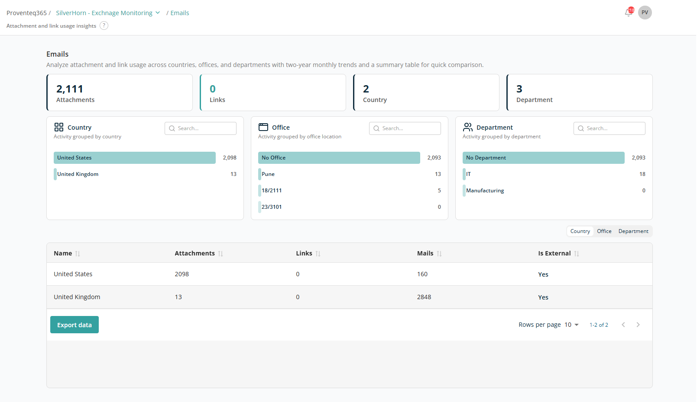

# Email Report

The **Emails** report shows how files are shared by email: how many attachments are sent, how much storage they take, and how many links are sent instead. It breaks the figures down by country, office and department, so you can see who sends the most attachments and follow the change over time.

Open it from **Reports** → **Emails** in an Exchange Monitoring workspace. It is the page an Exchange Monitoring workspace opens on.

## Who Can Use It

- Any user with a role on the workspace (**Workspace User** or higher) can view the report.
- Your license must include the **Exchange** feature.

## What the Report Measures

Each email scan reads the **Email Folder** chosen in the workspace configuration — by default **SentItems** — in every mailbox in scope. The figures count the emails in that folder, their attachments and the links in their text. See [Create Exchange Monitoring Workspace](./create-workspace.md).

- Every email is credited to the owner of the mailbox it was found in. Country, office and department come from that person's details in your directory. People with no value recorded are grouped under **No Country**, **No Office** or **No Department**.
- Only links to SharePoint, OneDrive for Business, personal OneDrive and WeShare are counted. Links that Microsoft Defender Safe Links has rewritten are read as the original link, so they are counted and classified correctly.
- Older months show only the email that is still in the mailboxes. Mail deleted by users or by retention policies before the scan cannot be counted.

## Views

Two tabs at the top of the page switch the panels and the chart between two measures:

- **Attachments & links** — the number of attachments and links. This is the default.
- **Storage** — the storage taken by attachments.

## Summary Cards

The cards at the top show the totals for the current filters. Hover over a card's information icon for details.

- **Attachments** — The number of files attached to the emails in scope. The tooltip names the folder the figures were measured from, for example *Measured from the SentItems folder of each mailbox in scope.*
- **Storage** — The total size of those attachments. When the folder is **SentItems**, this is the sender's copy in your tenant: *Sender-side copy in your tenant — recipients' copies are extra.* For any other folder, the same file can be counted once for each mailbox that holds it.
- **Links** — The number of links found in the emails in scope.
- **Link share** — Links as a percentage of all attachments and links, for example *1,200 links out of 4,000 attachments and links.* A higher share means more files are shared as links rather than attached.

## Country, Office and Department

Three panels break the figures down by **Country**, **Office** and **Department**. Use the **Search...** box in a panel to find a value.

- In the **Attachments & links** view, each row has two bars, **Attachments** and **Links**, on the same scale. Rows are ranked by the two added together.
- In the **Storage** view, each row has one bar for attachment storage, and rows are ranked by storage, so the groups that send the largest files come first.

Click a bar to filter the whole report by that country, office or department. Active filters appear as chips next to **Active filters** at the top of the page. Remove one chip, or click **Clear all**. The Emails and Links reports share their filters, so a filter you set here still applies when you open the [Link Report](./link-report.md).

## Trend Chart

In the **Attachments & links** view, the chart has two modes:

- **Latest** — **Attachments / Links of the current discovery run**: one line for attachments and one for links, by the month the emails were sent. Click two points to filter the report to that range of months, or click the same point twice to filter by a single month. The information icon explains that older months measure what survived in the mailboxes, not what was sent, so a rise from left to right is not by itself growth.
- **History** — **Attachments / Links of all discovery runs**: one pair of bars for each data refresh. Click a bar to filter the report to that data refresh; the chart returns to **Latest** and a **Run** chip with the refresh date appears in the filters. The bars use a logarithmic scale. If the figures jump by a large step between two refreshes — for example after the workspace's folder or retention setting changed — the bars before the step are faded and a note says they are not comparable with the ones after it.

In the **Storage** view, the chart shows **Attachment storage of the current discovery run** by month, with no **History** mode. Click two points to filter by a range of months, as in **Latest**.

## Data Table

The table summarises the figures by **Country**, **Office** or **Department**; choose the grouping with the tabs above the table. Columns:

- **Country**, **Office** or **Department** — the group, matching the selected tab.
- **Attachments** — the number of attachments.
- **Storage** — the size of those attachments.
- **Links** — the number of links.
- **Mails** — the number of emails.
- **Source** — **External** for emails sent to at least one recipient outside your internal domains, **Internal** otherwise. A group can have one row for each.

The table follows the active filters and can be sorted by any column. The toolbar above it has:

- **Search** — shows only the rows whose group name contains the text you type.
- **Refresh** — reloads the table.
- **Export** — downloads the table as a CSV file for the current grouping and filters. The export always holds every row, so it is unavailable while a search is active: *Clear the search to export. The export holds every row, not only the ones the search shows.*

## Related

- [Exchange Monitoring](./README.md)
- [Link Report](./link-report.md)
- [Create Exchange Monitoring Workspace](./create-workspace.md)
- [How to Monitor Exchange Links and Attachments](../13-how-to-guides/15-monitor-exchange-links-and-attachments.md)
