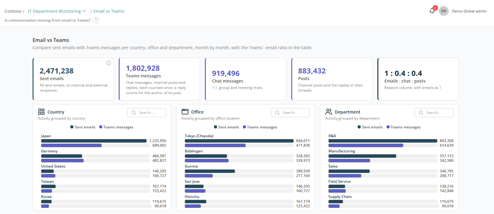
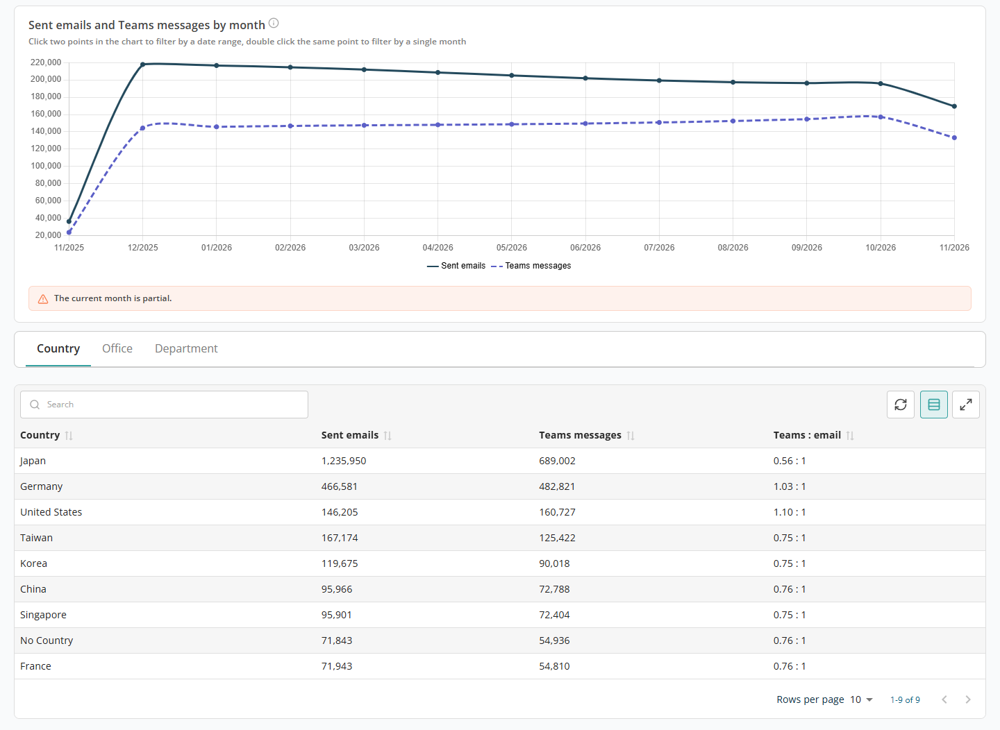

# Email vs Teams Report

The **Email vs Teams** report compares sent emails with Teams messages across your organisation. It helps you see whether communication is moving from email to Teams, by country, office location, and department, month by month. The report appears under **Reports** in an Exchange Monitoring workspace when both **Email discovery** and **Teams discovery** are on in the workspace configuration.

## Overview

The top section provides a quick summary of email and Teams activity:

- **Sent emails** — All sent emails, to internal and external recipients. The info icon gives the date of the email refresh they come from: the latest one that completed.
- **Teams messages** — Chat messages, channel posts and replies, each counted once. A reply counts for the author of its post.
- **Chat messages** — 1:1, group and meeting chats.
- **Posts** — Channel posts and the replies in their threads.
- **Emails : chat : posts** — Relative volume, with emails as 1. For example, `1 : 0.4 : 0.4` means 0.4 chat messages and 0.4 posts for every sent email.

Warning notes above the cards tell you when the figures need care:

- The Teams notes described in the [Teams Report](./teams-report.md#overview), when the latest Teams run did not read everything.
- Emails are read from a folder other than **Sent Items** (see **Email Folder** in [Create Exchange Monitoring Workspace](./create-workspace.md)). They are then not only sent emails, so they do not compare like for like with Teams messages.
- Sent emails and Teams messages start in different months. The totals, panels, and table then count from the first month both cover.
- The months picked in the chart are all before the first month both cover, so there is nothing to compare. Remove the month filter, then pick a later month in the chart.

## Analytical Insights

The section provides visual breakdowns to help you compare email and Teams usage:

- **Country** — Sent emails and Teams messages grouped by country. Use the **Search** box to locate data by country.
- **Office** — Sent emails and Teams messages grouped by office location. Use the **Search** box to locate data by office name.
- **Department** — Sent emails and Teams messages grouped by department. Use the **Search** box to locate data by department name.

Each row shows two bars, **Sent emails** and **Teams messages**, on the same scale. Each row is clickable and acts as a filter for the data. Clicking a row filters the entire report by that selection, and clicking it again removes the filter. The selected criteria are displayed at the top under **Active filters**, where you can remove one filter or click **Clear all**.

The **Sent emails and Teams messages by month** chart shows both series month by month. Click two points in the chart to filter the report by a date range, or double click the same point to filter by a single month. After the first click, **Cancel** stops the selection.

The info icon next to the chart title explains how to read it:

- One email is not one message: compare the trend of each series, not their heights.
- An email month counts what the mailboxes still held at the latest email refresh, so older months lose what retention has deleted since. A Teams month keeps what was counted. Fewer sent emails in older months can come from that, not from less email.
- It can also give the date the Teams history starts. A month before that date shows sent emails only.

A note under the chart tells you when the latest months are not final: **The current month is partial**, or Teams months from a given month are still filling in because a later run can add to them.

## Data Table

The table provides a comparative summary of email and Teams activity. Columns:

- **Country**, **Office**, or **Department** — The selected grouping. The column takes its name from the selected tab.
- **Sent emails** — Number of sent emails.
- **Teams messages** — Number of Teams messages.
- **Teams : email** — Teams messages per sent email. For example, `1.03 : 1` means 1.03 Teams messages for every sent email.

Above the table, three tabs let you view the data by **Country, Office, and Department**. Based on the selected tab, the first column shows the corresponding value (e.g. if the Country tab is selected, the first column reflects a value like `Germany`).

The table supports sorting on all columns.

The toolbar above the table offers:

- **Search** — Filters the rows of the table by the text you type.
- **Refresh** — Reloads the table.
- **Toggle density** and **Toggle fullscreen** — Change how the table is displayed.

At the bottom right of the table:

- **Rows per page** — 5, 10, 15, 20, 25, 30, 50, or 100. Default: 10.
- **Total Record Count** — Range and total record count.
- **Next/Previous Navigation** — Arrow icons to navigate.
