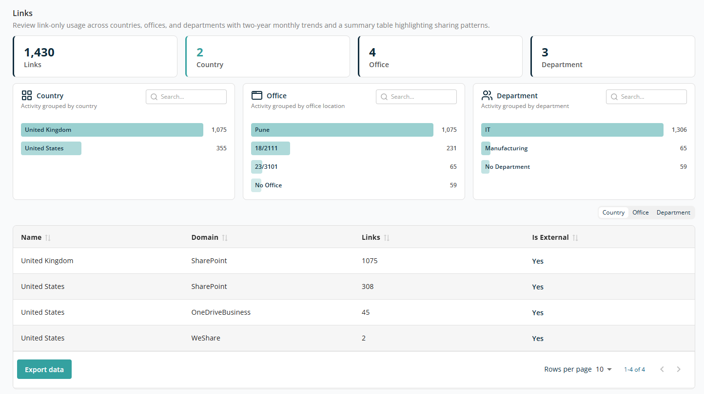

# Link Report

The **Links** report shows the links to files that your organisation shares by email. It tells you which systems the links point to, how many point to locations outside your organisation, and which countries, offices and departments send them.

Open it from **Reports** → **Links** in an Exchange Monitoring workspace.

## Who Can Use It

- Any user with a role on the workspace (**Workspace User** or higher) can view the report.
- Your license must include the **Exchange** feature.

## Which Links Are Counted

The report counts links found in the text of the emails in the workspace's **Email Folder**. See [Create Exchange Monitoring Workspace](./create-workspace.md).

- Only links to these systems are counted; the system appears in the **Domain** column and in the chart:
  - **SharePoint** — links to SharePoint sites.
  - **OneDriveBusiness** — links to OneDrive for Business, including direct links to a person's OneDrive, viewer links and Loop components.
  - **OneDrivePersonal** — links to personal OneDrive (onedrive.live.com).
  - **WeShare** — links to WeShare.
- Links that Microsoft Defender Safe Links has rewritten are read as the original link, so a protected SharePoint link is counted as a SharePoint link and classified as internal or external like any other.
- Each link is credited to the owner of the mailbox the email was found in, as on the Emails report, even when the email was sent from a shared address. Country, office and department come from that person's details in your directory.
- A link is **Internal** when its host name contains one of the workspace's **Internal Domains**, or when it points to the OneDrive of a person whose address is on one of those domains. Every other link is **External**. To count links to your own SharePoint sites as internal, include your SharePoint host name, such as *contoso.sharepoint.com*, in **Internal Domains**. See [Analysis Configuration](./create-workspace.md#analysis-configuration).

## Internal and External

The tabs at the top of the page — **All**, **Internal** and **External** — limit the whole report, including the cards, panels, chart and table, to all links, internal links only or external links only.

## Summary Cards

- **Links** — The number of links for the current tab and filters. The label changes to **Internal links** or **External links** on those tabs.
- **Countries**, **Offices** and **Departments** — How many countries, offices and departments sent links. Each card names the one that sent the most, for example *Most active: United Kingdom*. When two or more share the top place, the card says *No single most active country*.

## Links by Source

The **Links by source** panel shows the total number of links shared by email.

## Country, Office and Department

Three panels break the links down by **Country**, **Office** and **Department**. Use the **Search...** box in a panel to find a value.

Click a bar to filter the whole report by that country, office or department. Active filters appear as chips next to **Active filters** at the top of the page. Remove one chip, or click **Clear all**. The Emails and Links reports share their filters, so a filter you set on either report also applies on the other.

## Trend Chart

**Links of the current discovery run** shows one line for each system the links point to, by the month the emails were sent. The legend under the chart lists the systems; click one to hide or show its line.

Click two points to filter the report to that range of months, or click the same point twice to filter by a single month.

## Data Table

The table summarises the links by **Country**, **Office** or **Department**; choose the grouping with the tabs above the table. Columns:

- An icon for the system the links point to.
- **Country**, **Office** or **Department** — the group, matching the selected tab.
- **Domain** — the system the links point to, for example **SharePoint** or **OneDriveBusiness**.
- **Links** — the number of links.
- **Source** — **Internal** or **External**, as described above.

A group has one row for each system and each of internal and external. The table follows the active filters and the **All** / **Internal** / **External** tab, and can be sorted by any column. The toolbar above it has:

- **Search** — shows only the rows whose group name contains the text you type.
- **Refresh** — reloads the table.
- **Export** — downloads the table as a CSV file for the current grouping, tab and filters. It is unavailable while a search is active: *Clear the search to export. The export holds every row, not only the ones the search shows.*

## Related

- [Exchange Monitoring](./README.md)
- [Email Report](./email-report.md)
- [Create Exchange Monitoring Workspace](./create-workspace.md)
- [How to Monitor Exchange Links and Attachments](../13-how-to-guides/15-monitor-exchange-links-and-attachments.md)
