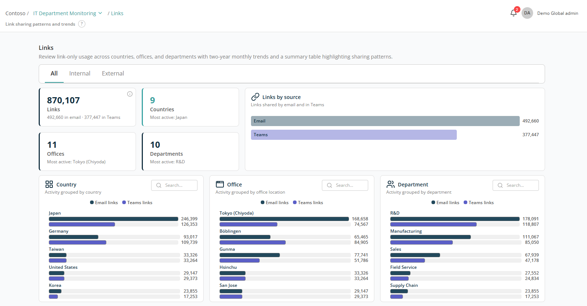
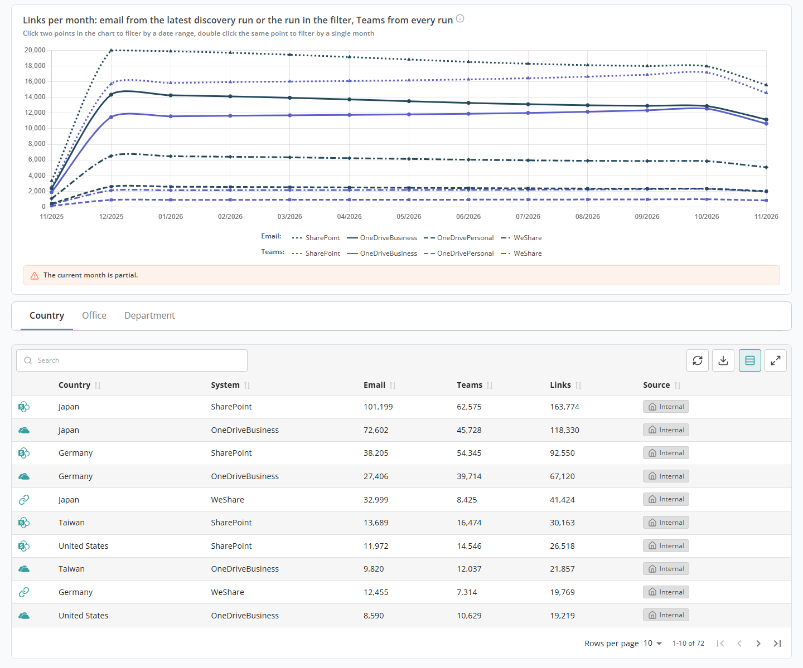

# Link Report

The **Links** report provides insights into how file and resource links are shared across your organisation: by email and, when **Teams discovery** is on, in Teams. It helps you analyse link-sharing patterns by country, office location, and department, enabling better monitoring of external access and data exposure risks.

At the top, three tabs let you choose which links the report counts: **All**, **Internal**, or **External**.

## Overview

The top section provides a quick summary of link activity:

- **Links** — Total number of links. The label follows the selected tab: **Links**, **Internal links**, or **External links**. When Teams links are counted, the line below splits the total into links in email and links in Teams, and the info icon notes that Teams links come from 1:1, group and meeting chats, channel posts and replies.
- **Countries** — Number of countries contributing to link-sharing activity, with the most active one.
- **Offices** — Number of office locations involved, with the most active one.
- **Departments** — Number of departments contributing to link usage, with the most active one.
- **Links by source** — Links shared by **Email** and in **Teams**. Click a bar to filter the report to that source, and click it again to show both. The **Teams** bar shows only when Teams discovery is on.

When the report counts Teams links, warning notes above the cards can tell you that the latest Teams run did not read everything (see the [Teams Report](./teams-report.md#overview)), or that email links and Teams links start in different months. In the second case, the totals cover different months: pick a month range in the chart to compare the same months.

## Analytical Insights

The section provides visual breakdowns to help you understand link-sharing patterns:

- **Country** — Number of links grouped by country. Helps to identify where most links are being shared geographically. Use the **Search** box to locate data by country.
- **Office** — Number of links grouped by office location. Useful for identifying activity from specific office locations. Use the **Search** box to locate data by office name.
- **Department** — Number of links grouped by department. Helps assess department-wise data sharing behaviour. Use the **Search** box to locate data by department name.

When the report shows both sources, each row has two bars, **Email links** and **Teams links**. Each row is clickable and acts as a filter for the data. Clicking a row filters the entire report by that selection, and clicking it again removes the filter. The selected criteria are displayed at the top under **Active filters**, where you can remove one filter or click **Clear all**.

The chart **Links per month: email from the latest discovery run or the run in the filter, Teams from every run** shows one line per system for each source shown. When both sources are shown, the legend lists the systems under **Email:** and **Teams:**; click an entry to hide or show its line. Click two points in the chart to filter the report by a date range, or double click the same point to filter by a single month.

When the chart shows both sources, the info icon next to its title explains that an email month counts what the mailboxes still held at the latest email refresh, so older months lose what retention has deleted since. A Teams month keeps what was counted. A note under the chart tells you when the latest Teams months are not final, for example **The current month is partial**.

## Data Table

The table provides a comparative summary of link activity. Columns:

- **Country**, **Office**, or **Department** — The selected grouping. The column takes its name from the selected tab. An icon before it shows the system.
- **System** — The platform from which the link originates, e.g. SharePoint, OneDriveBusiness, WeShare.
- **Email** — Number of links shared by email. Shown when the report shows both sources.
- **Teams** — Number of links shared in Teams. Shown when the report shows both sources.
- **Links** — Number of links shared.
- **Source** — Whether the links are **Internal** or **External**.

Above the table, three tabs let you view the data by **Country, Office, and Department**. Based on the selected tab, the first column shows the corresponding value.

The table supports sorting on all columns.

The toolbar above the table offers:

- **Search** — Filters the rows of the table by the text you type.
- **Refresh** — Reloads the table.
- **Export** — Downloads the table as a CSV file for offline analysis or reporting. Clear the search first: the export holds every row, not only the ones the search shows.
- **Toggle density** and **Toggle fullscreen** — Change how the table is displayed.

At the bottom right of the table:

- **Rows per page** — 5, 10, 15, 20, 25, 30, 50, or 100. Default: 10.
- **Total Record Count** — Range and total record count.
- **Next/Previous Navigation** — Arrow icons to navigate.
