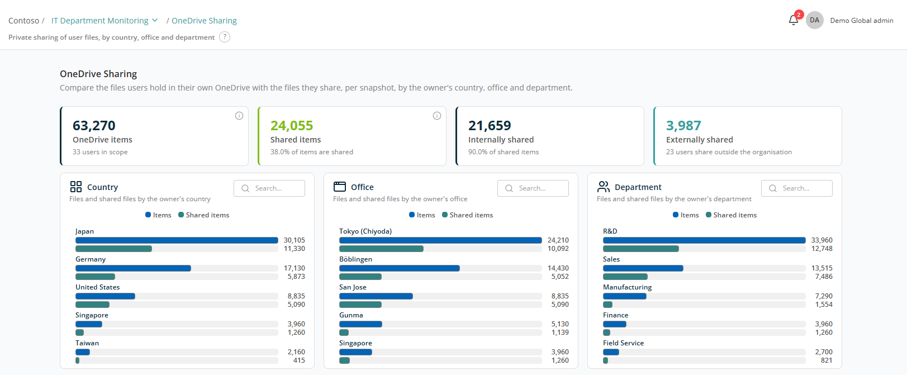
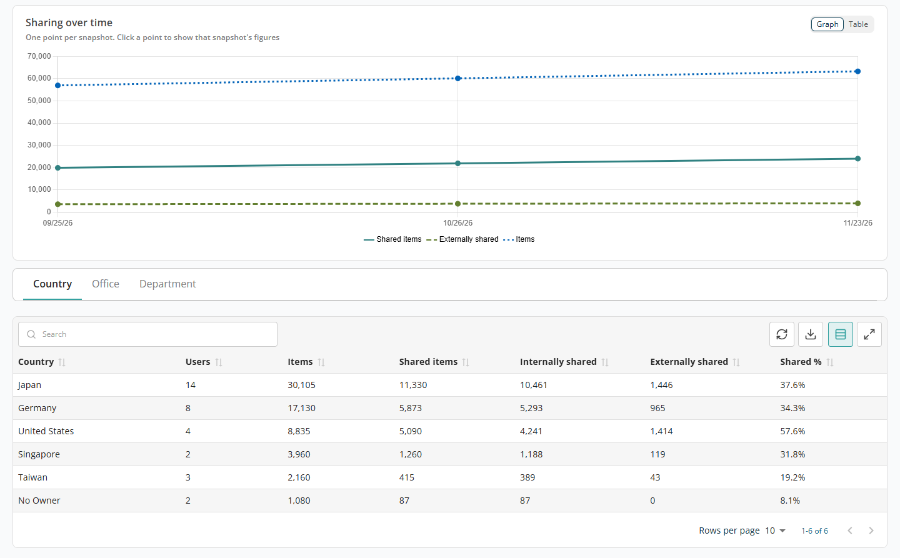

# OneDrive Sharing Report

The **OneDrive Sharing** report compares the files users hold in their own OneDrive with the files they share, by the owner's country, office location, and department. In an Exchange Monitoring workspace, the report appears under **Reports** when **OneDrive sharing** is on in the workspace configuration. The workspace then reads who each OneDrive is shared with after each data refresh: every OneDrive in the tenant, or only the pilot users' OneDrives when pilot users are set.

Sharing is a current-state measure, not an activity count. The figures come from snapshots, and every complete discovery adds a point to the trend. A file beneath a shared folder counts as shared, and each file counts once, however many links or permissions it has.

## Overview

The top section provides a quick summary of OneDrive sharing:

- **OneDrive items** — Total number of items in the OneDrives in scope. The line below shows the number of users in scope. The info icon gives the date of the snapshot and how many OneDrive owners were found in the directory; the rest are counted under **No Owner**.
- **Shared items** — Number of shared items, with the percentage of all items that are shared. The info icon shows how many items are shared both internally and externally; they appear in both classifications.
- **Internally shared** — Number of items shared inside the organisation, with their percentage of the shared items.
- **Externally shared** — Number of items shared with people outside the organisation, with the number of users who share outside the organisation.

**Shared items** and **Externally shared** appear only when **Show external sharing** is on under **OneDrive sharing** in the workspace configuration. Without it, the report shows **OneDrive items** and **Internally shared**, with the percentage of all items that are shared internally. The screenshots on this page show a workspace with external sharing on.

A warning note above the cards tells you when the figures are not from the latest discovery:

- The first OneDrive discovery is still collecting. Figures appear when it completes.
- The latest discovery did not produce a sharing snapshot. The figures are then from an earlier snapshot, and the note gives both dates.

Until the first snapshot exists, the page shows **No OneDrive sharing snapshot yet**. The first snapshot is taken when a full OneDrive discovery completes with security discovery on.

## Analytical Insights

The section provides visual breakdowns to help you understand OneDrive sharing patterns:

- **Country** — Files and shared files by the owner's country. Use the **Search** box to locate data by country.
- **Office** — Files and shared files by the owner's office. Use the **Search** box to locate data by office name.
- **Department** — Files and shared files by the owner's department. Use the **Search** box to locate data by department name.

Each row shows two bars on the same scale: **Items** and **Shared items**, or **Items** and **Internally shared** when external sharing is off. Each row is clickable and acts as a filter for the data. Clicking a row filters the entire report by that selection, and clicking it again removes the filter. The selected criteria are displayed at the top under **Active filters**, where you can remove one filter or click **Clear all**.

The **Sharing over time** chart shows one point per snapshot, with a line for **Items**, **Shared items**, and **Externally shared** (or **Items** and **Internally shared** when external sharing is off). Click a point to show that snapshot's figures in the rest of the report; a **Snapshot** filter with its date appears at the top. Use **Graph** and **Table** to switch between the chart and a table of the snapshots. In the table, clicking a row selects that snapshot.

## Data Table

The table provides a comparative summary of OneDrive sharing. Columns:

- **Country**, **Office**, or **Department** — The selected grouping, by the owner of the OneDrive. The column takes its name from the selected tab.
- **Users** — Number of users.
- **Items** — Number of items.
- **Shared items** — Number of shared items.
- **Internally shared** — Number of items shared inside the organisation.
- **Externally shared** — Number of items shared with people outside the organisation.
- **Shared %** — Percentage of items that are shared.

When external sharing is off, the table shows **Users**, **Items**, **Internally shared**, and **Internally shared %** after the grouping column.

Above the table, three tabs let you view the data by **Country, Office, and Department**. Based on the selected tab, the first column shows the corresponding value (e.g. if the Country tab is selected, the first column reflects a value like `Germany`).

The table supports sorting on all columns.

The toolbar above the table offers:

- **Search** — Filters the rows of the table by the text you type.
- **Refresh** — Reloads the table.
- **Export** — Downloads the table of the snapshot shown as a CSV file. Clear the search first: the export holds every row, not only the ones the search shows.
- **Toggle density** and **Toggle fullscreen** — Change how the table is displayed.

At the bottom right of the table:

- **Rows per page** — 5, 10, 15, 20, 25, 30, 50, or 100. Default: 10.
- **Total Record Count** — Range and total record count.
- **Next/Previous Navigation** — Arrow icons to navigate.
