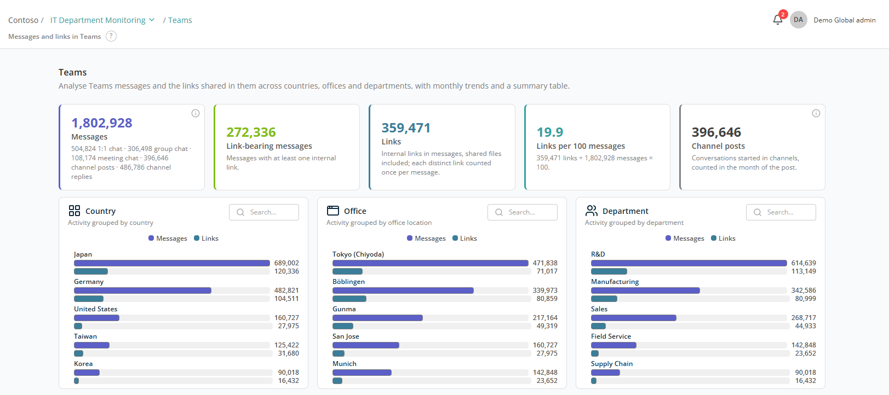
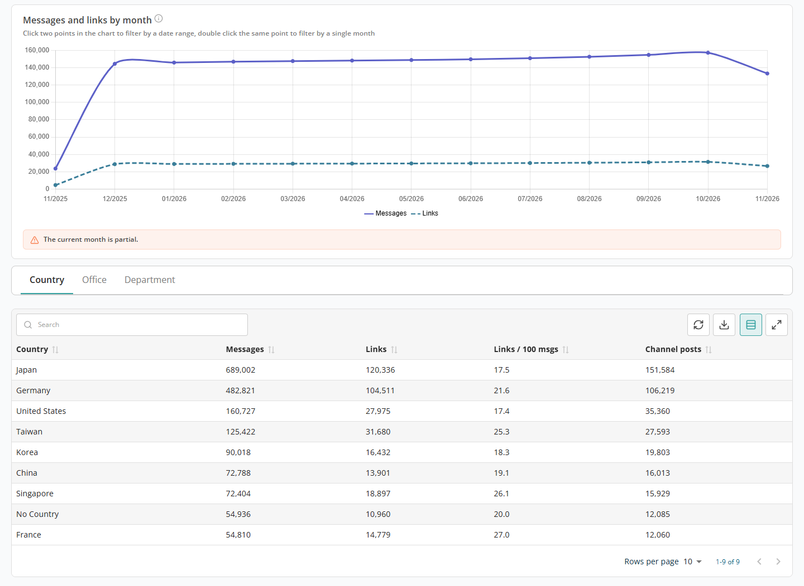

# Teams Report

The **Teams** report provides insights into Teams messages and the links shared in them across your organisation. It breaks them down by country, office location, and department, with monthly trends and a summary table. The report appears under **Reports** in an Exchange Monitoring workspace when **Teams discovery** is on in the workspace configuration. If it is off, the page shows **Teams discovery is off for this workspace**, with an **Open workspace settings** button for users who can edit the workspace.

## Overview

The top section provides a quick summary of Teams activity:

- **Messages** — Total number of Teams messages: 1:1, group and meeting chats, channel posts and replies. The line below the number splits the total into 1:1 chat, group chat, meeting chat, channel posts, and channel replies.
- **Link-bearing messages** — Messages with at least one internal link.
- **Links** — Internal links in messages, shared files included. Each distinct link is counted once per message.
- **Links per 100 messages** — Links divided by messages, multiplied by 100.
- **Channel posts** — Conversations started in channels, counted in the month of the post. They are already counted in **Messages**, never added to it.

A warning note above the cards tells you when the latest run did not read everything:

- Channel posts and replies, or chats, from the latest run are not included. Either the permission they need has not been granted, or the run reached its time limit before reading them.
- The latest run is incomplete because some users or teams could not be read. The next run reads them again.
- The latest run did not read some teams and users. Either a permission they need has not been granted, or the run reached its time limit. The next run tries them again.

## Analytical Insights

The section provides visual breakdowns to help you understand Teams usage patterns:

- **Country** — Messages and links grouped by country. Use the **Search** box to locate data by country.
- **Office** — Messages and links grouped by office location. Use the **Search** box to locate data by office name.
- **Department** — Messages and links grouped by department. Use the **Search** box to locate data by department name.

Each row shows two bars, **Messages** and **Links**, on the same scale. Each row is clickable and acts as a filter for the data. Clicking a row filters the entire report by that selection, and clicking it again removes the filter. The selected criteria are displayed at the top under **Active filters**, where you can remove one filter or click **Clear all**.

The **Messages and links by month** chart shows the number of messages and links in each month. Click two points in the chart to filter the report by a date range, or double click the same point to filter by a single month. After the first click, **Cancel** stops the selection.

A note under the chart tells you when the latest months are not final: **The current month is partial**, or months from a given month are still filling in because a later run can add to them. When the Teams history starts in the middle of a month, the info icon next to the chart title gives the date it is counted from.

## Data Table

The table provides a comparative summary of Teams activity. Columns:

- **Country**, **Office**, or **Department** — The selected grouping. The column takes its name from the selected tab.
- **Messages** — Number of Teams messages.
- **Links** — Number of links shared in the messages.
- **Links / 100 msgs** — Links per 100 messages.
- **Channel posts** — Number of channel posts.

Above the table, three tabs let you view the data by **Country, Office, and Department**. Based on the selected tab, the first column shows the corresponding value (e.g. if the Country tab is selected, the first column reflects a value like `Germany`).

The table supports sorting on all columns.

The toolbar above the table offers:

- **Search** — Filters the rows of the table by the text you type.
- **Refresh** — Reloads the table.
- **Export** — Downloads the table as a CSV file for offline analysis or reporting. Clear the search first: the export holds every row, not only the ones the search shows.
- **Toggle density** and **Toggle fullscreen** — Change how the table is displayed.

At the bottom right of the table:

- **Rows per page** — 5, 10, 15, 20, 25, 30, 50, or 100. Default: 10.
- **Total Record Count** — Range and total record count.
- **Next/Previous Navigation** — Arrow icons to navigate.
