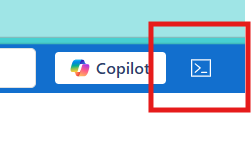
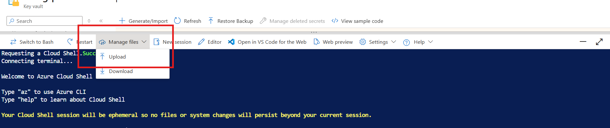
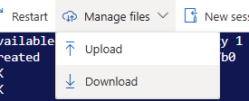
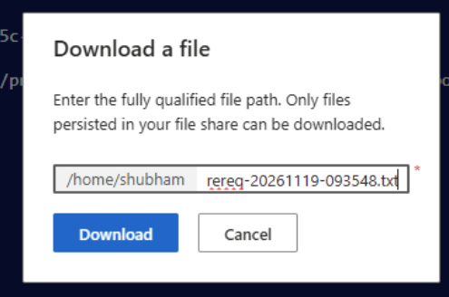

# Run the Prerequisites Script

**What this does:** `Proventeq365Prerequisites.ps1` prepares what the Marketplace deployment needs. It configures the app registration(s) for the required deployment and permission modes, optionally grants admin consent, validates the App Service plan quota, and creates or reuses the bootstrap resource group and **Bootstrap Key Vault** containing deployment secrets and tags. The Marketplace deployment reads values from that vault, so no secrets are shared with Proventeq.

Run this script **before** you deploy Proventeq365 from Azure Marketplace. Your Proventeq contact provides the container registry (ACR) username and password.

> **Before you start:** confirm the person running the script has the access listed in [Required Access](./03-azure-prerequisites.md#required-access), and that you have the values listed in [Information to Collect](./03-azure-prerequisites.md#information-to-collect).

The prerequisites script requires Azure CLI (`az`) 2.53 or later. PowerShell 7 or later is recommended; Azure Cloud Shell PowerShell is supported. If running locally, sign in with `az login` before starting.

## Download the Scripts

Download the deployment scripts to your machine:

- [Proventeq365Prerequisites.ps1](/prerequisites/Proventeq365Prerequisites.ps1) — run before the Marketplace deployment.
- [Proventeq365PostDeployment.ps1](/postdeploy/Proventeq365PostDeployment.ps1) — run after the Marketplace deployment.
- [Grant-NotificationMailboxSend.ps1](/postdeploy/Grant-NotificationMailboxSend.ps1) — optional, only if Proventeq365 should send email; see [Notification Email](./08-notification-email.md).

You upload them to Azure Cloud Shell in the next step.

## Open Azure Cloud Shell and Upload the Scripts

### Step 1 — Sign in to the Azure portal

1. Go to **https://portal.azure.com**.
2. Sign in with the account that has the access listed in [Required Access](./03-azure-prerequisites.md#required-access).

### Step 2 — Open Cloud Shell

1. Select the **Cloud Shell** icon (`>_`) in the top navigation bar of the portal, next to the search box.

   

2. If this is your first time, choose **PowerShell**. To keep scripts and logs between Cloud Shell sessions, select or create the required storage account and file share when prompted. This stores your Cloud Shell `$HOME` files in Azure Files; storage charges apply. Choose **No storage account required** only for a temporary session, and download any files you need before it ends.
3. If the toolbar shows **Switch to PowerShell**, select it. When you are already in PowerShell, the toolbar shows **Switch to Bash** and the prompt starts with `PS /home/<your-name>>`.

### Step 3 — Upload the scripts

1. In the Cloud Shell toolbar, select **Manage files** → **Upload**.
2. Select the downloaded `Proventeq365Prerequisites.ps1` and upload it.
3. Repeat for `Proventeq365PostDeployment.ps1`, and for `Grant-NotificationMailboxSend.ps1` if you downloaded it.



### Step 4 — Check the files are there

Files are uploaded to your home folder. Run:

```powershell
ls ./Proventeq365*.ps1
```

You should see both script names listed.

## Download and Keep the Script Logs

The prerequisites script writes each log entry to both a timestamped `.log` file and a matching `.txt` file under the `logs` folder next to the script. Both files are updated as the script runs; there is no end-of-run copy step. The script prints both full paths when it starts and repeats them in the success summary. If a runtime error stops the script, use the paths printed at startup. The `.txt` file contains entries sent through the script's logging function; an unexpected PowerShell error may appear only in the console unless the script explicitly logs it.

### Download a copy to your computer

1. In the script output, find **Text log file** and copy its full path. It looks like `/home/<your-name>/logs/prereq-20261119-093548.txt`. Download the `.txt` file; it contains the same logged entries as the `.log` file and is convenient to open on your computer.
2. In the Cloud Shell toolbar, select **Manage files** → **Download**.

   

3. Paste the full path into **Enter the fully qualified file path**, then select **Download**. For example, enter `/home/shubham/logs/prereq-20261119-093548.txt` using the exact username and timestamp printed by your run.

   

4. The browser downloads the TXT file to your computer (usually its Downloads folder).

Cloud Shell's **Download** command only downloads files persisted in the Cloud Shell file share. Configure Cloud Shell storage when prompted; a temporary session without persistent storage may not have downloadable files. The download is user initiated; the script cannot save directly into your computer's folders. Because entries are written to both files as they occur, the TXT file remains available if a runtime error stops the script, but it contains only entries logged before that error. Parameter-binding errors that prevent the script body from starting cannot be captured.

If you want the logs written directly to your computer without downloading them from a browser, run the script locally instead. The script supports local PowerShell 7 or later and Azure CLI (`az`) 2.53 or later; sign in first with `az login`. By default, both log files are written to the `logs` folder beside the local script. Keep that folder private because logs contain tenant, subscription and resource details.

### Keep logs for later Cloud Shell sessions

Cloud Shell sessions themselves are temporary, but files in `$HOME` persist when Cloud Shell is connected to its Azure Files-backed storage. The instructions above upload the script to `$HOME`, and its default `logs` folder is beside that script, so both log files remain available after closing and reopening Cloud Shell when persistent storage is enabled. If you previously chose **No storage account required**, reset Cloud Shell user settings and configure an existing or new storage account before relying on persistence. See [Persist files in Azure Cloud Shell](https://learn.microsoft.com/azure/cloud-shell/persisting-shell-storage).

Cloud Shell storage is convenient for later access from Cloud Shell, but it is not a separate organizational log archive. Files remain available across sessions while the backing storage account and file share are retained. For longer-term retention or shared access, logs can be uploaded to an organization-managed Azure Storage blob container. The current prerequisites script does not upload logs to Blob Storage; that enhancement would need a configured storage account/container, an agreed retention policy, and appropriate upload permissions (for example, **Storage Blob Data Contributor** scoped to the container). Treat the logs as operational records and restrict access accordingly.

## Signing In When Prompted (Device Code)

Cloud Shell is already signed in with your portal account, so **usually no extra sign-in is needed**. If the script needs to sign in again — for example because Cloud Shell is connected to a different directory — it pauses and shows a message like:

```text
To sign in, use a web browser to open the page https://login.microsoft.com/device and enter the code XXXXXXXXX to authenticate.
```

1. Copy the **URL** and the **code** from the message.
2. Open **https://login.microsoft.com/device** in a new browser tab, paste the code and select **Next**.
3. Choose your account. When asked *"Are you trying to sign in to Microsoft Azure CLI?"*, select **Continue**.
4. Return to Cloud Shell. If it asks you to **Select a subscription and tenant**, type the number for your tenant and press **Enter**.

## Run the Script

### How the commands work

- Each command is on **one line**. Copy the whole line, replace the sample values with your own and press **Enter**.
- `-AcrPassword (Read-Host -AsSecureString 'ACR password')` asks for the ACR password as hidden input. **Do not type the password into the command itself.**
- If you have more than one subscription and did not pass `-SubscriptionId`, the script lists them. Type the number of the correct subscription and press **Enter**.

### Parameters

| Parameter | Required | Default, allowed values and behavior |
| --- | --- | --- |
| `-CustomerTenantId` | Yes | Tenant containing the Azure subscription, resource group and Bootstrap Key Vault. |
| `-AppTenantId` | No | Defaults to `-CustomerTenantId`; use for the Microsoft 365 / app tenant in a cross-tenant deployment. |
| `-SubscriptionId` | No | If omitted, uses the only visible subscription or prompts when several are visible; with `-NonInteractive`, multiple subscriptions cause an error. |
| `-ApplicationName` | Yes | App name; 1–63 characters, starts with a letter or number, then letters, numbers, spaces, `.`, `_` or `-`. |
| `-ResourceGroupName` | No | Defaults to `rg-proventeq365-<normalized-application-name>`. Use a normal resource group, not a managed resource group. |
| `-Location` | Yes | Azure region for the bootstrap resource group, Key Vault and App Service quota probe. |
| `-PermissionMode` | Yes | `ReadOnly` or `ReadWrite`; selects the permission profile. |
| `-AcrUsername` | Yes | Pull username supplied by Proventeq. |
| `-AcrPassword` | Yes | `[securestring]`; use the hidden `Read-Host` prompt shown above. |
| `-PlatformAdminObjectId` | No | Defaults to the signed-in user in the app tenant. |
| `-DeploymentMode` | Yes | `SaaS` or `Hosted`; no default. See [Deployment Mode](./02-microsoft-365-prerequisites.md#deployment-mode). |
| `-SwitchMode` | No (default false) | Allows converting an existing Bootstrap Key Vault tagged with the other deployment mode. Without it, a mismatch stops the run; an existing vault with no mode tag is treated as `Hosted`. |
| `-ConfigureAiAgent` | No (default false) | Creates/configures the AI agent app and secret. Hosted-only; the script rejects this switch with `SaaS`. |
| `-GrantAdminConsent` | No (default false) | Grants consent to the required app(s). Requires Global Administrator or Privileged Role Administrator in the app tenant. |
| `-MultiTenant` / `-SingleTenant` | No (each defaults false) | Backward-compatible selectors for `SaaS` / `Hosted`. Supply at most one, and it must agree with `-DeploymentMode`; normally omit both. |
| `-KeyVaultName` | No | Defaults to a deterministic `kv-p365boot-...` name derived from application and subscription. Explicit names must meet Azure Key Vault naming rules: 3–24 letters, numbers or hyphens, starting with a letter and ending with a letter or number; names are globally unique. |
| `-ForceNewCert` | No (default false) | Rotates the client secret and SharePoint certificate; also rotates the AI agent secret when `-ConfigureAiAgent` is used. |
| `-RemoveBootstrapKeyVault` | No (default false) | Deletes and purges the Bootstrap Key Vault after setup; leaves the resource group. Do not use for a deployment that will consume this vault. |
| `-NonInteractive` | No (default false) | Prevents subscription selection prompts; provide `-SubscriptionId` if more than one subscription is visible. |
| `-DeployFoundry` | No (default false) | Sets the `deployFoundry` tag to true and registers `Microsoft.CognitiveServices` (also registered with `-ConfigureAiAgent`); it does not itself run the Marketplace deployment. |
| `-StaticWebAppRegion` | No | Defaults to `westeurope`; validates the Static Web App region and stores it in the `staticWebAppRegion` tag. |
| `-LogFolder` | No | Defaults to a `logs` folder next to the script. |
| `-AppServicePlanSku` | No | Defaults to `B3`. Allowed: `B1`, `B2`, `B3`, `S1`, `S2`, `S3`, `P0v3`, `P1v3`, `P2v3`, `P3v3`, `P0v4`, `P1v4`, `P2v4`, `P3v4`. |
| `-AppServicePlanCapacity` | No | Defaults to `1`; must be an integer of at least 1. |
| `-FailOnAppServicePlanQuota` | No | Defaults to true. Use `-FailOnAppServicePlanQuota:$false` only to continue after a failed/unknown quota probe; deployment can still fail. |
| `-CreateDeployUser` | No (default false) | Creates or reuses the optional deployment user; skipped for cross-tenant deployments. |
| `-DeployUserName` | No | Defaults to `proventeq365-deploy`; 1–64 letters, numbers, `_` or `-`, starting with a letter or number. |
| `-DeployUserDisplayName` | No | Defaults to `Proventeq365 Deployment User`; must not be empty. |

### Deployment mode examples

`-DeploymentMode` is mandatory on every prerequisites-script command. Use exactly one of these values:

**Hosted (single-tenant):**

```powershell
./Proventeq365Prerequisites.ps1 -CustomerTenantId <TENANT-ID> -ApplicationName "Proventeq365" -Location <REGION> -PermissionMode ReadWrite -DeploymentMode Hosted -AcrUsername <ACR-USERNAME> -AcrPassword (Read-Host -AsSecureString 'ACR password')
```

**SaaS (multi-tenant):**

```powershell
./Proventeq365Prerequisites.ps1 -CustomerTenantId <TENANT-ID> -ApplicationName "Proventeq365" -Location <REGION> -PermissionMode ReadWrite -DeploymentMode SaaS -AcrUsername <ACR-USERNAME> -AcrPassword (Read-Host -AsSecureString 'ACR password')
```

The SaaS mode creates a separate platform daemon app. `-ConfigureAiAgent` is currently Hosted-only.

### App Service quota check

Before creating the Bootstrap Key Vault, the script validates a Linux `Microsoft.Web/serverfarms` plan using `-AppServicePlanSku` and `-AppServicePlanCapacity` in `-Location`. It checks whether Azure Resource Manager accepts that SKU and capacity against the **App Service SKU quota** and the regional **Total Regional VMs quota**. The default probe is **B3**, capacity **1**. It validates; it does not create a plan or reserve quota. On success, the log confirms the SKU and capacity were validated, and the summary reports **Available**.

| Result | Meaning | Next step |
| --- | --- | --- |
| **NoQuota** | The selected App Service SKU quota is exhausted. | In **Azure portal → Quotas → App Service**, request an increase for that SKU, or choose a validated SKU and use the same SKU in the Marketplace deployment. |
| **NoRegionalQuota** | The regional **Total Regional VMs quota** is exhausted; other SKUs in that region will also fail. | Do not request the regional total directly. Request a small increase to the selected SKU limit and wait for the regional total to rise. If it does not, open **Service and subscription limits (quotas) → Function or Web App (Windows and Linux)** support. |
| **NotAvailable** | The SKU is not available for the subscription or region. | Choose a supported SKU or region and ensure the Marketplace plan uses it. |
| **BlockedByPolicy** | Azure Policy or a subscription restriction denied validation. | Ask the subscription administrator to resolve the reported restriction. |
| **Error** | Validation failed for another reason; quota is unknown. | Resolve the reported CLI, authentication or validation error before relying on the check. |

For **NoQuota** and **NotAvailable**, the script also probes the other allowed SKUs and prints their results. It does not test alternatives for **NoRegionalQuota**, because they share the exhausted regional quota. The script prints advice but never changes the SKU or region automatically.

With the default `-FailOnAppServicePlanQuota` behavior, any result other than **Available** causes the script to stop with an error stating that the **App Service Plan quota check failed** for the selected SKU and region. Credentials and tags have already been saved in the Bootstrap Key Vault, but the Marketplace identity grants and optional deploy-user setup have not run; the final summary is not reached. Setting `-FailOnAppServicePlanQuota:$false` logs a warning and continues. The Marketplace deployment may still fail when it creates the plan. Even a successful check does not reserve quota, so deployment-time validation may still fail.

### Optional deployment user

Use `-CreateDeployUser` only when you want the prerequisites script to create/reuse a dedicated same-tenant deployment identity. The default UPN is `proventeq365-deploy@<initial-tenant>.onmicrosoft.com`; customize its local name with `-DeployUserName` and display name with `-DeployUserDisplayName`. The script generates a password, stores it as a secret in the Bootstrap Key Vault (it never prints the password), tags the vault with the UPN, and ensures the user has **Owner** on the bootstrap resource group. It does not change app or service-principal owner lists. In cross-tenant mode this option is skipped.

The person running the script needs **User Administrator** (or a suitable higher directory role) and Microsoft Graph user-write permissions to create the account. They also need Azure permissions that allow role assignments at the resource-group and Key Vault scopes (normally subscription **Owner**, or **Contributor** plus **User Access Administrator**). This is a privileged identity: an RG Owner can grant itself Key Vault data access and reach deployment credentials. Enforce MFA and Conditional Access, and treat the generated identity accordingly. If an existing user is reused but its vault password secret is missing, the script does not reset its password; it reports that a manual reset and vault update are needed.

Example using the default deploy-user name and display name:

```powershell
./Proventeq365Prerequisites.ps1 -CustomerTenantId <TENANT-ID> -ApplicationName "Proventeq365" -Location <REGION> -PermissionMode ReadWrite -DeploymentMode Hosted -AcrUsername <ACR-USERNAME> -AcrPassword (Read-Host -AsSecureString 'ACR password') -CreateDeployUser
```

### Run order and output

The script signs in to the app tenant and checks directory roles, then resolves the subscription and Bootstrap Key Vault and checks existing secrets before creating or rotating credentials. It configures the app registration(s), API permissions and optional consent in the app tenant. In the subscription tenant it registers required resource providers, creates/reuses the bootstrap resource group, validates the Static Web App region and App Service plan quota, creates/reuses the Bootstrap Key Vault, writes secrets and tags, grants Key Vault access to the Marketplace identities, and finally handles the optional deploy user. The SaaS flow includes the separate platform daemon app; Hosted uses one app.

When the run completes, the final summary prints a per-step status table plus tenant IDs, subscription, resource group, Bootstrap Key Vault resource ID, app and daemon IDs, deployment and permission modes, audience/scope, secret name, Foundry and Static Web App settings, App Service quota details and deploy-user status. Use the printed Bootstrap Key Vault resource ID in the Marketplace picker and later for `-BootstrapKeyVaultId`.

### Scenario A — Standard (Read-write, with admin consent)

Use this for most deployments.

**Command:**

```powershell
./Proventeq365Prerequisites.ps1 -CustomerTenantId <TENANT-ID> -ResourceGroupName <BOOTSTRAP-RG-NAME> -KeyVaultName <BOOTSTRAP-KV-NAME> -ApplicationName "Proventeq365" -Location <REGION> -PermissionMode ReadWrite -DeploymentMode Hosted -AcrUsername <ACR-USERNAME> -AcrPassword (Read-Host -AsSecureString 'ACR password') -GrantAdminConsent
```

**Sample:**

```powershell
./Proventeq365Prerequisites.ps1 -CustomerTenantId 3f6c1a2b-8d4e-4c7a-9b21-5e0f7d9a1c34 -ResourceGroupName rg-contoso-p365 -KeyVaultName kv-p365boot-contoso01 -ApplicationName "Proventeq365" -Location uksouth -PermissionMode ReadWrite -DeploymentMode Hosted -AcrUsername p365-contoso-pull -AcrPassword (Read-Host -AsSecureString 'ACR password') -GrantAdminConsent
```

### Scenario B — Read-only permissions

```powershell
./Proventeq365Prerequisites.ps1 -CustomerTenantId 3f6c1a2b-8d4e-4c7a-9b21-5e0f7d9a1c34 -ResourceGroupName rg-contoso-p365 -KeyVaultName kv-p365boot-contoso01 -ApplicationName "Proventeq365" -Location uksouth -PermissionMode ReadOnly -DeploymentMode Hosted -AcrUsername p365-contoso-pull -AcrPassword (Read-Host -AsSecureString 'ACR password') -GrantAdminConsent
```

### Scenario C — With the AI agent (Copilot)

```powershell
./Proventeq365Prerequisites.ps1 -CustomerTenantId 3f6c1a2b-8d4e-4c7a-9b21-5e0f7d9a1c34 -ResourceGroupName rg-contoso-p365 -KeyVaultName kv-p365boot-contoso01 -ApplicationName "Proventeq365" -Location uksouth -PermissionMode ReadWrite -DeploymentMode Hosted -AcrUsername p365-contoso-pull -AcrPassword (Read-Host -AsSecureString 'ACR password') -GrantAdminConsent -ConfigureAiAgent
```

This also creates a second app registration named `Proventeq365 AI Agent`. If you use this scenario, also select **Deploy Copilot Agent** in the [Marketplace deployment](./06-deploy-from-azure-marketplace.md) and pass `-ConfigureAiAgent` to the [post-deployment script](./07-run-post-deployment-script.md).

### Scenario D — Use a specific subscription (no selection prompt)

```powershell
./Proventeq365Prerequisites.ps1 -CustomerTenantId 3f6c1a2b-8d4e-4c7a-9b21-5e0f7d9a1c34 -SubscriptionId 9a8b7c6d-1e2f-4a3b-8c9d-0e1f2a3b4c5d -ResourceGroupName rg-contoso-p365 -KeyVaultName kv-p365boot-contoso01 -ApplicationName "Proventeq365" -Location uksouth -PermissionMode ReadWrite -DeploymentMode Hosted -AcrUsername p365-contoso-pull -AcrPassword (Read-Host -AsSecureString 'ACR password') -GrantAdminConsent
```

### Scenario E — Without admin consent

Use this when the person running the script is not a Global Administrator or Privileged Role Administrator. Run the script without `-GrantAdminConsent`. To create the app, you need at least **Application Administrator** or **Cloud Application Administrator**.

```powershell
./Proventeq365Prerequisites.ps1 -CustomerTenantId 3f6c1a2b-8d4e-4c7a-9b21-5e0f7d9a1c34 -ResourceGroupName rg-contoso-p365 -KeyVaultName kv-p365boot-contoso01 -ApplicationName "Proventeq365" -Location uksouth -PermissionMode ReadWrite -DeploymentMode Hosted -AcrUsername p365-contoso-pull -AcrPassword (Read-Host -AsSecureString 'ACR password')
```

Then a Global Administrator grants consent using the **App (client) ID** from the script summary — see [Grant Admin Consent](./04-entra-app-registration.md#grant-admin-consent).

> **Important:** Proventeq365 cannot access Microsoft 365 or SharePoint until admin consent is granted.

### Scenario F — Rotate the client secret and SharePoint certificate

```powershell
./Proventeq365Prerequisites.ps1 -CustomerTenantId 3f6c1a2b-8d4e-4c7a-9b21-5e0f7d9a1c34 -ResourceGroupName rg-contoso-p365 -KeyVaultName kv-p365boot-contoso01 -ApplicationName "Proventeq365" -Location uksouth -PermissionMode ReadWrite -DeploymentMode Hosted -AcrUsername p365-contoso-pull -AcrPassword (Read-Host -AsSecureString 'ACR password') -GrantAdminConsent -ForceNewCert
```

> **It is safe to run the script again.** It reuses the existing app, resource group and Key Vault. Missing secrets are created; pass `-ForceNewCert` to rotate existing client, certificate and (when enabled) AI-agent secrets. Use the **same** `-ApplicationName`, `-ResourceGroupName` and `-KeyVaultName` every time. After a certificate rotation, run the [post-deployment script](./07-run-post-deployment-script.md) again to import it.

## Script Output — Copy These Values

When the script finishes, it shows a **SUMMARY**. Copy these two values — you need them in the next stages:

| Summary line | Used for | Example |
| --- | --- | --- |
| **Bootstrap Key Vault** | The Marketplace deployment, and `-BootstrapKeyVaultId` in the post-deployment script | `/subscriptions/9a8b7c6d-1e2f-4a3b-8c9d-0e1f2a3b4c5d/resourceGroups/rg-contoso-p365/providers/Microsoft.KeyVault/vaults/kv-p365boot-contoso01` |
| **App (client) ID** | `-MainAppClientId` in the post-deployment script | `6b2e9f14-3c7d-4a58-b1e0-7f9c2d4a8e61` |

Next: [Deploy from Azure Marketplace](./06-deploy-from-azure-marketplace.md).
