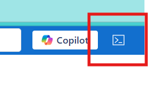
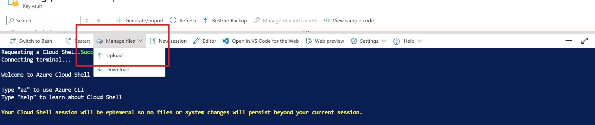

# Run the Prerequisites Script

**What this does:** `Proventeq365Prerequisites.ps1` prepares everything the Marketplace deployment needs. It creates the [Entra ID app registration](./04-entra-app-registration.md) with its permissions, admin consent, client secret and SharePoint certificate, and a bootstrap resource group containing a **Bootstrap Key Vault**. The Marketplace deployment reads everything from that vault, so no secrets are shared with Proventeq.

Run this script **before** you deploy Proventeq365 from Azure Marketplace. Your Proventeq contact provides both deployment scripts — `Proventeq365Prerequisites.ps1` and `Proventeq365PostDeployment.ps1` — together with the container registry (ACR) username and password.

> **Before you start:** confirm the person running the script has the access listed in [Required Access](./03-azure-prerequisites.md#required-access), and that you have the values listed in [Information to Collect](./03-azure-prerequisites.md#information-to-collect).

## Open Azure Cloud Shell and Upload the Scripts

### Step 1 — Sign in to the Azure portal

1. Go to **https://portal.azure.com**.
2. Sign in with the account that has the access listed in [Required Access](./03-azure-prerequisites.md#required-access).

### Step 2 — Open Cloud Shell

1. Select the **Cloud Shell** icon (`>_`) in the top navigation bar of the portal, next to the search box.

   

2. If this is your first time, choose **PowerShell**. When asked about storage, choose **No storage account required**, select your subscription, then select **Apply**.
3. If the toolbar shows **Switch to PowerShell**, select it. When you are already in PowerShell, the toolbar shows **Switch to Bash** and the prompt starts with `PS /home/<your-name>>`.

### Step 3 — Upload both scripts

1. In the Cloud Shell toolbar, select **Manage files** → **Upload**.
2. Select `Proventeq365Prerequisites.ps1` and upload it.
3. Repeat for `Proventeq365PostDeployment.ps1`.



### Step 4 — Check the files are there

Files are uploaded to your home folder. Run:

```powershell
ls ./Proventeq365*.ps1
```

You should see both script names listed.

> **The Cloud Shell session is temporary.** Files and logs are lost when the session ends. If you close Cloud Shell or it times out, upload the scripts again. To keep the logs, download them from the `logs` folder with **Manage files** → **Download** before closing (for example, `logs/prereq-20261014-101500.log`).

## Signing In When Prompted (Device Code)

Cloud Shell is already signed in with your portal account, so **usually no extra sign-in is needed**. If the script needs to sign in again — for example because Cloud Shell is connected to a different directory — it pauses and shows a message like:

```text
To sign in, use a web browser to open the page https://login.microsoft.com/device and enter the code XXXXXXXXX to authenticate.
```

1. Copy the **URL** and the **code** from the message.
2. Open **https://login.microsoft.com/device** in a new browser tab, paste the code and select **Next**.
3. Choose your account. When asked *"Are you trying to sign in to Microsoft Azure CLI?"*, select **Continue**.
4. Return to Cloud Shell. If it asks you to **Select a subscription and tenant**, type the number for your tenant and press **Enter**.

## Run the Script

### How the commands work

- Each command is on **one line**. Copy the whole line, replace the sample values with your own and press **Enter**.
- `-AcrPassword (Read-Host -AsSecureString 'ACR password')` asks for the ACR password as hidden input. **Do not type the password into the command itself.**
- If you have more than one subscription and did not pass `-SubscriptionId`, the script lists them. Type the number of the correct subscription and press **Enter**.

### Parameters

| Parameter | Required | Value |
| --- | --- | --- |
| `-CustomerTenantId` | Yes | Your tenant ID |
| `-ApplicationName` | Yes | Name of the app registration, e.g. `Proventeq365` |
| `-Location` | Yes | Azure region, e.g. `uksouth` |
| `-PermissionMode` | Yes | `ReadWrite` (full functionality) or `ReadOnly` (reporting only) — see [Deployment Mode](./02-microsoft-365-prerequisites.md#deployment-mode) |
| `-AcrUsername` | Yes | ACR username from Proventeq |
| `-AcrPassword` | Yes | Requested as hidden input (see above) |
| `-ResourceGroupName` | Recommended | Bootstrap resource group name |
| `-KeyVaultName` | Recommended | Bootstrap Key Vault name (globally unique, max 24 characters) |
| `-GrantAdminConsent` | Recommended | Grants admin consent automatically (Global Administrator or Privileged Role Administrator only) |
| `-SubscriptionId` | Optional | Skips the subscription selection prompt |
| `-PlatformAdminObjectId` | Optional | Entra object ID of the Proventeq365 platform administrator. Defaults to the person running the script. |
| `-ConfigureAiAgent` | Optional | Also creates the AI agent (Copilot) app registration |
| `-FrontendUrl` | Optional | Only if you already have a custom domain for Proventeq365 |
| `-ForceNewCert` | Optional | Creates a new client secret and SharePoint certificate (rotation) |

### Scenario A — Standard (Read-write, with admin consent)

Use this for most deployments.

**Command:**

```powershell
./Proventeq365Prerequisites.ps1 -CustomerTenantId <TENANT-ID> -ResourceGroupName <BOOTSTRAP-RG-NAME> -KeyVaultName <BOOTSTRAP-KV-NAME> -ApplicationName "Proventeq365" -Location <REGION> -PermissionMode ReadWrite -AcrUsername <ACR-USERNAME> -AcrPassword (Read-Host -AsSecureString 'ACR password') -GrantAdminConsent
```

**Sample:**

```powershell
./Proventeq365Prerequisites.ps1 -CustomerTenantId 3f6c1a2b-8d4e-4c7a-9b21-5e0f7d9a1c34 -ResourceGroupName rg-contoso-p365 -KeyVaultName kv-p365boot-contoso01 -ApplicationName "Proventeq365" -Location uksouth -PermissionMode ReadWrite -AcrUsername p365-contoso-pull -AcrPassword (Read-Host -AsSecureString 'ACR password') -GrantAdminConsent
```

### Scenario B — Read-only permissions

```powershell
./Proventeq365Prerequisites.ps1 -CustomerTenantId 3f6c1a2b-8d4e-4c7a-9b21-5e0f7d9a1c34 -ResourceGroupName rg-contoso-p365 -KeyVaultName kv-p365boot-contoso01 -ApplicationName "Proventeq365" -Location uksouth -PermissionMode ReadOnly -AcrUsername p365-contoso-pull -AcrPassword (Read-Host -AsSecureString 'ACR password') -GrantAdminConsent
```

### Scenario C — With the AI agent (Copilot)

```powershell
./Proventeq365Prerequisites.ps1 -CustomerTenantId 3f6c1a2b-8d4e-4c7a-9b21-5e0f7d9a1c34 -ResourceGroupName rg-contoso-p365 -KeyVaultName kv-p365boot-contoso01 -ApplicationName "Proventeq365" -Location uksouth -PermissionMode ReadWrite -AcrUsername p365-contoso-pull -AcrPassword (Read-Host -AsSecureString 'ACR password') -GrantAdminConsent -ConfigureAiAgent
```

This also creates a second app registration named `Proventeq365 AI Agent`. If you use this scenario, also select **Deploy Copilot Agent** in the [Marketplace deployment](./06-deploy-from-azure-marketplace.md) and pass `-ConfigureAiAgent` to the [post-deployment script](./07-run-post-deployment-script.md).

### Scenario D — Use a specific subscription (no selection prompt)

```powershell
./Proventeq365Prerequisites.ps1 -CustomerTenantId 3f6c1a2b-8d4e-4c7a-9b21-5e0f7d9a1c34 -SubscriptionId 9a8b7c6d-1e2f-4a3b-8c9d-0e1f2a3b4c5d -ResourceGroupName rg-contoso-p365 -KeyVaultName kv-p365boot-contoso01 -ApplicationName "Proventeq365" -Location uksouth -PermissionMode ReadWrite -AcrUsername p365-contoso-pull -AcrPassword (Read-Host -AsSecureString 'ACR password') -GrantAdminConsent
```

### Scenario E — Custom domain already known

```powershell
./Proventeq365Prerequisites.ps1 -CustomerTenantId 3f6c1a2b-8d4e-4c7a-9b21-5e0f7d9a1c34 -ResourceGroupName rg-contoso-p365 -KeyVaultName kv-p365boot-contoso01 -ApplicationName "Proventeq365" -Location uksouth -PermissionMode ReadWrite -AcrUsername p365-contoso-pull -AcrPassword (Read-Host -AsSecureString 'ACR password') -GrantAdminConsent -FrontendUrl https://p365.contoso.com
```

### Scenario F — Without admin consent

Use this when the person running the script is not a Global Administrator or Privileged Role Administrator. Run the script without `-GrantAdminConsent`. To create the app, you need at least **Application Administrator** or **Cloud Application Administrator**.

```powershell
./Proventeq365Prerequisites.ps1 -CustomerTenantId 3f6c1a2b-8d4e-4c7a-9b21-5e0f7d9a1c34 -ResourceGroupName rg-contoso-p365 -KeyVaultName kv-p365boot-contoso01 -ApplicationName "Proventeq365" -Location uksouth -PermissionMode ReadWrite -AcrUsername p365-contoso-pull -AcrPassword (Read-Host -AsSecureString 'ACR password')
```

Then a Global Administrator grants consent using the **App (client) ID** from the script summary — see [Grant Admin Consent](./04-entra-app-registration.md#grant-admin-consent).

> **Important:** Proventeq365 cannot access Microsoft 365 or SharePoint until admin consent is granted.

### Scenario G — Rotate the client secret and SharePoint certificate

```powershell
./Proventeq365Prerequisites.ps1 -CustomerTenantId 3f6c1a2b-8d4e-4c7a-9b21-5e0f7d9a1c34 -ResourceGroupName rg-contoso-p365 -KeyVaultName kv-p365boot-contoso01 -ApplicationName "Proventeq365" -Location uksouth -PermissionMode ReadWrite -AcrUsername p365-contoso-pull -AcrPassword (Read-Host -AsSecureString 'ACR password') -GrantAdminConsent -ForceNewCert
```

> **It is safe to run the script again.** It reuses the existing app, resource group and Key Vault. A new secret and certificate are created **only** when you pass `-ForceNewCert`. Use the **same** `-ApplicationName`, `-ResourceGroupName` and `-KeyVaultName` every time. After a rotation, run the [post-deployment script](./07-run-post-deployment-script.md) again to import the new certificate.

## Script Output — Copy These Values

When the script finishes, it shows a **SUMMARY**. Copy these two values — you need them in the next stages:

| Summary line | Used for | Example |
| --- | --- | --- |
| **Bootstrap Key Vault** | The Marketplace deployment, and `-BootstrapKeyVaultId` in the post-deployment script | `/subscriptions/9a8b7c6d-1e2f-4a3b-8c9d-0e1f2a3b4c5d/resourceGroups/rg-contoso-p365/providers/Microsoft.KeyVault/vaults/kv-p365boot-contoso01` |
| **App (client) ID** | `-MainAppClientId` in the post-deployment script | `6b2e9f14-3c7d-4a58-b1e0-7f9c2d4a8e61` |

Next: [Deploy from Azure Marketplace](./06-deploy-from-azure-marketplace.md).
